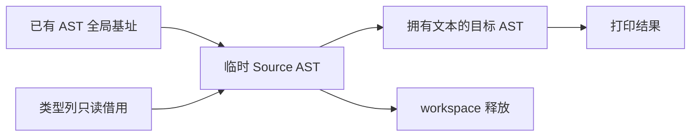

# 公开形状声明生成自举

## Intent：最终目标

把公开输入输出的 shape 描述符 AST 构造规则迁入 RX/ZX，完成已有类型遍历规划之后的
剩余声明生成职责。保留结构化 AST、后序编号、声明顺序及原成本模型。

## Data：可用证据

起点 c8f39e45，工作区干净。shape/planning.zig 的正式路径已经调用 Source plan.rx，
但 shape.zig 仍决定类型到 kind 的映射、字段与 child 引用、tuple 数字字段及公开根。
Lower.declarations 在非 type_only 入口使用这项职责；它不依赖 Lower 的可变 Map。

现有 TypeTable 可借用；AST 已有 EnumLiteral/Object 和字段列。现有 header、整数
名称打印及 constants 构造可以复用。需要补通用 AST 构造与导入原语，不需要新语法、
运行库或编译器专用语义桥。

## Edges：边界与限制

- RX 显式连接规划、形状构造、公开根和声明发布；ZX 保留内聚类型／字段遍历。
- Task 仍被规划编号但不生成 shape；不得改变已有边界或顺手修订其协议。
- 全部 Zig 语法通过 AST 与统一 printer 输出；名称文本可以复用整数打印，不能构造
  完整源码片段。类型与字段列借用，不展开整个类型表。
- Source 构造草稿在真实 workspace 中释放，导入 AST 必须拥有新生成的名称文本。
- 旧实现只保留初始 seed；正式路径不得回调旧规则。不新增测试用例。
- 复用现有检查；固定约 5.34 秒 CPU 基线及最近约 495MB RSS 参考均不重置。

## Answer：交付格式与成功标准

提供完整 Source 形状声明生成入口与通用 AST 原语、仅做物理导入的 Native 适配器，
贯通构建注册和阶段编译。全部目标文件与旧工具对照，运行相关既有检查及固定输入
性能对照。完成后统一提交推送全部内容，工作区干净且无未推送提交。

## 实现与阶段证据

Source build.rx 实际连接 plan、initialize、construct、roots、constants。construct 的
逐类型遍历留在 ZX；成员遍历只负责一个产品类型，根声明单独发布。kind、name、
reference 与对象构造围绕同一公开 shape 协议组织，没有把完整流程藏回单个 ZX 入口。

补充通用 named/Object 表达式原语及 Field 列模型，复用 header、整数名称打印及
Constant 声明列。Native 只导入这些列：表达式 ID 和字段 range 已含全局基址，
导入只重定位 payload offset，不再给 ID 加 base；字段及常量直接导入其目标，避免
先写声明表又转回 ArrayList 的中转。新生成的名称文本归目标 AST 拥有，scratch 释放
后仍有效。原实现完整移入 seed；没有添加向 Source 暴露的专用语义桥。

初始 Native seed → Source 工具 37/37 步骤通过，下一代 Source 工具 19/19 步骤通过。
固定旧输入生成 141 入口、2220 模块、1982 函数文件，全部 2268 文件与上一阶段
工具结果相同，仅 .zxc-inputs 工具身份不同。

接线修复两项：可空 match 结果补显式 string? 上下文；旧 slots 适配器原先写死
executeValue 的指针参数，新类型复用使该入口选择描述符值参数，改用现成
columns.invoke 自动处理视图参数形态。该适配仍逐字段检查兼容布局并借用数组，
没有复制底层类型列，也没有放宽布局校验。

删除旧 generated_shape_plan 的宿主注册及适配分支后，规划仅由新 RX 内部消费，
初始 seed 所需 Native 规划算法仍保留。最终入口数回到 144，当前 Source 闭包为
2257 模块、2013 函数文件，不为已迁移规则保留重复的正式宿主接口。

## 最终验收

最终版本初始 seed → Source 工具 37/37 步骤通过，Source → 下一代 Source 工具
19/19 步骤通过。两代分别对当前 144 入口、2257 模块生成 4694 个文件，全部实际
产物一致，仅 .zxc-inputs 工具身份不同。16 份新增 RX/ZX 的 fmt --check 和 lint
全部通过；全部 ZX 文件低于 180 行。

- 编译器：21/21 步骤、372/372 现有检查通过。
- CLI：61/61 步骤、34/34 现有检查通过。
- 函数分析专项：48/48 步骤、49/49 现有检查通过，包括结果释放边界、嵌套列表、
  分配失败清理和单元静态链接执行。未新增测试用例。

在构建全部结束后，对冻结 141 入口、2220 模块输入做四轮交替对照，每轮使用空
生成缓存，resident 关闭。前后均为 ReleaseSmall、两分区构建的 Source 工具；
首轮保留，中位按随后三轮计算。全部 2268 文件仅身份标记不同。

| 指标          | 修改前       | 修改后       | 变化      |
| ------------- | ------------ | ------------ | --------- |
| CPU 中位      | 5.33 秒      | 5.30 秒      | -0.03 秒  |
| 墙钟中位      | 1.18 秒      | 1.17 秒      | -0.01 秒  |
| 峰值 RSS 中位 | 498,401,280B | 497,795,072B | -606,208B |

RSS 四轮旧值为 501.2/498.4/500.1/486.8MB，新值为 492.6/478.1/497.8/501.2MB，
范围重叠，微小中位差不作为内存优化收益。CPU 没有超过固定约 5.34 秒基线；
上阶段约 495MB 的参考仍保留，同轮旧工具也在约 498MB，未见持续单向增长。
不重复计时来消除不利样本，也不把这些数据说成完整冷构建的收益。

正式命令、日志、runtime-comparison.json 和 fixedpoint-result.json 保存在
.zig-cache/cold-build-analysis/shape-emission，均被忽略规则排除。

## 自我复核与剩余边界

公开形状的自有构造规则已由 Source 执行，Native 默认路径仅导入结构化 AST。
原 kind 映射、后序编号、Task 空洞、成员顺序和公开根顺序均保留；名称使用现有
整数文本原语，不拼接 Zig 语句。Source 输入借用原类型列，生成文本由 AST 拥有。

复核确认导入器按列名读取；失败时最多保留已追加的完整行，Lower 整体中止并由
其 AST arena 释放，不会把列写成不等长状态。未把 Source 的临时名称借给目标 AST，
也没有把整个临时 arena 延长到结果生命周期。

本阶段不等于完整自举。AST 列物理存储、Lower 宿主状态和导入桥仍是 Native 过渡
职责；Scope、缓存状态及其他传递依赖还需继续迁移。完整目标仍须传递依赖审计及
规定的阶段自编译，不能用本阶段产物一致代替。
