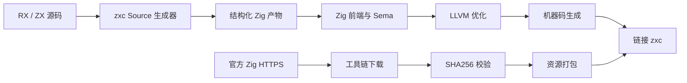
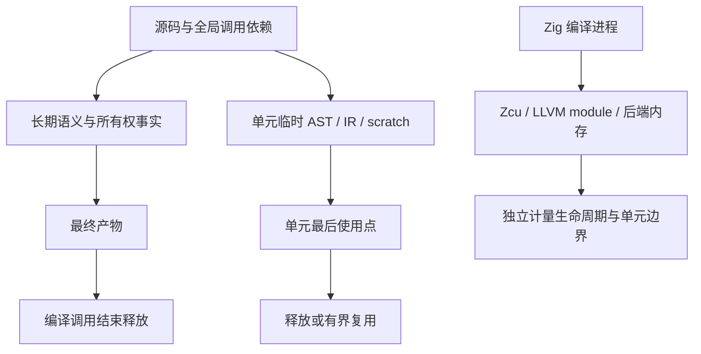

# 冷构建耗时与内存定位

## Intent：最终目标

修复工具链真实HTTPS下载失败；完整构建使用本机逻辑核心数12；将冷构建耗时
和内存追到具体进程与阶段，优化已证实的异常成本并保持运行时零成本契约。
先完成上一阶段提交推送；本阶段独立收口全部变更后提交推送，继续自举。

## Data：可用证据

已验收Source生成：CPU约5.36秒，峰值RSS约0.676GB。完整冷构建另有固定记录：
ReleaseSmall、-j2、空项目及Zig构建缓存，stage0和已下载依赖/工具链为输入；
墙钟133.16秒、CPU157.05秒，100ms采样构建树峰值3,270,688,768字节，
最大单进程3,256,516,608字节。热构建三次墙钟0.32/0.37/0.28秒，中位0.32。

日志主项：compile exe zxc small约1分钟、MaxRSS3G；bundle-zig fast16秒、
MaxRSS1G。这些尚未细分为Sema、LLVM优化、机器码与链接，不能把全部时间归因
为“生成LLVM字节码”，也不能直接把Zig进程峰值当作zxc生成器arena。
本机逻辑/物理核心数均12，Zig默认并发本就为全核心；上轮-j2是显式测量配置。

冷缓存打包触发std.http.Client.fetch失败TlsInitializationFailed；证书根扫描
失败会报告CertificateBundleLoadFailure，当前更像后续TLS创建/握手路径，须
取得底层错误后判断。无HTTP(S)/ALL_PROXY及SSL_CERT环境覆盖。官方归档为
releases.json中的ziglang.org 0.17.0 aarch64-macos URL，已有SHA校验正确的副本。

## Edges：边界与限制

- 不关闭TLS证书验证、不改成HTTP、不按当前机器或URL硬编码分支；修复通用下载链路。
- 不新增测试用例；使用独立诊断复现、真实下载与现有回归，探针/日志只在忽略目录。
- 不清理用户缓存，不把失败、下载或不同配置混作算法性能对照；保留Source固定基线。
- 并发改为12后先测；按进程分清Zig后端与zxc内存。已有按函数重置的scratch
  不能误报完全不释放；需要查明保留容量、最终使用点及跨单元依赖。
- 仅对有证据的表示、重复分析或生命周期开销动手；不盲目增加分区或并发层，
  不撤回自举实现。阶段以完整下载/构建能力闭环验收，不再拆内部接线交付。

## Answer：交付与成功标准

实际HTTPS下载及SHA256通过；12核完整冷/热构建可运行；给出Zig前端、LLVM、
机器码和链接阶段证据以及最大内存进程，解释实际异常与最小修复。保留可复核
原始命令、输入、日志和固定基线；必要受影响回归通过后统一提交推送。

## HTTPS复现与最小修复

克隆本机stdlib到忽略目录，只在副本增加TLS底层错误日志，未修改安装的Zig。
HEAD请求200；实际archive.prepare完整下载及SHA通过；此前失败的同一个bundle-zig
二进制不改代码重跑也成功。因此表现为间歇性连接/握手失败，目前没有复现底层
构造错误，不能将其说成已定位证书或算法缺陷。诊断见cold-build-analysis下日志。

最小补强放在既有archive.prepare：临时TLS/连接/读取错误最多3次尝试，间隔
250/500ms；本地文件、HTTP非成功、SHA不符、磁盘写入和取消不泛化重试。
每次重新建立/截断输出并重算SHA，失败关闭后删除残留；HTTP客户端临时分配
放在单次scratch arena，成功或失败即结束该范围。保留系统证书与SHA验证，
不引入外部下载命令、运行库或平台特判。受控故障注入未新增用例，不伪称已覆盖。

## 细分计时采集方式

本机Zig0.17 --time-report需要WebUI协议，但不会启动浏览器。使用loopback
WebSocket读取缓存的二进制CompileResult（tag7），在Build Summary后连接，
避开Maker尚未配置完成的窗口；所有报告排空后终止仅本诊断的idle进程组。
保留前端parse/astgen/sema/codegen/link CPU、LLVM emit/link flush wall、
LLVM pass原文以及最昂贵声明。采集器终止后的进程寿命不当作构建时间。
安装包无实际Zcu/LLVM emitter源码，不能凭字段名擅自进一步拆优化与机器码；
须以实际LLVM pass报告解释。现有分区在Small可用，但增加C ABI桥、跨区内联
限制及共享types/inline闭包重复编译，先保持单单元、仅-j12采集，不盲目开启。

## 12核与LLVM直接证据

首次12核单单元time-report诊断完成，约133.17秒到summary，采样树峰值3.750GB。
此为带计时探针的诊断，不能与无探针-j2的133.16秒直接宣称算法无收益。
主zxc编译78.779秒：CPU parse.198、astgen.816、sema1.901、Zig codegen.786；
LLVM emit wall76.572、link flush.0285秒。use_llvm=true，3846 reachable文件、
8183个泛型实例、26009个声明。最大工作在单个LLVM编译过程。
LLVM pass原文：MemCpyOpt7.226s、DSE4.747s、SROA3.912s、InstCombine6.271s；
机器调度7.834s、AArch64选指6.866s、寄存器分配4.306s。阶段不能误说成纯IR转换。

Maker协议注释漏写声明尾部sema_count，最初top声明解析无效，已按官方build-web
解码器从原frame重解：32B尾部，所有frame消费长度核对通过；Stats/LLVM原文不受影响。
原始与修正报告均保留，未重跑构建。首要声明耗时在TLS/曲线预计算，前端非瓶颈。

优化前LLVM IR166,343,728B，17727函数、229114静态memcpy、299921个alloca；
不能将静态站点总数当运行复制次数。最大的仓库自有异常在Storage.finish：
逐列try每处errdefer展开整表清理，导致平方级错误出口IR。Expression一项
3,874,100B/8015 memcpy/8104 alloca，改为共享错误块后112,588B/95/183。
七个相关Storage.finish已统一修正，Control特殊create/null路径保留；
只读审查确认成功转移列已清空self，失败列留在self，因此释放两组互不重叠。
既有编译器与模块/契约/原生引用分配失败回归正在运行，未新增用例。

用户进一步明确ZX复合值应主要共享引用、不可变更新引用；已追加AGENTS和原话。
生成器应从表示上消除多余物化，标量传值、必要新存储与外部ABI须有理由；
本轮先消除已证实的错误出口展开，再据实测决定下一处代码生成优化，不把
全部LLVM内存误归因于应用arena，也不盲改所有arena为逐项释放。

既有完整编译器回归首次371/372；唯一失败为旧OOM用例仍使用loop(...).values，
被上一阶段新lint正确拒绝，未进入分配失败校验。已只将既有用例尾部投影移入
loop.return，保留原输入/状态/递增与noResize/noRemap故障枚举，不新增数量。
19条集成其余项与全部313前端、39RX均通过；只补充受此旧用例改动影响的复验。

补充同一关键路径的构建配置候选：bundle-zig单独LLVM约18.32秒、总19.48秒，
其职责为I/O、SHA和资源打包，将宿主工具根模块由fast改small；不改变genz依赖
优化模式或应用主程序Small配置。该候选需核对本地/真实下载打包产物完全一致、
实际打包运行成本和冷编译收益，无证据收益则撤回该单行配置，不扩大到其他工具。

## 本阶段验收与下一职责

429项既有检查通过（编译器372、模块/契约/原生引用57），没有新增用例。
同一冻结合法Source输入三对CPU5.33→5.31秒中位、wall1.15→1.17秒，RSS约
667.5→668.3MB；首个after OS冷页wall2.93原样保留。2268文件无增删，仅
.zxc-inputs工具摘要变化，2267实际产物SHA完全一致。不替换旧Source固定基线。

12核、Small、单单元、空local/global构建缓存的无探针完整冷构建122.88秒、
CPU150.86秒；热三次wall.22/.21/.21，中位.21，CPU中位.77秒。旧-j2冷构建
133.16秒/157.05CPU与新配置混合了并发、共同清理和宿主工具策略，不能把
10.28秒全部归因某一算法。冷树采样峰值3.307GB、最大单进程3.292GB；
对旧-j2的3.271GB未见实质降低，不宣称内存问题已解决。热构建极短，每次仅
1采样，树合计约109～204MB，不能与旧低并发的采样数字当作同口径私有物理内存。

bundle-zig冷编译fast19.48秒/约1GB→small8秒/566MB；相同冻结manifest及
官方本地归档三对打包运行CPU中位.02→.04秒、wall.03→.05秒，明确记录这一
小幅运行成本，固定预算不重置。四个产物（归档、resources.tar.gz、resources.zig、
index.json）完全一致；Small集成打包工具真实HTTPS下载并校验，产物也与本地
完全一致。采用该策略以减少构建关键路径，不改应用优化模式。最新CLI已从
同一已验收缓存安装到zig-out/bin/zxc，28/28步骤通过、编译目标全部复用。

用户最新参考的RVO、移动/借用、切片与I/O零拷贝已归入AGENTS及原话。
本阶段交付是已证实的错误清理展开修复、宿主打包策略与TLS暂态可靠性；
并未宣称整个语言已做到无复制，或已经确定初始TLS握手的更底层原因。
下一完整职责继续核查复合值引用表示与不必要物化，在现有机制上补齐并验收，
不新造move语法、运行库或机械mmap读取。之后仍继续自举与传递依赖迁移。

## 零拷贝表示：读取字段不先物化完整父对象

上一阶段4372debe已提交推送并确认无未推送/未提交变更；继续本职责。
最小候选只融合普通Field链：从最近的未represented ABI对象，沿原引用读取最终
字段，末端仍用原borrowed/inlineStored/conversion.value规则转换；不重建整个
Usage/Plan等中间视图。原锚点调用projection，保留原求值与布局分派；缓存、
normalize、renew及iteration_value/loop_fields环境均不越过，TupleField目标
不融合，保留splice特例。没有新语法、ABI或运行库。
生成缓存域v83→v84；先验证实际生成形态、借用/身份/错误和输出，再计量LLVM
规模与运行成本。若该候选无收益或不正确，仅撤回候选，不撤回已完成自举。

字段融合候选已完成Source生成与编译：2268文件集合不变，40个实际函数文件
消除父视图构造（另有摘要变化），总字节32,408,912→32,233,500，减少175,412。
只读审查再次确认：未selected对象的State/View均使用ABI布局；锚点可为ABI
指针或布局值，代码不擅自解引用。缓存读计数由原projection保留，最终origin
仍来自同一ABI叶对象，嵌套列表走原elements转换。回退前不求值根，不重复调用。

字段融合已完成459/459现有回归（253/253构建步骤），覆盖Native值边界、函数
分析、loop初值/列/模块化；无新增用例。Source下一代2268文件集合不变，只有
.zxc-inputs不同，2267产物逐字节一致。复用v83旧缓存由新工具重新生成，所有
2268文件与v84冷生成完全一致，未跳过任何校验文件。

同冻结合法Source输入三对CPU中位5.34→5.32秒、wall1.19→1.17、RSS约
677.6→676.2MB；仅为无退化证据，不把微小波动宣称显著收益、不重置旧基线。
同工具链/配置下生成函数LLVM IR 85,006,028→84,320,097B，静态memcpy
123747→122698（-1049）、alloca148832→147566（-1266），函数数1810不变。
整个工具优化前IR126,828,455→126,130,886B；原始命令、ll和统计在忽略目录。
1791个生成函数已有sret返回位置通道，是可复用RVO基础；不能仅凭该属性断言
函数内部已无复制。继续区分底层数据、元数据和最终机器码，不机械追求零个
memcpy字样。当前未做新的完整冷构建对比，不用这些IR数据声称3.3GB已下降。

本职责正式CLI构建/安装28/28步骤通过，已更新zig-out/bin/zxc；主程序编译
仍为LLVM主导、日志MaxRSS约3G。此轮没有重测完整冷缓存，保留上一阶段
122.88秒/.21秒与约3.3GB作为已声明配置下的记录，不推断未计量的总体收益。
字段融合属于零拷贝生成契约的一项已闭环实现，所有权/ABI不变，剩余物化与
生命周期仍继续按最后使用点及实际复制证据审查；整个自举goal未完成。
本职责全部变更统一验收、提交推送后继续自举，维持全工作区收口。
