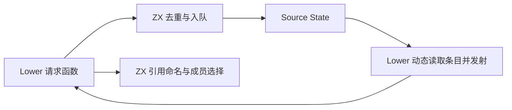
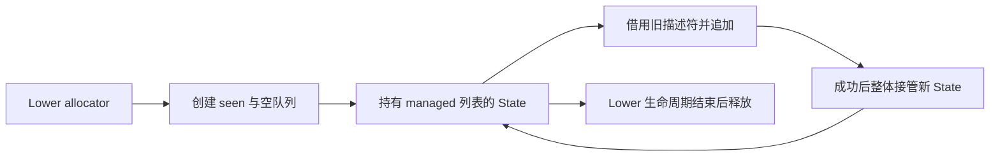

# 函数发射请求状态自举

## Intent：最终目标

把函数发射队列的状态、变体去重、首次请求标记及引用命名迁入 ZX，保持 FIFO、
递归发射时动态追加及原名称规则。推进自有状态迁移，不只迁移无状态谓词。

## Data：可用证据

起点 7999a6e9，工作区干净。requests.zig 原有 ArrayList(Item) 和逐函数 EnumSet；
Lower 发射过程中可以新增请求，因此不能固定遍历长度或保留条目指针。
uniqueness/work 已以 executeState 跨调用保留列表所有权和 frontier，可直接复用。

## Edges：边界与限制

- 保持每个函数的 regular/value 各最多一次，只有首次请求 first 为真。
- Source 持有去重表及请求列；Native 只投影 count/at 并衔接现有 Lower。
- 三列追加成功后再更新 seen；OOM 时整轮 Lower 中止，不承诺分配容量事务回滚。
- 不经 executeIn 的列表视图往返，不逐次复制队列；member 返回静态文本，不分配。
- 初始 seed 保留旧算法；不新增运行库、专用语义桥或测试用例。
- 复用既有检查，性能只测实际受影响路径，固定约 5.34 秒 CPU 基线不重置。

## Answer：交付格式与成功标准

交付可用的 Source 队列与引用规则、Native 物理适配及构建入口。核对生成所有权、
完整产物、阶段编译和相关现有检查；性能无累计退化后收口全部变更、提交推送。

## 实现与所有权复核

Source 的 State 使用 ids、variants、first 三个平行列及逐函数 seen 位图，避免条目
对象逐项装箱和 AoS 中转。push 先检查旧 mask，命中直接返回旧 State；未命中时
依次追加三列，最后更新 seen，保证首次变体标记和原 FIFO 顺序。

create/push 的 executeState 直接指向私有 callValue，返回包含 managed 列表的值，
不经过公共切片 ABI 丢弃 storage，也不在返回时再分配对象。Native 保存新 State，
count 每轮动态读取，at 只返回 Item 值，允许函数发射过程中继续追加请求。

初始化曾使用 bytes.repeat 精确分配，但外部返回列表被标为 plain，首次 with 会
复制整张 seen。最终改用已有 ZX loop 构造，保留 exclusive 存储，消除首次更新
的全表复制；列表正常扩容仍有几何容量成本，不能声称初始化完全不分配或不搬迁。
三列 append 保留 frontier，seen 后续原地更新，不按请求重建队列或去重表。

名称复用 printer/text/integer 的十进制字节算法，regular 为 function_id，value
追加 _value；member 选择静态 call/callValue。Native 以零容量 allocator 调用
member，生成函数错误集合为空且没有分配。枚举通过具名分支转换，不依赖两个
枚举的物理宽度或序号强转。

本职责为四个原子操作，直接使用 ZX 构建入口；没有为了标签数量制造 RX 转发层。
仍依赖 Native Lower 调度和目标 AST 存储，整个函数发射器及完整自举尚未完成。

## 阶段与产物证据

初始 seed → Source 构建 37/37 步骤通过；Source 再生成 19/19 通过。修复初始化
所有权后，继续由已有 Source 工具生成最终 Source 工具，19/19 通过。用于正式
性能对照的是后者，而非初始 seed 生成本体。

两代 Source 工具对相同当前输入的 150 个入口、2310 个模块和 2055 个函数文件
生成 2359 个文件，只有 .zxc-inputs 工具身份标记不同。这仅证明当前职责的产物
不动点，不替代最终传递依赖审计。

原始命令、日志及比较结果位于忽略目录
.zig-cache/cold-build-analysis/function-requests，source-checks.log 记录六个 Source
文件的 fmt/lint 均通过；未新增测试用例。

## 现有回归与性能

- compiler：21/21 步骤、372/372 检查通过。
- function-analysis 与 native-declarations：78/78 步骤、106/106 检查通过。
- CLI 构建与回归：64/64 步骤、34/34 检查通过，包括 runtime 和 Store。
- 总计 512 项现有检查通过。CLI 保留包默认单分区公共契约，其本体构建峰值仍约
  3GB；不能将此结果与根构建两分区约 2.2GB 的峰值混为一谈。

正式对照两侧工具本体均由 Source 生成，运行也启用 Source 分析／生成；固定 Zig
0.17.0、ReleaseSmall、输入、配置和缓存边界，完成构建后隔离计时。四轮交替，
首轮保留在原始数据中，以下为后三轮中位。

冻结 141 入口、2220 模块、1982 函数的批量生成：

| 指标     | 前           | 后           |
| -------- | ------------ | ------------ |
| CPU      | 5.30 秒      | 5.29 秒      |
| 墙钟     | 1.18 秒      | 1.17 秒      |
| 峰值 RSS | 495,992,832B | 484,245,504B |

2268 个文件仅工具身份标记不同。CPU 低于固定约 5.34 秒基线，近期约
5.31→5.30→5.31→5.29 秒，没有持续增长；不重置累计基线。RSS 样本存在约 13MB
波动，新工具也出现 496.9MB，不能将本轮中位差额宣称为明确内存优化收益。

实际覆盖单文件发射队列的 CLI 对照使用现有 std:querystring escape 输入，每组
20 次无缓存调用，四轮交替：

| 指标              | 前         | 后         |
| ----------------- | ---------- | ---------- |
| 单次 CPU          | 3.0026ms   | 3.0076ms   |
| 单次墙钟          | 3.1504ms   | 3.1781ms   |
| 峰值 RSS 四轮中位 | 8,470,528B | 8,462,336B |

两个输出文件字节完全相同。差额属于微小波动，不宣称提速；批量生成与毫秒级
单文件发射为不同场景，不能交叉相减。命令、工具哈希、全部样本和产物摘要见
runtime-comparison.json、single-comparison.json；本阶段没有重测完整冷构建。

## 自我复核与未完成项

本次迁移了请求队列的完整规则及状态，不把 Native 投影层误计为规则自举；旧规则
仅供初始 seed。未新增语法或以专用原生回调替代 Source 算法。

SoA 将原单个条目列表改为三个标量列，保留摊销追加，但不保证相同的分配次数；
现有生成形态与受影响性能证据未显示退化。OOM 后仅保证 seen 未提前提交，
不承诺部分扩容的底层容量完全回滚。剩余 Lower、AST 存储和缓存等原生职责仍需
继续迁移，不能据本阶段不动点宣称整体自举完成。
