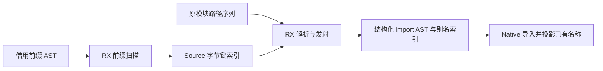
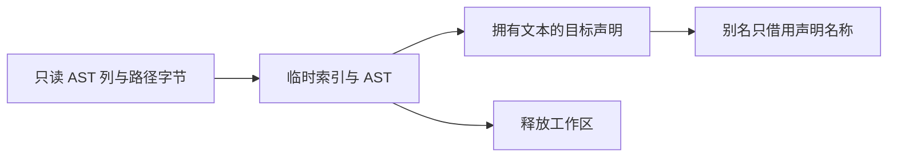

# 原生模块导入声明自举

## Intent：最终目标

把 imports.zig 的完整自有规则迁入 RX/ZX：识别已有 import、按路径去重、选择别名及
发射新声明；保持原求值／声明顺序、名称和期望线性成本。

## Data：可用证据

起点 7c3b47d0，工作区干净。唯一正式消费点为 Lower.declarations，在类型和 shape
声明前执行；目前前缀只有 std，但现有实现按全部前缀声明识别直接单参数字符串
import，同路径后出现者覆盖前者。新增别名使用原 native_modules 行号，而非去重序号。

已有 Source 哈希／线性探测模式、通用 AST 上下文、字符串及 builtin 构造和常量导入。
可借用 AST 完整列及前缀 range，无需复制表达式 payload，也无需新的语义桥。

## Edges：边界与限制

- Source 同时拥有规则与哈希工作表，不回调 Native Map 查询；维持开放寻址与期望
  线性复杂度，不替换为逐模块扫描全部前缀或其他平方算法。
- 键和声明索引采用平行列，避免每个条目额外装箱；仅借用路径字节。
- AST 叶及名称由目标 AST 拥有；别名返回原输出列表的相对声明索引，不能混用
  stored declaration 的全局行号。已有 AST 借用期间不得修改其列。
- 原算法仅保留给初始 seed，不新增运行时、语法、专用语义桥或测试用例。
- 复用既有检查和有效证据；固定约 5.34 秒 CPU 基线不重置。

## Answer：交付格式与成功标准

RX 显式连接工作表初始化、前缀扫描、模块解析／发射及发布；ZX 按独立职责组织
哈希与 AST 算法。新旧完整产物、阶段编译、相关现有检查及受影响性能通过；收口
全部变更并提交推送，确认工作区干净且没有未推送提交。

## 实现与语义复核

RX 顺序连接 initialize、prelude、modules 和通用 constants 发布。前缀解码严格按
Constant→Builtin.Import→唯一 String 参数读取原 AST；索引覆盖已有键的声明位置，
模块阶段命中后复用，未命中才按原模块行号生成 zx_native_i。

新增 core/bytes/index 采用字节键、u32 声明索引及 nullable 桶的平行列，Wyhash 与
线性探测复用既有 Source 模式。按前缀数加模块数的上界建立 2×上界+1 个桶，
实际键数不超过该上界，始终有空桶；这是内部有界索引，不宣称为可无限插入的
普通 Map API。桶比例放在职责 const.zx 中，路径字节保持借用。跨包调用按现有
source_packages 清单显式注册，没有放宽包解析规则。

Native 用现有 nodes.declarations 转存前缀声明并借用 AST 列，原表达式 payload
不复制。Source 返回的别名索引相对于原 ArrayList，新增声明接在其后；导入后只
投影声明已拥有的名称，未混用 stored 全局行号，也没有再次复制别名文本。

生成 put 的两个 with 更新直接写槽，append 保留增长 frontier，未见每次复制整表。
静态检查仍发现 probe 参数对象及 Index ABI 描述符各一次临时装箱；它们不复制
数组，说明该生成路径还有元数据构造优化空间，不能将本阶段称为完全零分配。

## 验收结果

初始 seed → Source 工具 37/37 构建步骤通过，Source → 下一代 Source 工具
19/19 步骤通过。两代对当前 146 入口、2304 模块、2051 函数文件生成 4779 个
文件，全部实际产物一致，仅 .zxc-inputs 工具身份不同。相关 15 份 RX/ZX 的最终
fmt --check 与 lint 通过，全部低于建议 180 行。

- 编译器：21/21 步骤，372/372 现有检查通过。
- CLI：61/61 步骤，34/34 现有检查通过。
- 函数分析：48/48 步骤，49/49 现有检查通过。
- 原生声明：34/34 步骤，57/57 现有检查通过，覆盖实际 emitBundle 的长别名、
  重排输入、原生成员及分配失败路径。未新增测试用例。
- 同配置的正式 CLI 构建 29/29 步骤通过。

### 测量真正受影响的路径

冻结批量 library-files 路径设置 function_modules，跳过 imports.lower，因此只做
正确性比较，不重复进行不相关生成器计时。固定 141 入口输入的全部 2268 文件与
旧工具一致，仅工具身份标记不同。固定 CPU 约 5.34 秒基线继续保留，未重置。

受影响成本对照使用既有 standard/querystring/escape/cases.zx，CLI 单文件发射
通过 verified_compile.render→genz.bundle 执行新旧 import 规则。前后 CLI 同为
ReleaseSmall、单编译单元、相同工具链及归档；关闭缓存，四组交替运行，每组每工具
20 次，保留首次组，中位取后三组的每次均值。输出两份文件全部相同，确实含
zx_native_0 = @import("zxc_standard")，没有把跳过职责的路径当性能证据。

| 指标          | 修改前     | 修改后     | 变化       |
| ------------- | ---------- | ---------- | ---------- |
| 单次 CPU 中位 | 3.03035ms  | 2.98255ms  | -0.04780ms |
| 单次墙钟中位  | 3.19651ms  | 3.15269ms  | -0.04382ms |
| 峰值 RSS 中位 | 8,552,448B | 8,560,640B | +8,192B    |

差异很小，不宣称加速或内存收益。新工具首次组墙钟均值 31.78ms、旧 4.00ms 原样
保留，不用后续组替换；随后新工具各组为 3.126/3.183/3.153ms，旧为
3.197/3.127/3.951ms。这里的毫秒级 CLI 发射与秒级批量生成器基线、完整冷构建
是不同测量对象，不能相减或换算。

命令、日志、single-comparison.json、fixedpoint-result.json 及完整产物比较位于
.zig-cache/cold-build-analysis/imports-emission，均由忽略规则排除，不纳入提交。

## 自我复核与剩余边界

本阶段把自有导入规则及索引状态迁入 Source，没有用临时 Native 查询桥替代 Map
迁移。内部桶上界、最后声明优先及原模块序号语义都由真实代码保证；没有硬编码
当前只有 std 的前缀事实。

原 AST 列借用仅覆盖同步 Source 调用，导入后才修改目标；新增文本归目标 AST
所有，名称投影活至其声明释放。探测参数装箱保留为明确的生成质量优化点，实测
没有可辨退化，也不以此宣称所有底层分配已消除。

AST 物理存储、Lower 可变状态、缓存与其他 Native 传递依赖仍需迁移；本阶段
完整职责交付不等于整个自举完成，最终仍需规定的依赖审计及阶段自编译。
