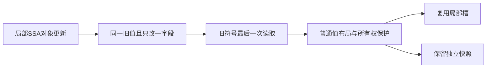
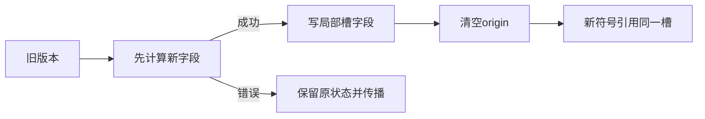

# 局部状态复用与构建峰值优化

## Intent：最终目标

减少正式CLI的LLVM编译工作与约3.3GB构建峰值，保留RX/ZX不可变语义、
零拷贝及已完成自举。首先消除已死SSA状态版本的整记录重建，不盲目修改arena。

## Data：可用证据

当前9706d13d，工作区干净。正式CLI优化前IR161,168,759字节、17729函数。
ABI construct的2aff…callValue约850KB IR、1975 alloca、2426 memcpy；
源码每次更新单个current字段，生成代码重新组装约560B的整个Build。
Native iteration.lowerMode还有重复清理上下文复制，但本轮先处理通用状态更新。

## Edges：边界与限制

只复用当前Scope内、普通selected且非referenced对象的局部值存储。
对象必须仅修改一个字段，其余字段直接读取同一旧符号的对应字段，且旧符号
在该绑定以后没有读取（包括条件分支、嵌套Scope、回调和Task捕获）。
禁止越过normalize/renew、缓存表达式、特殊loop_fields或iteration_value布局。
先完整求值修改项，成功后才改本地槽并清空origin；错误和短路次序保持原样。
旧值仍被后续读取、对象有可观察引用、多个字段修改或特殊布局时全部回退。
不改变底层集合所有权或复制许可，不增加运行库、不按文件/函数名特判。

当前修改位于仍待迁移的通用Native lowering内部，不据此宣称Scope已自举。

## Answer：交付格式与成功标准

- 生成形态证实重建次数下降；保留既有快照与别名回归。
- Source下一代不动点及旧缓存升级/编辑/恢复与冷生成一致。
- 同冻结输入核对CPU/wall/RSS，固定累计基线不重置。
- 针对同一正式主程序核对IR与LLVM构建峰值；未实测前不宣称3.3GB已修复。
- 全工作区统一验收、提交推送，确认无未提交、未推送内容。

## 执行记录

先实现保守的Scope内最后读取与单字段更新合并，再检查真实Source产物覆盖，
保留未满足条件的完整原生成路径。

首个SSA复用候选覆盖329个实际函数文件（另含输入/文件摘要），Source总字节
32,240,608→31,888,688；ABI construct单文件150,099→105,778字节。
下一代Source工具编译通过，未出现重复变量/未定义名字等布局接线错误。
只读审查未发现最后读取、Task捕获、origin与名字恢复的确定反例。

继续补齐同一问题的快照路径：旧值需要保留时，不逐字段重建整个对象，而是
复制一次普通值布局、只覆盖变更字段、清origin。Scope复用与快照共用同一
纯模式匹配器，禁止特殊布局/引用对象/normalize/renew，RHS错误和数据COW
仍走原表达式。这里只减少描述符重建，保留语义上需要的快照副本。

快照路径生成后，ABI construct进一步150,099→99,617字节，但最大Source
函数a293…源码完全未变。追到另一个确证重复点：每个调用/退出分支都展开
相同的逐列表storage弱化，重复清理整份约2KB上下文。补充按稳定State类型名
与相对slot许可位图合并的静态Zig清理函数，调用方仍先保留原本的值快照，
只把无引用寿命风险、至少两个写入的清理块抽到普通函数。出现需要复制的
referenced子对象或optional根时继续原路径；不在helper里创建或返回局部引用。
helper只接收调用方临时变量的可变指针，沿原clear逻辑改permission字段，
没有allocator、动态分派或zxc运行库。共享类型名参与身份，避免以不稳定的
全局TypeId命名而破坏增量产物与冷生成一致性。

最终候选2269文件集合不变，509个实际函数文件改变；总字节32,240,608→
31,643,272。a293函数254,756→143,711字节，ABI construct150,099→99,617。
Source下一代2269文件中仅.zxc-inputs不同，2268实际文件逐字节一致。

同冻结合法输入三对CPU中位5.33→5.34秒，wall1.17→1.16，RSS约678.3→678.1MB，
不宣称显著运行收益，不重置原累计基线；首次after wall3.02、CPU5.50的启动
等待样本原样保留，后两次CPU5.32/5.34。相同输入的6,122,210字节memo payload
仍完全一致，SHA与上一阶段相同，未改变分析结论与记录协议。

同Native代码、Zig、依赖缓存下，仅替换生成函数体并完整重编主程序：
CPU69.47→68.36秒，wall68.94→67.86，单进程MaxRSS3,288,825,856→
3,262,906,368字节。两边AST缓存都经IR提取预热，LLVM目标产物未命中缓存，
OS缓存未清空。这不是全仓空缓存冷构建，也不是私有物理内存或同时树RSS。
**峰值仅减少约26MB（0.8%），整体高峰值没有解决，不能声称修复3.3GB问题。**

对应主程序优化前IR161,428,043→158,579,745字节；生成函数IR85,916,656→
83,044,561字节。静态memcpy219200→213826、alloca289842→287287，新增464个
类型/许可专化的普通静态清理函数。construct的850238B/2426memcpy/1975alloca→
432623B/480/950，a293主体1118990→334883B（其清理函数另计）；所有helper
合并后的整体IR已纳入上述总量，不仅挑主体统计。静态站点不是运行复制次数。

623/623既有检查、405/405构建步骤及相关Native source/library路线通过；
没有新增用例。旧缓存升级、4→3合法编辑及恢复全部2268文件等于对应冷生成。
还在冻结副本将一个已有局部常量访问改成普通对象字段访问，新增局部类型并让
类型bundle发生变化：编辑2生成/2160复用，恢复0生成/2162复用，所有输出仍
与相应冷生成逐字节相等，验证helper身份不依赖全局TypeId。未改原始基线。

自我复核：缓存诊断脚本一处重复读取基线造成无效I/O，已中断该比较；复用
已完成的生成结果，只读取各输出一次完成比较，没有为此重复生成或编译。
本阶段是通用lowering元数据优化，未宣称完成Scope自举或解决全局LLVM驻留；
下一职责需检查编译单元边界与跨单元ABI成本，不能仅靠继续缩小单个函数掩盖
整个主程序仍作为同一LLVM模块长期驻留的事实。

正式CLI构建及安装28/28步骤通过，已更新zig-out/bin/zxc；构建摘要仍为MaxRSS
约3G，不能据单阶段结果宣称完整冷构建峰值解决。所有Native源已在最终构建前
格式化，后续hook仅检查同一内容。记录与日志位于忽略目录llvm-peak。
本阶段全部变更统一提交推送，继续解决编译单元生命周期与跨单元传参成本。
