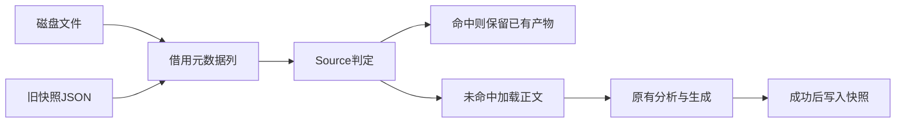

# 源码快照判定自举与正文读取复用

## Intent：最终目标

生成器命中未修改输入时不再读取全部源码正文，降低分区构建的额外CPU；
快照的数据模型、上下文匹配、清单验证及时间保护由RX/ZX承担。

## Data：可用证据

起点为97a5269a，工作区干净。此前两分区热构建CPU中位数0.8989秒，
普通路径0.7691秒。生成器命中三轮中位数约0.0678秒CPU，其中约0.0584秒
系统时间；当前实现仍在检查输出指纹前读取约2200份RX/ZX源码。

原有Files.vouches要求inode、size、mtime、ctime一致，且ctime加1秒严格小于
原始读取开始时刻。Zig时间戳为i96，ZX最高只有i64；无损拆成有符号i32高位和
u64低位，由Source保留完整比较域及跨低位边界的时间保护，不截断纳秒或秒。

## Edges：边界与限制

- 每次重新枚举目录，新增、删除、重命名及外部接口均参与；缺少bulk metadata时stat。
- 快照同时绑定工具身份、工作目录、原始manifest和分区配置；命中仍检查输出指纹。
- 读取时刻来自实际打开源码前，不能用写缓存时刻或本轮启动时刻替代。
- Native保留目录及文件I/O、元数据位拆分、通用JSON和借用适配；Source决定复用。
  这不代替其余编译器语义、现有resident状态及初始seed的迁移。
- 不新增测试用例；复用真实源码变更/恢复及已有检查，验收前不宣称完成。

## Answer：交付格式与成功标准

完整接入生成器后，对ZX、RX、模板、接口及目录清单变化执行增量/干净生成对照，
恢复后全部一致；时间保护及损坏快照不能产生错误命中。比较受影响的冷生成、
无修改命中和端到端热构建，同时复核借用与释放边界。阶段完成后统一提交推送。

### 生成质量缺口

首轮构建144入口/2238模块通过，ZX、RX、模板、接口及目录增删/重命名对照通过，
4662个产物在同输入增量/干净生成间一致；损坏checksum与截断快照也回退并修复。
审查另发现接口来源只应匹配ZX，已按真实接口读取逻辑修正，并验证RX同名来源。

产物检查发现循环内的只读cursor仍有一次allocator.create/文件。原因是bool返回
函数的loop.next进入值布局Scope，原有scalar_entry要求非值布局，而局部聚合规则
只覆盖value_output。改为复用同步标量函数已有的非逃逸资格；继续排除Scope或函数
结果携带该类型、借用别名、已有值表示和Task捕获。公开ABI及消费代码保持不变。
生成缓存升为v88，接下来通过后续阶段编译让工具自身也使用修复后的生成形态。
此前命中及冷生成计量仅作诊断，不作为最终性能验收。

完整产物差异核对还发现条件选择的共享table描述符被扩大后的规则值化。尝试透传
分支借用后，下一代冷生成出现了前一代没有的导入诊断。已定位为specifier/check
循环状态新增分配，而其Native调用方使用零容量FBA并catch unreachable；这会导致
OOM进入未定义行为，尚无Scope悬垂证据。

最终资格仅扩大到同步标量函数中原地新构造的object，不扩大到条件选择、引用、调用
或Scope结果，不改变既有borrowed规则。继续复用原有类型/返回边界及Task限制。
这样cursor仍可栈化，原table别名和零分配状态布局保持不变；失败产物保留用于复核。

### 最终正确性证据

- 下一代工具自身构建19/19、真实144入口冷生成通过；2238模块、1997函数文件。
- 编译器372/372、CLI运行与Store检查34/34通过，没有新增测试用例。
- ZX、RX、模板及接口分别修改，增量与干净生成4663文件一致；恢复后全部一致。
  两个相邻阶段工具对同输入的所有生成文件仅工具身份标记不同。
- 快照判定7个函数全部没有allocator.create/alloc；specifier仍为零create，
  table描述符选择保持指针。没有用消费代码改写回避生成器问题。
- 前轮真实源码验证另覆盖目录新增/删除/重命名、checksum损坏、截断快照及
  RX与接口同名的来源区别，修改/恢复对照通过。相关匹配与失效逻辑后续保持不变。

### 最终性能与范围

固定冻结141入口/2220模块、resident关闭、交替四轮，保留首轮但取后续三轮中位数：
旧工具CPU5.32秒、新工具5.30秒，墙钟均1.17秒，RSS约675→671MB。
全部产物仅`.zxc-inputs`身份不同；相对既有固定基线约5.34秒没有累计增长。

批量metadata枚举不读取正文，在支持bulk metadata的平台串行执行该短任务，避免
仅为元数据启动计算线程池；其他平台保留并行stat，真正的编译计算仍使用全核心。
六轮交替命中CPU中位数0.0436→0.0155秒，墙钟0.0136→0.0164秒；最终阶段
生成器命中约0.0163秒CPU。该墙钟增加约2.8ms，须与端到端结果一并看待。

最终端到端使用同一Source工具、144入口、ReleaseSmall、12核心、resident关闭，
普通与两分区交替运行；初始化轮排除，后续五轮所有编译步骤均命中缓存。
CPU中位数普通0.7775秒、两分区0.8377秒，增量0.0602秒；墙钟0.2135与
0.2186秒，增量约5.1ms。相对本轮起点两分区0.8989秒降低0.0612秒，
相对既有固定普通路径0.76～0.77秒累计增加约0.07～0.08秒，处于0.1秒容差内；
容差不随本次提交重置，后续继续跟踪累计与趋势。

同配置两分区构建31/31步骤通过，time最大单进程RSS为2,223,996,928B，
构建树200ms采样最大2,210,054,144B。采样是下界，不是瞬时精确峰值或物理私有内存；
相比此前单单元3,284,992,000B，最大单进程RSS降低约32%。两次辅助工具缓存状态
不同，且依赖及OS缓存保留，不把本轮60.72秒墙钟/98.37秒CPU称为完整冷构建或
公平总CPU收益。以上内存数据与前述Source生成器约671MB属于不同阶段。

原始验证及计量保存在忽略目录`.zig-cache/cold-build-analysis/partitions/`：
`snapshot-production-validation/result.json`、`snapshot-production-*-tests.log`、
`snapshot-production-runtime-comparison.json`、`snapshot-production-cli-metrics.json`、
`snapshot-production-warm-comparison.json`及`serial-snapshot-comparison.json`。
完整自举依赖审计、初始seed及默认分区选择仍属于持续目标；本阶段不宣称全部完成。

