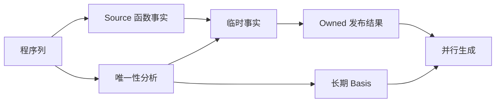
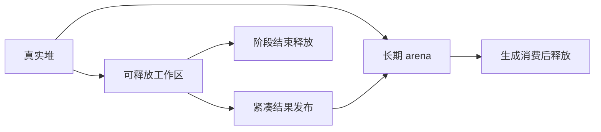

# 生成器工作区生命周期与峰值收口

## Intent：最终目标

继续自举，同时消除已能定位的临时内存滞留及重复存储。区分生成器峰值和 Zig 后端
构建峰值，不把分区编译收益当作生成器 arena 生命周期已经合理的证明。

## Data：可用证据

起点 282df895，工作区干净。上一阶段冻结输入的新旧生成器 RSS 中位分别为
679,919,616B 和 670,744,576B，范围重叠，但约 9.2MB 差额没有定位。新增构造证明
只有每函数一个 bool；两份递归生成函数无分配，不能直接用新增列解释该差额。

当前 function_analysis 先把生成事实复制到临时 arena，结束后再发布到 Owned arena。
Uniqueness.Basis 与临时计划具有不同生命周期，需要逐项核对内部子 arena 的 backing。
先对实际执行路径记录容量，再选择修改，不能只依据 RSS 或调用了 deinit 作判断。

## Edges：边界与限制

- 不改算法、所有权证明、错误顺序或生成语义，不增加专用原生语义桥。
- 临时探针只记 arena 容量，不将其当作 RSS 或累计分配量；验收前移除探针。
- 借用程序列与输出事实的生命周期保持成立，不删除必要的输出所有权复制。
- 不新增测试；复用受影响路径的既有检查、全部输出比较和固定输入性能证据。
- 固定 CPU 约 5.34 秒的累计基线不重置；不重复运行不能改变下一步决策的计时。

## Answer：交付格式与成功标准

记录实际存活关系、容量证据与最小修改，证明结果在临时工作区释放后有效；实际生成
产物及既有检查通过，单阶段与累计性能均可接受。阶段完成后统一提交推送全部变更，
确认工作区干净且没有未推送提交。不能解释的内存差额明确保留。

## 执行与证据

固定 141 入口、2220 模块的探针确认，Source 事实临时容量约 5.83MB，Uniqueness
工作区约 30.72MB，summary 工作区约 1.03MB。Flow 临时容量却为 480,346,636B，
最终 Owned arena 容量 863,884,032B。容量包含未使用空间，不能当作实际 RSS。

根因有两层：Flow.create 的子 arena 挂在 Owned 上；递归图走 settle 时，又同时保留
所有 Body，其 Order 构造临时 arena 挂在该批 Body 的 arena 上。每个 Order 已经复制
紧凑结果，构造草稿仍无法真正归还。Prepared 同样直接在批次 arena 构造，混合了中间
数据与最终四列。调用 deinit 没能建立真正的阶段释放边界。

第一步将 Basis/Flow 的 workspace 显式接到真实 backing，并只发布一次计划；探针
Owned 降为 7,399,804B，Flow 临时容量仍为 220,824,756B，RSS 为 651,034,624B。
这说明只修外层生命周期还不足以消除批次内部的临时累计。

随后给 Body 显式传构造 workspace。settle 串行复用一份构造 arena，每个函数后 reset，
保留容量供下一函数使用。Prepared 仅发布 first/elements/objects/object_first 四列，
Order 延续已有逐列发布；原 Program/Function 仍借用。layered 路径每 worker 独立，
继续在当前 Body 分析结束后 reset，不重置 Walk 长期工作区。

并发计划在 join 后直接复制到最终 Owned，避免中转 scratch 再复制；非并发 Owned
创建直接将计划分配到最终 arena。现成 Basis 的 analyze 路径仍以调用方 allocator
持有计划，未改变其契约，也没有在两个线程同时修改同一 Owned arena。

最终探针 Flow 临时容量 17,256,512B，Owned 7,399,804B，发布中转 scratch 从
3,255,348B 降到 610,076B；同次进程 RSS 483,475,456B，原探针 678,658,048B。
两次全部 2268 文件比较仅 .zxc-inputs 工具身份不同。三次 probe 保留于
.zig-cache/cold-build-analysis/memory-lifetime，均不纳入提交。探针已全部移除，
正式验收如下。

## 正式验收

移除全部临时探针后，初始 Native seed 构建 Source 工具 37/37 步骤通过，再由该工具
构建下一代 Source 工具 19/19 步骤通过。两代工具分别对当前 144 入口、2241 模块
生成 4672 文件，全部实际文件相同，仅 .zxc-inputs 工具身份不同。

- 编译器：21/21 构建步骤，372/372 现有检查通过。
- CLI：61/61 构建步骤，34/34 现有检查通过。
- 函数分析专项：48/48 构建步骤，49/49 现有检查通过，包含结果在 scratch 释放后
  保持有效、嵌套列表事实、分配失败清理及独立单元执行。
- 仅调整既有 fixture 的 Basis 参数，未新增测试用例。

同冻结 manifest，resident 关闭，每轮空生成缓存，新旧工具交替四轮，首轮数据完整
保留，中位取随后三轮。旧工具为上一阶段 constructed-bootstrap，新工具为本阶段
bootstrap；工具链、配置、入口、并发及输入保持一致。

| 指标          | 修改前       | 修改后       | 变化                      |
| ------------- | ------------ | ------------ | ------------------------- |
| CPU 中位      | 5.32 秒      | 5.31 秒      | -0.01 秒                  |
| 墙钟中位      | 1.19 秒      | 1.18 秒      | -0.01 秒                  |
| 峰值 RSS 中位 | 681,197,568B | 495,239,168B | -185,958,400B（约 27.3%） |

旧 RSS 四轮为 679.6/681.2/681.3/680.2MB，新为 488.7/496.2/493.5/495.2MB，
收益在每轮均可见。冻结输入全部 2268 文件仅身份标记不同。CPU 没有超过固定约
5.34 秒基线，没有以重置累计基线或牺牲 CPU 换取内存。采样与比较结果保存在
.zig-cache/cold-build-analysis/memory-lifetime/runtime-comparison.json；正式构建命令、
日志及 fixedpoint-result.json 同目录，均被忽略规则排除。

## 自我复核与剩余边界

本阶段修复已证实的临时生命周期错误，保留 Source 分析与原算法，并未撤回自举。
并发发布在 join 后完成；Source.ready 调用契约未变；Prepared/Order 的返回列独立
存活，只有 Program/Function 描述符继续借用原程序。每 worker 的 Walk 长期内存
没有被逐 Body reset。审查发现的既有 fixture 签名漏项已补齐并通过专项检查。

容量下降不等于释放了相同数量的实际物理页面；最终收益使用无探针进程 RSS 报告。
上一阶段约 9.2MB 的同轮差额未被单独归因，不能说新增 bool 导致了全部问题。
本阶段收益来自原有 Flow 工作区层层挂长期 arena 的实证缺陷，远大于该差额。

这也不等于完整冷构建峰值或整个自举已经完成。Zig 后端单进程约 2.2GB、Safe
构建进程树约 2.62GB 是不同测量对象；本阶段未改变目标生成形态，没有重复运行
无关完整冷构建，也不将生成器收益换算为冷构建收益。Scope、Lower、缓存状态与
其他 Native 传递依赖仍需按完整职责继续迁移。
