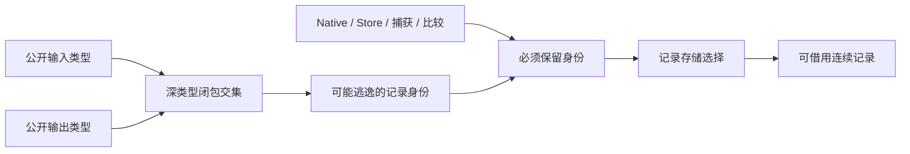

# 缓存记录编码的自举与借用表示

## Intent：最终目标

将uniqueness memo的规范记录排序与字节编码作为完整职责迁入RX/ZX，
保留原来的HashMap迭代、连续记录缓冲复用、sortUnstable顺序与二进制协议。
先补齐通用的输入记录不逃逸证明，再迁移消费代码；不得为迁移增加记录数组复制。

## Data：可用证据

- Native memo.entries先复用order高水位容量，按key排序，再写count/key/level。
- 普通ZX比较器sort已生成std.mem.sortUnstable；ad3a0066补齐owned复用。
- core.columns.storage.view能静态核验布局并借用连续记录，packed Level消费需mask。
- state/public_inputs对任何聚合输出标记整个Input，使与输出无关的Record[] boxed。
- state/shared另用整个scope的read_only限制Sort；编码State.buffer写入也会触发该限制。
- 原生调用、Store、Task/capture、身份比较已有独立的深类型保护根。
- 目前整体冷构建峰值仍约3.3GB，不能将本项借用能力当作峰值问题已解决。

## Edges：边界与限制

公开输入、输出深类型闭包的交集提供保守证明：共同的Object/Tuple仍保留身份，
未出现在任何公开输出的记录身份不能经返回值逃逸。所有公开边界合并分析，
宁可多保护，不按编译器类型名或文件名特判。新建同形输出同样命中结构TypeId。
外部调用、捕获、存储、身份比较、重复对象及已有共享规则继续独立生效。
Sort按被排序记录的可见性保护，不能因为它旁边存在别的可变值就复制整份记录。

临时Native适配只负责借用已有存储、所有权转交与宿主HashMap提取；不能加入
新的编译器语义桥。迁移不等于整个memo完成：缓存索引、持久化、restore和trace
的自有状态仍待后续完整职责迁移。

## Answer：交付格式与成功标准

1. 通用记录借用能力经Source阶段自编译和既有值边界/别名/数组回归验收。
2. RX明确排序与编码阶段，ZX围绕排序比较、记录字节协议各自保持内聚。
3. 生成产物证实连续记录直接借用，唯一输入排序复用，shared/plain保留快照。
4. 同冻结输入评估受影响路径，记录累计基线；旧缓存升级等于同输入冷生成。
5. 全部变更统一验收、提交推送，确认工作区干净且无未推送提交。

## 执行记录

上一阶段ad3a0066已推送且工作区干净。本阶段先实现闭包交集及Sort类型可见性，
核对真实表示后再接入memo，不将内部接线分别当成交付阶段。

已完成类型闭包交集及基于visible[child]的Sort硬保护；其他保护根不改。
删除仅被旧Source门禁调用的4个read_only文件，Native seed退路保留。
142入口的新memo编码产物已生成：executeState.records.items为连续ABI Record[]，
Native storage.view按大小、对齐和字段偏移静态验证Level→u8兼容，消费时mask低3位。
RX按order→word(count)→records清晰连接，records调用既有integer写key与level，
没有为单字节创建数组。生成order以storage writable判断复用，Native显式交付
owned的order缓冲直接constCast排序，shared/plain仍dupe；未建立指针行数组。
Source初始与下一代能力生成的2263实际文件全同，证明能力本身未改变旧自举布局；
新增memo消费才是本项能力的实际覆盖，未将前一小步单独提交。

Native旧排序编码与Source新编码，同冻结合法141入口/2220模块三对CPU中位
5.32→5.31秒，wall1.17→1.19秒，RSS678.5→676.7MB；不宣称显著提速，
不重置固定基线。新工具首次wall2.98秒等待异常原样保留，其分析/生成/写出
计时约1.01秒，原因未进一步断言；后两次1.19/1.17秒，不隐藏首次样本。

同冻结输入2268输出仅.zxc-inputs不同。2163个缓存按真实storage header解析：
只允许compiler_digest差异，marker、key、length及整个payload逐字节一致。
其中uniqueness memo payload为6,122,210字节，SHA256为
2eabe8b017ce750d0999c63a6db23608d09881ec8fdf23b2e582332077a2daaa。
这覆盖了真实状态键、记录顺序和编码协议，而不仅是最终生成结果。

当前142入口的Source下一代2269文件，只有.zxc-inputs不同，2268实际产物
完全一致。用副本冻结输入验证旧工具缓存升级、maximum_routing_fields的
合法4→3编辑以及恢复：三项均全部2268文件与相应冷生成逐字节相等；编辑
1生成/2161复用，恢复0生成/2162复用。原始冻结基线未修改。

623/623既有Zig检查通过，405/405构建步骤通过，另含8组Native借用source/
library运行路线；覆盖原生值边界、函数分析、loop初值/列/模块化、字段所有权、
值返回、跨请求Store别名及Task生命周期。没有新增测试用例。
本次变更的10个ZX/RX文件均通过lint与fmt --check（20项检查）。

自我复核：这里只完成规范记录排序与编码职责，没有迁移整个memo HashMap、
load/save、restore或trace；Native种子仍保留原算法作为初始引导路径。
生产路径使用Source entries，Native适配的owned许可只交给本次独占order缓冲，
state/records长度/width均为轻量描述符传递，严格布局核验不允许退回逐行复制。
缓存字节等价是本职责的强证据，仍不能代替最终全编译器传递依赖审计。
完整冷构建峰值约3.3GB依然是未解决项，本轮不据局部RSS波动宣称修复。

正式CLI构建与安装28/28步骤通过，已更新zig-out/bin/zxc；主程序构建仍报告
MaxRSS约3G，未重新测完整空缓存冷构建。只读复核未见阻塞：owned只授予自有
order，Source记录不进入返回State，OOM不发布新State且旧buffer未被释放。
本职责统一提交推送后继续自举；峰值内存继续独立定位，不以本项结束该问题。
