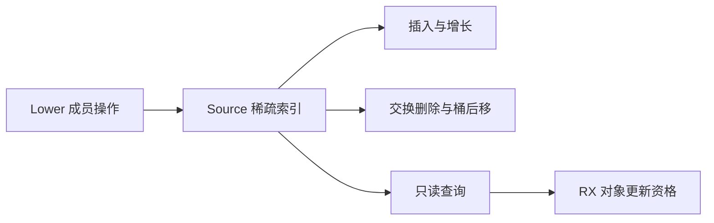
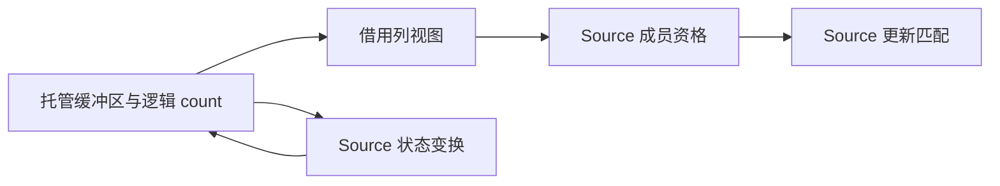

# Lower 成员集合状态自举

## Intent：最终目标

迁移 Lower 的 state_symbols 与 stack_symbols 稀疏集合状态，让对象更新的 RX 判定
直接查询 Source 集合，移除上阶段成员事实适配。保留缓存表的独立迁移边界。

## Data：可用证据

起点 b72909da，工作区干净。两个集合只有 put/remove/contains 与空重置，没有迭代
消费者；既有 core/integer/index 已支持稀疏探测与插入，缺少删除。cache 的迭代
消耗 serial，不能借本阶段顺手改变。

## Edges：边界与限制

- 删除使用稠密键交换末元素、修正桶索引和探测簇后移，不保留无界 tombstone。
- 底层 Source 状态经 executeState 保留，读取只借用列；不构建稠密全表镜像。
- 删除和查询必须零分配，插入只在容量不足时增长；检查真实生成闭包。
- 核对 Lower 浅拷贝及 worker 重置，不能依靠未经证明的独占假设改变共享行为。
- RX 保留原判定顺序，将 Source 成员资格接到来源选择与字段扫描之间。
- 不新增测试，使用已有行为检查与产物对照；按真实成本变化验证固定累计基线。

## Answer：交付格式与成功标准

通用索引具备可复用删除，两个集合正式状态由 Source 持有；Native 仅管理类型与
执行接口。相关阶段、行为、产物和性能验收通过后统一提交并推送全部变更。

## 实现与共享边界

通用 remove 先定位删除键与活跃末键所在桶，再覆盖被删键、修正桶索引、减少逻辑数量。
随后沿探测簇扫描，以环形距离比较决定是否搬入空洞，直至真正的空桶，最后清除
空洞。遇到无需移动的桶仍继续扫描，不保留 tombstone。返回原稠密位置，便于其他
并行值列实施同样的交换删除。Index.count 是活跃边界，keys.length 是已初始化
高水位；删除不缩短物理切片，插入先复用未激活槽位，grow 只重排活跃键。完整
u32 键域可用，空标记只用于桶位置。

Native members 门面保留生成的托管状态，put 调用 executeState，contains 只读
借用列，remove 使用零字节分配器。迁移门面管理的 writable 状态下 Query 和 remove 不增加分配；容量只在 insert
增长时增加。对象更新 matching 仅准备两份只读列视图，RX 在 source 后直接执行
Source eligible，再进行 evaluation 与 changed，移除上一阶段的成员事实适配。
cache.contains 事实及缓存状态仍为 Native 过渡边界。

Lower 的四处浅拷贝已核对：函数 helper 与排序 worker 将两个集合重置为空；
Task worker 与契约 predicate 继承 state 集合、重置 stack 集合。后两处明确借用
父集合的完整状态头，子作用域临时增删后仍由原有 defer 清理。只共享 keys/buckets
底层而复制长度是不安全的：子删除可能交换末元素，导致父旧描述符越界或查错。
借用只在同步子编译期间有效，没有堆分配状态头或逃逸的编译器闭包。

原生初始引导继续使用旧 AutoHashMap；正式路径的成员算法及 keys/buckets 模型
来自 Source，Native 仍承担生成接口和共享引用适配，不宣称整个 Lower 已自举。

## 编译单元与类型保护

首次接线发现主 Program 的 Index 已被全局重复产品保护装箱，因此 members_add
没有 executeState。实际原因是 scope/reads.Work 同时含 last.index 与 seen，
scope/reuse.Work 也重复包含 Last/Index；同一输出内重复的产品类型被深度装箱。
这与 import 冻结无关，也不能通过删掉共享保护或改字段名称规避。

沿用既有 Entry Set 机制，把 add/get/remove 与 core 索引依赖编译为独立 members
单元，拥有自己的私有托管表示，保留统一的公开 ABI 转换规则。它仍静态链接普通 Zig，不增加
解释层、动态加载或专用运行库。主单元中的只读 Index 继续按原规则选择表示；本轮内部 Index 契约新增 count，
消费处同步更新。视图仅投影已有列与数量，不把不同私有 ABI 强制转换。

members 的输入根进一步收敛到 core 与 genz/analysis/members，并据相同边界追踪
依赖。实际只分析 9 个可达模块。收敛前后全部 19 个文件仅 .zxc-inputs 输入身份
不同；production-bootstrap 与 final-bootstrap 的二进制 SHA256 完全相同，因此
没有重复正式性能计时。构建日志中的成员生成步骤从约 1 秒降至 21ms，这是本次
构建观察，不将不同缓存边界换算成完整冷构建收益。

## 阶段与验收证据

初始 seed 构建 Source 工具 38/38 步骤通过，再由其构建下一代工具 20/20 通过；
输入边界收敛后最终工具构建 20/20 通过。两代工具分别对主单元和成员单元生成：

- main：159 入口、2367 模块、2425 文件，仅工具身份标记不同。
- members：3 入口、9 模块、19 文件，仅工具身份标记不同。
- 编译器：22/22 构建步骤，372/372 现有检查通过。
- 十二个相关 ZX/RX 文件逐项格式化与 lint 通过，没有新增测试。

原始构建命令、日志、Source 检查、逐文件摘要、二进制摘要和比较脚本统一保留在
被忽略的 .zig-cache/cold-build-analysis/members。fixedpoint-result.json 包含两个
编译单元，bounded-members-outputs.json 记录输入收敛前后产物比较。

## 容量复用缺口与修正

生成体审查发现初版删除会 pop 到零长。zxReserve 为避免从普通空切片读取不存在
的容量头，仅在 len!=0 时复用；因此删空后重插会重新分配 keys，初版不能算成本
验收完成。没有删除这条安全 guard，也没有保留已确认的成本偏差。

复用已有 Work 方案，为通用 Index 增加逻辑 count，让 keys 保留已初始化缓冲区。
删除只减少 count；重插 count<keys.length 时用 with 覆盖有效物理槽位，否则才
push。不会读取未初始化元素，也不会保留无界 tombstone。所有 Index 消费处已
核对，原来仅 insert/grow/remove 用 keys.length 表示逻辑数量，已统一修改；
其他 seen/last 索引从不删除，行为保持。Native 空状态与只读视图同步携带 count。

该修改改变实际成本模型，因此在功能通过后重新集中验收，而非重复初版计时
作为最终证据。

## 性能证据与累计边界

沿用冻结 141 入口 manifest，关闭 resident，每轮新输出与生成缓存，新旧工具
交替四轮。首轮完整保留，中位取后续三轮；比较在其他构建前单独运行。旧工具为
b72909da 的 production-bootstrap，新工具为容量修正后的 retained-bootstrap，全部
2268 文件仅工具身份标记不同。

| 指标          | 修改前       | 修改后       | 变化         |
| ------------- | ------------ | ------------ | ------------ |
| CPU 中位      | 5.31 秒      | 5.31 秒      | 持平         |
| 墙钟中位      | 1.16 秒      | 1.16 秒      | 持平         |
| 峰值 RSS 中位 | 490,389,504B | 495,828,992B | 在近期波动内 |

旧 RSS 四轮为 498.3/487.3/496.0/490.4MB，新为 497.4/495.8/494.2/496.1MB。
CPU 仍低于固定约 5.34 秒比较基线，没有重置累计基线，也不据小幅波动宣称提速
或新增内存收益。此前约 27.3% RSS 改善仍归属于构造工作区生命周期修复。

新安装工具首轮墙钟 3.03 秒、CPU 5.27 秒，内部 infer/emit/write 为
528/418/98ms；后续墙钟 1.16～1.17 秒。首次额外等待尚未归因，继续保留原始
数据，不把温态中位报告为首次启动或完整冷构建时间。

最终成本证据为 retained-runtime-comparison.json；初版 runtime-comparison.json
仍保留，不混作最终结果。没有仅因冻结输入整体成本持平就忽略生成体发现的容量
复用缺陷，最终实现修复该成本边界后再交付。

## 最终验收与自我复核

容量修正后的工具构建 20/20 步骤通过。retained-fixedpoint-result.json 核对主单元
2425 文件及成员单元 19 文件，两代均仅身份标记不同；最新生成闭包确认删空后
重插走 with(count,key)，writable 分支直接更新已有槽位，没有 descriptor.create、
pop/retract 或隐式整数组复制。共享输入所需的复制回退仍保留。

- 最终编译器：22/22 构建步骤、372/372 现有检查通过。
- 最终四个相关目标：355/355 构建步骤、636/636 直接 Zig 检查通过，另有目标内
  Node 行为检查；具体日志为 retained-compiler-tests.log 与
  retained-related-tests.log。
- 12 个 Source 文件格式/lint 通过，未新增测试用例。
- 消费边界复核确认 count≤keys.length，grow 仅处理活跃前缀；reads/reuse 的索引
  不删除，原位置列协议保持。四个 Lower 复制点的继承与重置均已核对。

初版全输入对照持平不足以证明删空重插成本等价，生成体审查指出的缺口已实际
修复，没有当作可接受迁移代价。没有删除零长切片安全 guard，没有靠字段改名、
撤回 Source 集合或新增 Native 算法绕过问题。私有状态接口的编译单元边界及
Native 共享引用适配仍被明确列出，不混同于整个 Lower 的完整自举。

缓存表及其带 serial 影响的迭代、Lower 其他规则和状态仍需继续迁移，完整自举
尚未完成，目标保持进行中。

最终数量表示亦由 Native 初始引导构建验证 38/38 步骤通过；其生成的主单元
2425 文件、成员单元 19 文件与 retained 工具结果均仅身份标记不同，证据为
seed-final-result.json。容量修正后 Native→Source 与 Source→Source 两条链均已
贯通，没有仅验证旧表示就宣称完成本阶段。
