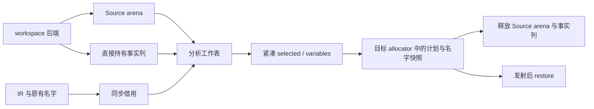

# 作用域复用计划自举

## Intent：最终目标

迁移 scope/reuse.create 的启用规则、候选资格、最后读取判断、positions 表和计划
选择到 RX/ZX。保留独立的 object_update.match 叶判定，以及名字和 AST 的物理应用。

## Data：可用证据

起点 991f11bf，工作区干净。最后读取及 Source 整数索引已可复用。原 create 先
扫描候选、再收集 last、维护 Native positions、标记 variable 并顺序更新名字。
object_update.match 仍依赖 Lower cache/state_symbols/stack_symbols，不能假装已迁移。

## Edges：边界与限制

- 只将既有叶判定结果作为事实输入，Native 不继续执行复用资格和 last-read 规则。
- 提前禁用判定不分配；无原生候选时事实列不分配，不收集 last。
- positions 登记所有有 symbol 的绑定，并在查询旧位置后覆盖当前 symbol。
- 先保存全部原始名字，再按绑定顺序应用别名，保留链式别名和 restore 语义。
- 事实表只分解标量列，不复制 IR；Source 工作区在 create 结束时释放，不延长
  seen/pending 的生命周期到整个后续表达式发射阶段。
- 编排由 RX 的候选分支、collect、初始化和 plan 显式表达；循环算法保留 ZX。
- 不新增测试用例，不新增语法和专用运行库，固定性能基线不重置。

## Answer：交付格式与成功标准

贯通 Source 计划和 Native 应用桥，移除正式路径上的旧 create 算法与 positions
HashMap。阶段再生成、完整产物、相关现有回归和受影响性能验收后统一提交推送。

## 实现与边界复核

enabled 的四项禁用规则由 Source 决定，Native 使用零容量 allocator 同步调用。
通过启用门后，Native 对有 symbol 的绑定各调用一次既有 object_update.match；
该函数只读、不生成 fresh 或 AST，取代原先提前扫描及主循环中的重复判定。

事实以 MultiArrayList 保存 binding、previous、reference、field_index、field_value、
type_id，Source 只借用 binding/previous/type 三列。没有复制表达式表、符号类型列
或 bindings；没有将 Native HashMap 按每个绑定重新快照。

RX 先 has 资格检查，有合格候选才调用 Source reads.collect，再连接 initialize
和 plan；无候选返回 null。Source 资格检查保持 previous 不等于当前 symbol、
symbol 类型等于 change 类型两项约束，object_update.match 的规则仍为原生叶。

plan 按所有绑定顺序处理。先查询 previous 的已绑定位置及最后读取位置，符合时
记录候选行并标记原绑定为 variable；然后更新当前 symbol→位置。bind 的覆盖
索引为 inserted.position，写入值为当前 binding，保留重复 symbol 的覆盖语义。
没有 match 的种子绑定仍登记，不能仅处理事实行。

Native 在 scratch 活着时将选中行投影成 Change 标量值，variables 复制到 Lower
allocator，保存完整原始名字后再按绑定顺序应用别名。Self 不保留 Source 切片。
工作区在 create 返回时释放，不延长 seen/pending/positions 到表达式发射或递归
子作用域。restore、append 及其名字/AST 存储操作仍为显式过渡桥。

生成形态中 changes/variables 直接写槽，positions 覆盖原地写、新键使用
zxReserve(..., true)，没有整表 COW。仍有每个有 symbol 绑定对 bind 返回 Last
的描述符装箱；它不复制索引表或 positions，成本保留并由实际测量验收。

## 阶段证据

初始 seed → Source：37/37 构建步骤通过；Source 再生成：19/19 通过。
两代 Source 工具对相同当前输入的 155 入口、2344 模块和 2083 函数文件生成
2397 个文件，仅 .zxc-inputs 工具身份标记不同。编译器 372 项现有检查通过。

十个相关 Source 文件 fmt/lint 通过，未新增测试。命令、日志、工具和比较结果
位于忽略目录 .zig-cache/cold-build-analysis/scope-reuse。

## 内存成本的进一步复核

首轮 CPU/墙钟持平，但 RSS 中位上升约 9.4MB，因此没有直接收口。增加事实集为空
时的 Native 等价早退；Source has 在零行时必返回 false。进一步读取正式生成代码
确认：原空集路径也没有堆装箱，早退只减少调用和栈描述符准备，不能用它解释数 MB
RSS 变化。原假设未成立，保留首轮与复测全部数据，不将其称为内存修复。

实际可确认的临时成本是 MultiArrayList 扩容：先分配新缓冲再释放旧缓冲，在 arena
中旧非尾部缓冲不能释放。事实列改为显式 workspace 所有权及 deinit，但继续查阅
调用链发现，正式 function_sources.Work.run 给 generate 的 workspace 本身就是
worker scratch Arena，因此不能据此宣称旧容量已真正释放。此项假设也明确纠正。

更直接的生命周期差异是发布分配交错：原先 Source 执行后，再从 Lower allocator
分配最终 changes/variables/names。Lower arena 与 Source scratch 共享 worker arena
后端，Lower 扩块可能打断 Source scratch 的尾部回收，使临时块留至 unit reset。

最终增加既有 Source has 的公开入口，以零容量 allocator 先判定资格；有合格候选
才分配最终三数组，再创建 Source scratch 并运行分析。Source 返回后只投影 Change、
memcpy variables、保存/应用名字，不再从 Lower 分配。这样消除发布扩块造成的回收
交错；没有为非空但全不合格的事实集提前分配输出，也没有由 Native 重写资格规则。
RX 保留独立 has 分支，原生预检只为安排目标存储时序。

事实列的 defer 在 Source arena 之前注册，保证调用与结果投影期间借用有效，先
释放分析工作区，再释放事实列。worker arena 的保留上限和 unit reset 策略不变，
不宣称所有底层父 arena 页面都会在每次 Source 返回时交还操作系统。

仅修改 Native 事实列存储与空集接口早退，没有撤回 Source 计划或改变算法；Source
资格、last-read 和 positions 规则保持不变。

## 最终验收与性能

最终内存时序版本 Source 构建 19/19 通过。编译器 372 项检查证据保留；最终 Native
边界版本补跑相关组合回归，354/354 步骤、636/636 个直接 Zig 检查及相应 Node
运行检查通过。最终 156 入口、2344 模块、2083 函数的两代 Source 输出共 2399
文件，仅工具身份标记不同，见 ordered-fixedpoint-result.json。

性能两侧工具本体均由 Source 生成，运行均使用 Source 分析/生成；固定 Zig 0.17.0、
ReleaseSmall、原 141 入口/2220 模块/1982 函数冻结输入和缓存边界。每次影响实际
分配的修改后才补相应四轮交替测量，使用新的空缓存与输出目录，不重复旧热缓存。

| 版本             | CPU 前→后  | 墙钟前→后  | 峰值 RSS 中位前→后 |
| ---------------- | ---------- | ---------- | ------------------ |
| 初始迁移         | 5.30→5.31s | 1.17→1.17s | 485.0→494.4MB      |
| 空集接口早退     | 5.31→5.30s | 1.16→1.17s | 496.0→493.5MB      |
| 事实列显式 owner | 5.23→5.29s | 1.15→1.15s | 486.7→496.0MB      |
| 发布时序调整     | 5.26→5.28s | 1.14→1.15s | 497.0→494.9MB      |

中位均按既有规则取后三轮，首轮完整保留。最终旧 RSS 四轮为
495.8/496.6/497.0/497.3MB，新为 496.7/494.9/485.6/495.6MB；最大值未增加。
此前各组旧工具自身可出现约 17MB 跨度，不能将中位的小幅差额宣称为确定收益。
最终 CPU 相比固定约 5.34s 基线仍低约 0.06s，没有重置基线；近期约
5.31→5.30→5.31→5.29→5.31→5.28→5.28s，没有持续增长。

最终新工具首次启动墙钟 3.02s（CPU 5.33s、infer/emit/write 529/413/59ms）原样
保留，后三轮墙钟 1.15s。首次启动的额外等待尚未归因，不将温态中位解释为首次
启动耗时；本阶段未重测完整冷构建或 Zig 后端峰值。

各版 2268 个冻结输入产物均仅 .zxc-inputs 工具身份标记不同，目标代码没有额外
差异。原始样本及哈希分别见 runtime-comparison.json、final-runtime-comparison.json、
optimized-runtime-comparison.json 和 ordered-runtime-comparison.json。

## 自我复核与剩余边界

没有以首轮绿色 CPU 掩盖 RSS 上升，也没有继续盲测未修改代码直到出现有利样本；
每次补测对应接口或分配时序改动。空集装箱和 direct workspace 可立即 free 两项
初始解释均由真实代码纠正，不将未证实解释当作根因结论。

本阶段的启用、资格、last-read 决策和 positions 状态已由 Source 执行；Native
object_update.match、名字恢复、更新发射、Lower 缓存及其他共享状态仍待迁移。
工作区仍受 worker 父 arena 生命周期约束，后续继续遵守同一固定基线和实际所有权
检查；不能据本阶段产物不动点宣称完整自举完成。
