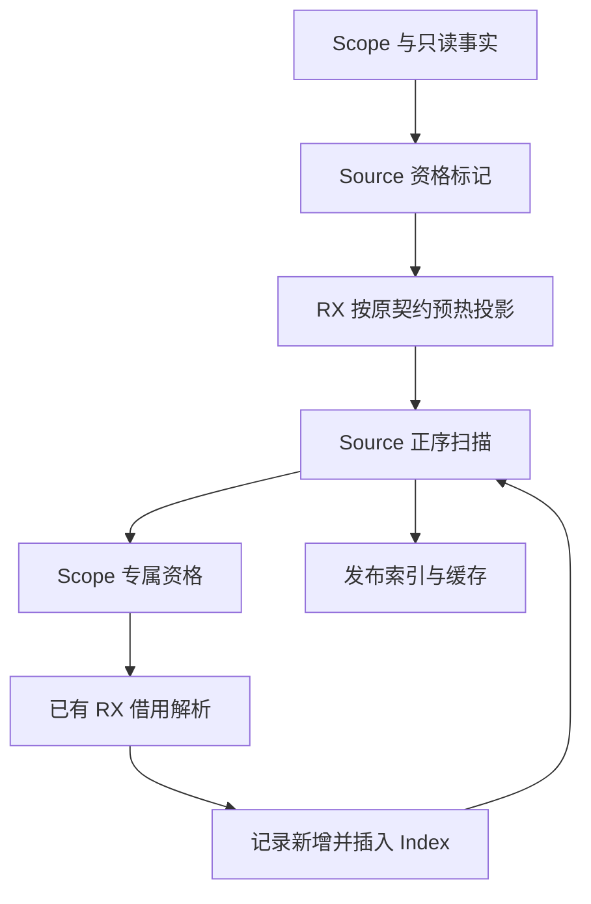
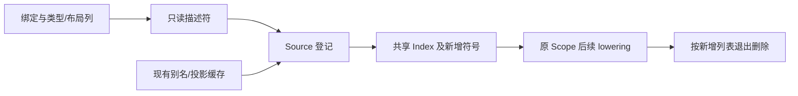

# 作用域栈登记自举

## Intent：最终目标

将 Scope 的局部值资格、投影预热、栈符号登记迁入 Source，与语句块登记共用已自举
的借用解析和符号索引，保持 Scope 专属语义与退出删除顺序。

## Data：可用证据

起点 f8a02a38，工作区干净。statements 的登记与 borrowed/optional 已自举，
Scope.lowerMode 仍保留 snapshot、scalar entry、projected 和 borrowed tuple/alias
等规则。布局、scalar、descendant、projections、Index 与 resolve 均已有 Source 实现。

## Edges：边界与限制

- 保留 local_root/projected/scalar_entry/scoped_locals 的资格和求值顺序；当
  local_root 或 projected 时，即使 bindings 为空，也按旧契约预热缺失投影表。
- local_aggregate 的类型后代检查早于 scalar_entry 的筛除，保持原短路顺序。
- Scope.binding.borrow 的 Tuple/Alias 特例不能并入普通 const 的借用规则。
- 正序扫描绑定，跳过空 symbol；added.push 在 Index.insert 之前；只返回本轮新增符号。
- Index 通过 current() 发布，保留跨 bundle storage/容量；原作用域继续退出删除。
- Scope 原有失败清理必须保留：新增列表成功后先发布，再执行插入；插入成功后再发布
  Index。发生 OOM 时适配器清理已发布新增符号，不复制整张索引来模拟回滚。
- 不复制类型、表达式、绑定或缓存整表；Native 只借用事实与发布结果。
- Scope 后续复用、反向求值与语句组装仍为后续职责，不混为本轮完成。
- 不新增测试，集中验收产物、既有行为和固定累计性能，统一英文提交推送。

## Answer：交付与成功标准

正式 Scope 栈登记规则与状态来自 Source，RX 明确编排投影预热和登记算法；语义、
产物保持，无累计性能退化。所有变更一起提交推送，工作区干净。

## 执行与自我复核

### 实现

- `scope/build.rx` 明确连接资格标记、必要的投影预热和状态初始化；
  `scope/step.rx` 显式分派扫描、借用解析、追加、插入和结束。
- `candidate.zx` 保留 Scope 的 snapshot、scalar entry、borrowed tuple、
  local aggregate 与 borrowed alias 资格。五种投影表达式共用 `projection.zx`。
- 绑定、类型、布局、索引和缓存均通过描述符借用。Index 保留私有存储权限，
  不通过只读 ABI 往返，不复制整表。
- Native 只保留事实视图、状态发布、原有错误清理，以及尚未迁移的后续 lowering。
  原算法保留在 seed 路径，正式生成路径使用两个新增 Source 入口。

### 失败清理复核

追加新增列表、插入索引分成两个发布点，避免下一次分配失败后，外层清理使用旧
列表或旧索引描述符。Native 对已发布新增列表安装 `errdefer`，退出成功后沿用
Scope 原有删除顺序。

检查实际 growth 产物：Append 写入后只构造描述符和按值 State；Insert 在 core
插入成功后只按值重建 State；入口直接返回，无后续分配、装箱或整表复制。
扫描借用原 seed 字段，返回仍保留 Index/added 的存储权限，没有 renew。

### 已完成验收

- Native 引导构建 39/39；Source 正式构建 21/21。
- 编译器现有检查 23/23 步骤，372/372 通过。
- 两代分别生成 main 2,704、collections 64、growth 326 个文件；除 `.zxc-inputs`
  外逐文件一致。这证明本阶段生成稳定，不能替代完整自举的依赖闭包验收。
- 固定输入为原 readability manifest，141 entries、2,220 modules，零复用，
  2,268 个输出文件。两组各八轮交替顺序，剔除首轮；计时时无其他构建任务。

| 对照                | CPU 中位数    | 墙钟中位数    | 峰值 RSS 中位数             | 配对 CPU 差中位数 |
| ------------------- | ------------- | ------------- | --------------------------- | ----------------- |
| 本阶段前 → 后       | 5.33 → 5.34 s | 1.14 → 1.14 s | 494,043,136 → 485,163,008 B | +0.01 s           |
| 固定累计基线 → 当前 | 5.35 → 5.31 s | 1.17 → 1.13 s | 494,256,128 → 493,535,232 B | −0.04 s           |

固定基线 SHA-256：
`8f1e7cee1eadb3ea0f6f7150bab951c55672ce294e4fbe7c50d5858723bdd92d`。
本阶段输出除输入指纹外一致；累计对照仅保留已验收的 Sha256State 接口及清单差异。
当前没有累计性能退化；RSS 波动不能直接视为本阶段内存优化收益。

原始构建、回归、性能和产物报告位于忽略目录
`.zig-cache/cold-build-analysis/scope-locals/`。

### 相关行为验收

14 个相关既有目标共 700/700 步骤、1,586/1,586 检查通过；包括值返回、函数更新、
所有权、复合引用、不可变列表、嵌套 buffer、Task、统一库、RX 并行、原生引用、
值边界、聚合循环与字段所有权。与编译器检查合计 1,958 项，未新增测试用例。
分配失败扫描中的诊断输出不改变最终成功汇总。

### 自我批判与后续边界

本轮只迁移 Scope 栈登记算法。Scope 的复用计划、反向绑定求值、AST 组装，以及
Native Lower 的资源和状态承载仍是过渡依赖。不能据此宣称完整 Scope 或编译器
已经自举。完整目标仍需逐项迁移剩余自有语义/状态，完成传递依赖审计和阶段自编译。
