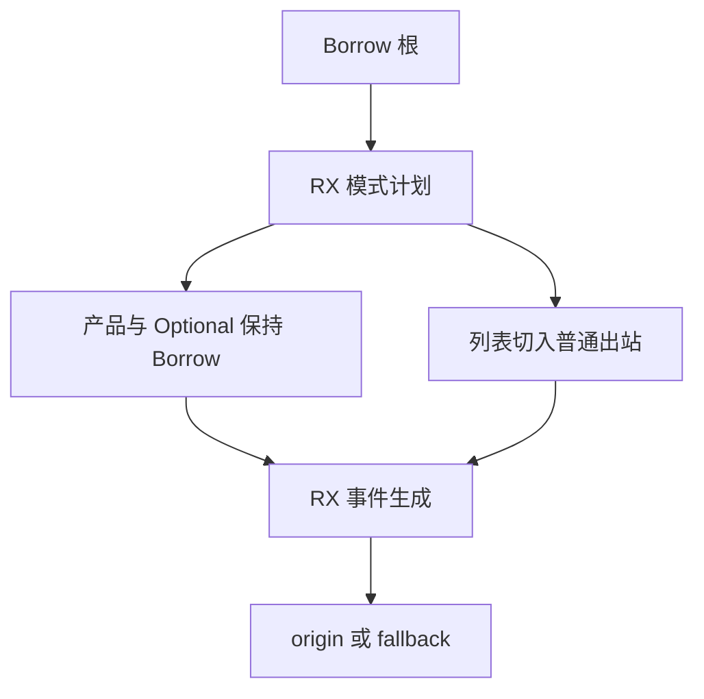
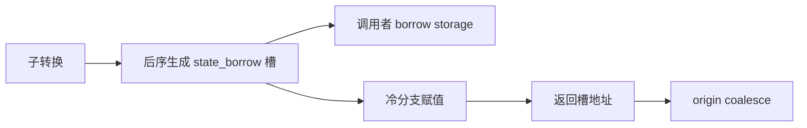

# 借用值转换自举

## Intent：最终目标

将 Borrow 的完整递归迁入现有 RX/ZX 转换树，保留只读借用、临时存储与惰性
fallback 的寿命和开销；不新增专用运行库或语义桥。

## Data：可用证据

起点 09bde5e4，工作区干净。普通出入站已经共用树；Borrow 的产品/Optional
子模式仍为 Borrow，List 则使用普通出站列表路径，不引入新的递归回调。
旧 Native 会把所有 state_borrow undefined 槽写入传入 storage，赋值保留在
当前 rebuilt body。正式入口传 body/body，仍需保留独立 storage 参数契约。

## Edges：边界与限制

- 新增 borrow_storage，独立于 self.reference_storage 与当前 body。
- 槽声明在调用者 storage 中，不能被收到 Optional 或父产品的冷分支里；对子节点
  的 Borrow 槽按原后序顺序创建，fresh 在全部子转换之后。
- 返回 origin ?? fallback；分配的是外置 undefined 局部槽，不用 allocator.create。
- List 切换 Pointer 或 RowValue→Pointer；由此产生的 Reference 槽仍用原全局存储。
- Native 只处理资源与导入；view、AST 存储及其他 Lower 状态仍是后续依赖。
- 不新增测试，受影响路径集中验收；基线固定，累计性能不退化。

## Answer：交付与成功标准

Borrow 正式路径不执行 Native 递归规则，保留调用者 storage 的共享/独立两种形态。
验证两代、阶段产物、既有行为及累计性能后，统一英文提交并推送所有变更。

## 执行与自我复核

Borrow 模式已加入共享树；普通产品与 Optional 递归保持 Borrow，Rows 切入普通
出站。新 emit/borrow 按原顺序生成槽、声明、赋值、origin、地址、block 与 coalesce。
旧算法保留在 borrow_seed，正式 facade 只判断资源边界并调用共享适配器。

独立 borrow_storage 在整个事件遍历中累计；声明使用全局 Variables 长度作为
payload offset，恢复 global statement headers 时保留新增 Variables。Native 将
reference storage、调用者 borrow storage、root body 分别配对导入；storage/body
相同时，先追加声明再追加 body，没有持有扩容前的 items 指针。动态名称采用
拥有型导入，覆盖 scratch 生命周期。

Native 引导构建通过 39/39，Source 正式构建通过 21/21；只读源码复核未发现
模式传播、槽丢失、导入别名或寿命问题。两代生成 main 2704、collections 64、growth 204 个文件均仅输入标识不同，见
final-fixedpoint-result.json。编译器检查通过 372/372 项（23/23 步）；相关运行
检查通过 1414/1414 项（631/631 步），覆盖值返回、函数更新、输入所有权、复合
引用、不可变列表、嵌套缓冲、Task、库运行、RX 并行与原生引用分析/IR。合计
1786 项，未新增测试。证据为 final-compiler-tests.log、final-related-tests.log。

### 性能与产物证据

冻结 141 个入口、2220 个模块；交替八轮，排除首轮取中位数。计时在构建与行为
检查之前隔离进行，固定 anchor 未重置。

| 对照                 | CPU 秒      | wall 秒     | 峰值 RSS 字节         |
| -------------------- | ----------- | ----------- | --------------------- |
| 阶段前 → 本阶段      | 5.32 → 5.33 | 1.14 → 1.14 | 494813184 → 489783296 |
| 固定 anchor → 本阶段 | 5.36 → 5.32 | 1.18 → 1.14 | 496041984 → 494551040 |

阶段配对 CPU 差值中位数 +0.01 秒，累计 -0.04 秒；同时跟踪阶段与累计趋势，
不逐次重新领取容差。RSS 保留原始数值，不据小幅变化宣称稳定收益；这里只测
当前 arm64 生成器，不覆盖完整冷构建或 LLVM 峰值。

阶段 2268 个文件仅 .zxc-inputs 不同。累计仅为先前已验收的 SHA256 流式接口
ABI 与清单哈希差异，逐项验证预期结构后核对剩余类型与实现，不豁免 types.zig。
固定 anchor SHA256 仍为
`8f1e7cee1eadb3ea0f6f7150bab951c55672ce294e4fbe7c50d5858723bdd92d`。

本地证据在 `.zig-cache/cold-build-analysis/state-borrow/`：native.log、production.log、
final-runtime-comparison.json、cumulative-runtime-comparison.json、精确 ABI
校验脚本。产物和临时日志不提交。

### 自我复核与剩余边界

没有用 Reference 槽替代 Borrow storage，没有把 undefined 声明错误收到冷分支，
也没有为复用框架增加原实现不存在的数组复制、解释器或专用回调。两代与既有行为
检查均通过；view、类型/AST 缓存、物理导入和外围 Lower 仍为过渡依赖，不能
据本阶段推断完整编译器已自举。

### 后续 View 边界核对

View 需要保留真实 state_types/view_types 句柄相等时整棵直返；未初始化缓存不能
作为相等证据。应先保留根短路，再在 enter 前跳过相等子树的完整事件区间，
不能只在 exit 返回原值。先展开整棵 plan 再剪枝虽可能语义一致，却增加无用
规划和资源成本，后续不得将其视为已等价迁移。View 产品子模式保持同一方向、
复制既有 origin；连续对象行列表仅 borrowed/items，其他列表切换普通 Value/Pointer。
此处仅完成边界核对，未将 View 记作已实现。
