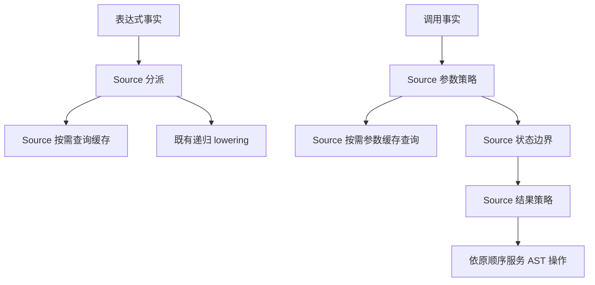

# 值调用策略自举

## Intent：最终目标

将正式值调用路径的表达式分派、参数存活策略、状态边界与结果策略迁入 RX/ZX。
保留参数、callee、转换、clip 和结果 AST 的原有生成顺序及成本模型。

## Data：可用证据

起点 4c7a451a，工作区干净。类型关系谓词已统一 Source。核对发现内联准备和函数
事实分析的正式入口已使用 Source，不重复迁移 seed-only 路径。
`value_call/root.zig` 仍执行正式表达式及调用策略，覆盖 borrowed、pointer、legacy
和跨状态调用。现有生成器已提供所需全部普通能力，无须新增语言语法或原生语义桥。

## Edges：边界与限制

- normalize、state represented、renew、cache、ExprKind 的分派优先级不能改变。
- 保留原有 cache 与 sharesAggregate 的惰性门禁；Source 直接借用缓存列调用已有 map.lookup；
  不新增宿主往返，也不重复类型关系判定。
- pointer＋shared 参数不能临时栈化；参数 lower 后才执行 legacy 或普通调用路径。
- legacy 先于输入转换、clip 和 value callee 请求返回，不预备未选择的 callee。
- 普通路径依次 input transition、clip、value callee、call、结果处理；pointer_result
  优先于 borrowed 和构造，不改变 ABI 指针身份或 fresh 顺序。
- Native 仅提供只读事实、服务请求及调用既有结构化 AST 原语；完整调用 AST、Lower
  状态与其他递归 lowering 仍是后续迁移边界，不宣称整个值调用完成自举。
- 不新增测试；阶段与固定累计性能验收集中完成，复用有效产物与行为证据。

## Answer：交付与成功标准

正式调用的策略规则来自 Source，RX 表达参数、边界和结果策略的组合与早返回。
产物与既有行为保持，无累计性能退化；统一英文提交推送，工作区干净。

## 执行与自我复核

### 实现

- `expression.zx` 拥有完整分派优先级，输出目标 lowering 的枚举；Native 按枚举
  调用既有递归 lowering 或结构化 AST 原语，旧分派保留在 seed。
- `build.rx` 依次调用 argument、boundary、result，组合参数、状态边界及结果计划。
  argument 先判类型后代，再按原门禁查缓存与共享；pointer＋shared 仍使用普通参数。
- Source 直接借用 count、metadata、keys 和 key 调用已有 core map.lookup，既不借
  values，也不复制数据列。空表按 count 直接返回，不探测空桶。
- Native 将参数 lower 完成后按计划执行 legacy 早返回，或 input transition→clip→
  value callee→call→结果处理；pointer_result 的优先级保持不变。
- `policy.zig` 仅构造借用事实并通过零容量 allocator 同步执行。旧 root 完整保存为
  seed，正式路径不再执行旧策略。没有新增语法、运行库或编译器专用语义桥。

### 顺序与生命周期复核

逐项对照 normalize/state/renew/cache/ExprKind 优先级以及全部参数、结果策略。
Source 输入为不可变类型表、状态查询枚举、缓存只读列和标量；描述符均在同步调用
帧内存活，输出不保存输入指针。

策略在参数 lower 前确定。当前参数路径虽然推进 serial、AST、cache_reads、uses_*
及临时作用域，却会恢复 state_active；allows_allocation 与 state_plan 不发生持久
变化，因此边界事实快照有效。没有提前生成 bind、转换或未选择的 callee；其 AST
顺序与原实现一致。未来若修改这些作用域契约，需要重新核对此处快照。

生成闭包复核：dispatch 7 个模块，call plan 14 个模块，均未发现 create、alloc、
dupe、reserve 或 renew。实际调用的 executeValue 按值返回小结果；公开 executeIn
中的输出装箱不属于本轮 fixed0 调用路径。

### 验证证据

- 第一代工具构建 39/39、正式工具构建 21/21 步骤通过；生成下一代时实际执行了
  零容量策略查询，未触发分配。
- 两代产物核对：main 2704、collections 64、growth 269 个文件分别一致，唯一
  差异为 `.zxc-inputs`。
- 编译器既有检查 372/372 通过，23/23 步骤；相关行为 1586/1586 通过，
  700/700 步骤，合计 1958 项。不新增测试。范围覆盖值返回、函数更新、owned input、
  复合引用、不可变列表、嵌套缓冲、Task、统一库、RX Parallel、原生引用和值边界、
  聚合循环、字段所有权。最终日志为 final-compiler-tests.log 和 final-related-tests.log。

### 性能证据

采用同一冻结输入的正式生成器：141 个入口、2220 个模块、2268 个文件。
八轮交替测量，剔除首轮；每轮均无复用，计时期间没有同时运行其他构建。

| 对照              | CPU 中位数     | 墙钟中位数     | 峰值 RSS 中位数            |
| ----------------- | -------------- | -------------- | -------------------------- |
| 阶段前 → 阶段后   | 5.31 → 5.31 秒 | 1.14 → 1.14 秒 | 494501888 → 493518848 字节 |
| 固定基线 → 阶段后 | 5.36 → 5.32 秒 | 1.19 → 1.14 秒 | 493109248 → 493404160 字节 |

阶段配对 CPU 差值中位数 −0.01 秒，固定基线 −0.05 秒；未见累计性能退化。
固定基线 RSS 相差约 0.3 MB，属于本组观测波动，不将微小时间和内存差异解释为
确定性收益。固定基线 SHA-256 仍为
`8f1e7cee1eadb3ea0f6f7150bab951c55672ce294e4fbe7c50d5858723bdd92d`。

阶段产物仅输入追踪文件不同；累计差异仍限定于此前已核验的 SHA256 接口和清单，
使用精确检查，没有豁免整个类型文件。原始证据保存在忽略目录
`.zig-cache/cold-build-analysis/value-call-policy/`。

### 自我批判

本阶段完成的是策略规则职责。实际调用 AST、参数递归 lower、临时借用的存储管理
和 Lower 宿主状态仍由既有 Native 实现服务；完整自举还必须迁移这些职责并执行
传递依赖审计与约定阶段自编译。产物一致及 fixed0 查询不能代替这些最终门禁。
性能结论只覆盖当前 arm64 工具链及冻结生成输入，不外推为冷 LLVM 构建收益。
