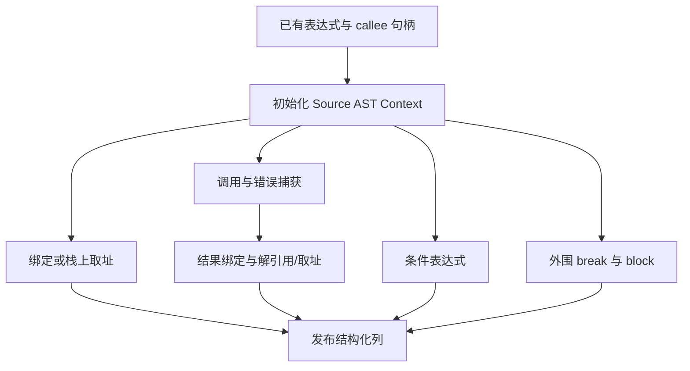
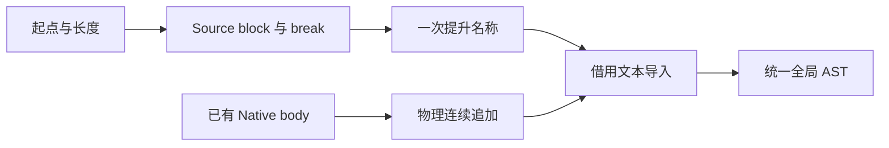

# 值调用语法树自举

## Intent：最终目标

将值调用的绑定、栈上取址、调用与错误捕获、结果解引用/取址、条件表达式和外围
block 组装迁入 RX/ZX；复用既有 AST 原语，保持编号、fresh 与求值顺序。

## Data：可用证据

起点 38bebb9f，工作区干净。调用策略已在 Source，正式 root 仍手写上述 AST。
Source 已有 context call/fallible/binding/address/dereference/conditional 等原语。
Native 语句体是已有 Statement 列表，最终仅物理追加到全局列；无需复制进 Source。

## Edges：边界与限制

- Stack 在 objectValue 后 fresh operand；Invoke 在 call/catch 后绑定结果；Block 最后 fresh。
- 使用当前 capture，保持 try/catch 的错误传播和 uses_allocator 标记。
- Block 接收 body_first/body_count，Source 只发一条 break 和一个回指既有体的 block；
  导入时先连续追加已有 body，再追加 break，中间不执行其他 lowering。
- 不直接套用基于局部 Context 行数的 context/block；显式使用 expressions/block 的范围。
- fresh 名称仅提升一次；identifier、constant_name、block_label 和 break_value_label
  共享该长期名称。静态 allocator 名称及既有 capture 名称可借用。
- Native 保留递归 lowering、类型资源与物理导入；不新增运行库、模板或源码片段。
- 不新增测试。阶段结束集中验收产物、相关行为、固定累计性能并统一提交推送。

## Answer：交付与成功标准

正式值调用的上述 AST 来自 Source，RX 显式编排调用、结果绑定和变换；编号与产物
保持，无累计性能退化。英文提交推送全部变更，工作区干净。

## 执行与自我复核

### 实现

- `emit/build.rx` 初始化 Context、调用 apply、发布结构化结果；apply 选择绑定、
  栈上取址、调用、解引用、条件和 block；invocation.rx 显式编排 legacy 早返回、
  结果解引用、结果绑定和取址。
- 所有节点使用已有 AST 原语构造。调用复用 context/call 和 fallible；当前 capture
  决定 try/catch，Source 显式发布 uses_allocator，保留旧 Lower.call 的标记行为。
- Block 用 expressions/block 显式回指原 body 起点，长度为 body_count+1；只生成
  一条 break。宿主先连续追加已有 body，验证范围，再导入 Source 列，不收集或复制
  整个语句体到 Source。
- Source 发布 fresh 名称及 identifier payload 槽位。宿主只提升名称一次，并替换
  identifier、body.constant_name、block_label、break_value_label 的列描述符；
  Invoke 的槽位跳过已有 allocator identifier。最多复制两个 identifier 切片描述符，
  不复制既有文本或缓存数据。
- 既有 appendBorrowingText 与 appendSelectedBorrowingText 保留长期文本引用，
  接管 call_arguments 等非文本嵌套切片。单项临时工作区在导入后释放。
- 正式 value_call/root 不再手写这些 AST。Native 仍调用既有参数/分支递归 lower、
  转换、clip 和构造资源；旧实现保留在 seed。

### 顺序和生命周期复核

Stack 在 objectValue 完成后 fresh operand；Invoke 在 allocator identifier、call 和
catch/try 后再绑定或解引用；外围 block 最后 fresh。条件表达式仍按 condition、yes、
no 的顺序 lower，再生成节点。legacy 与 pointer/result 的优先级保持。

Source 与 Native 输入描述符同帧同步使用，发布的长期名称由 Lower allocator 持有；
静态 allocator 文本及原 capture 名称均超出临时工作区生命周期。导入器复制调用实参
数组的底层数据，输出 AST 不引用 scratch。Source Context 中的中间描述符允许短期
分配，没有将编译器自身的 AST 分配误称为零分配。

### 验证证据

- 第一代工具构建 39/39、正式工具构建 21/21 步骤通过。
- 两代产物核对：main 2704、collections 64、growth 281 个文件分别一致，唯一
  差异为 `.zxc-inputs`。
- 编译器检查 372/372 通过，23/23 步骤；相关行为 1586/1586 通过，700/700
  步骤，共 1958 项，没有新增测试用例。范围包含值返回、函数更新、owned input、
  复合引用、不可变列表、嵌套缓冲、Task、统一库、RX Parallel、原生引用和值边界、
  聚合循环与字段所有权。最终日志为 final-compiler-tests.log、final-related-tests.log。

### 性能证据

使用同一冻结输入的正式生成器：141 个入口、2220 个模块、2268 个文件。
八轮交替测量，剔除首轮；每轮均无复用，计时阶段无同时构建。

| 对照              | CPU 中位数     | 墙钟中位数     | 峰值 RSS 中位数            |
| ----------------- | -------------- | -------------- | -------------------------- |
| 阶段前 → 阶段后   | 5.32 → 5.31 秒 | 1.14 → 1.14 秒 | 495878144 → 493617152 字节 |
| 固定基线 → 阶段后 | 5.36 → 5.32 秒 | 1.18 → 1.14 秒 | 496041984 → 494141440 字节 |

阶段配对 CPU 差值中位数 0.00 秒，固定基线 −0.04 秒；未见累计性能退化。
不将微小时间和内存变化当作确定性收益。固定基线 SHA-256 仍为
`8f1e7cee1eadb3ea0f6f7150bab951c55672ce294e4fbe7c50d5858723bdd92d`。

阶段产物仅输入追踪文件不同；累计差异仍限定于此前已核验的 SHA256 接口与清单，
精确校验通过，没有整体豁免类型文件。原始证据位于忽略目录
`.zig-cache/cold-build-analysis/value-call-emission/`。

### 自我批判

本阶段迁移值调用自身的基础 AST 组装；完整参数递归 lower、其他表达式生成、类型
资源和 Lower 宿主状态仍未全部迁移。不能以本轮产物一致和行为通过宣称完整自举。
后续仍需正式传递依赖审计与约定的阶段自编译。性能结论只覆盖当前 arm64 工具链
及冻结生成输入，不等同于冷 LLVM 构建或其他平台收益。
