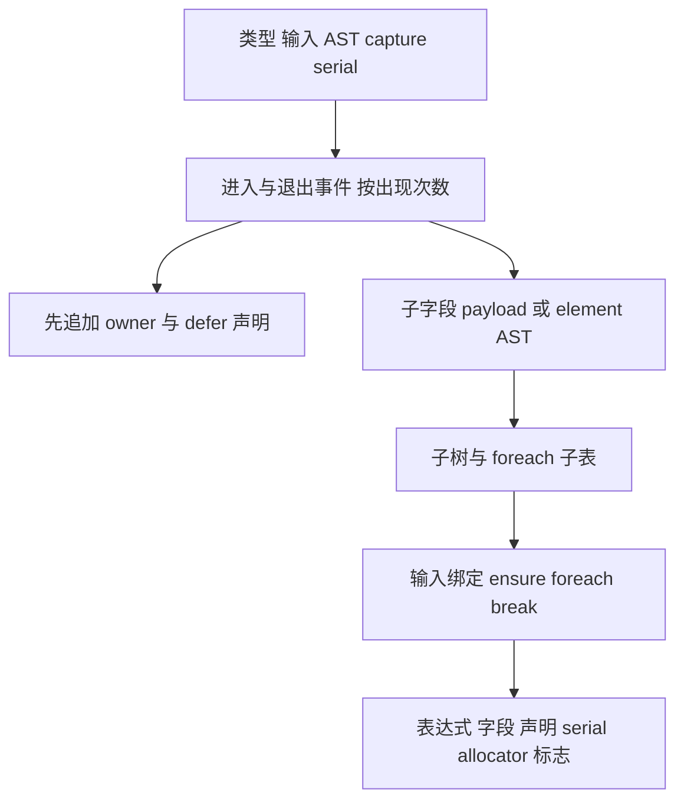

# 入站转换与缓冲创建自举

## Intent：最终目标

将入站转换和缓冲创建的互递归逻辑完整迁入 Source，保留类型表示、所有权、
布局、分配策略及求值顺序；不通过只迁移外壳或改变数据模型推进自举。

## Data：可用证据

基线提交 52c66550。conversion.convert 同时有 inbound/outbound 消费者，出站
会调用 construct 的另一套表示转换，不能误删。入站的 Object/Tuple/Optional
递归与 buffered List 创建互相调用，实际需作为一个完整职责迁移。

根 types.get 已后序缓存所有实际要遍历的命名后代：Optional 不缓存但后续只
构造可空 AST；非 buffered List 的类型与转换均停止遍历。Context 内无删除
类型缓存的路径。因此根布局完成后，可预备子句柄而不再消耗 fresh 或追加
局部类型声明。此结论只适用于同一 Context、inline_lists 不变的入站转换。

## Edges：边界与限制

- 类型命名仍由根查询先后序完成；buffer owner/defer 按转换访问顺序先于元素
  转换追加，即使 buffer 位于 Optional 内也保持原外层声明位置。
- represented(child) 使用 iteration_layout 规则，不改成包含 buffered-list 的
  Context.represented，避免额外元素遍历和复制。
- 非 represented 元素借用原 items，owned=false；represented 元素才 ensure
  capacity 并逐项转换，owned=true。保留原来一次预留容量和追加方式。
- fresh 顺序为 buffer、operand、可选 element、子树名称、最后 block。
- 失败、capture、Optional 惰性、子循环/外层 block 的全局语句布局均保持。
- Native 仍管理类型叶子、scratch、AST 导入与物理存储；outbound/construct
  和普通 ABI 转换继续保留，不能宣称全量转换或自举已完成。

## Answer：交付与成功标准

RX 表达类型出现树规划、转换事件遍历及发布；ZX 实现各项规则与集合算法。
无新 Native 语义回调，补齐通用 defer AST 列；集中跑现有检查、两代产物对照
及固定输入性能验收后，统一提交推送。

## 自我复核

类型句柄准备前移依赖上述已验证的类型缓存性质，不能推广到 outbound。
临时计划和 Source AST 表有实际编译期成本，必须量测，不能把字节一致当作
零开销证据。保留语义必需的元素转换与复制，不宣称所有缓冲均零复制。

## 产物与性能证据

证据目录 `.zig-cache/cold-build-analysis/inbound-conversion/`，日志及 JSON 本地忽略。

- Native 首代构建 38/38，Source 生产构建 20/20。
- 26 个修改的 Source 文件均格式化且 lint 通过，新增 ZX 最长 101 行。
- 两代主模块各 2,604 文件、集合模块各 50 文件，逐文件 SHA-256 仅
  `.zxc-inputs` 身份记录不同。
- 固定输入 141 入口、2,220 模块、1,982 函数文件，前后各 2,268 文件，
  除 `.zxc-inputs` 外逐文件一致。

相同工具链、resident=0、无并发构建下四组交替测量，保留首次样本；
下表为后面三组中位数，原始记录见 runtime-comparison.json。

| 指标     |    上阶段终版 |    本阶段终版 |      变化 |
| -------- | ------------: | ------------: | --------: |
| CPU      |        5.35 s |        5.37 s |   +0.02 s |
| 墙钟     |        1.17 s |        1.18 s |   +0.01 s |
| 峰值 RSS | 491,208,704 B | 497,696,768 B |     +1.3% |
| 工具大小 |   6,102,448 B |   6,189,120 B | +86,672 B |

相对未重置的长期 CPU 基线约 5.34 秒，累计增加约 0.03 秒，在约定的累计
0.1 秒容差内。记录本次增加，不把容差当作每阶段可重新领取的预算；若后续
持续增长需定位优化。RSS 仍处既有采样区间，不宣称内存改善。本测量仅覆盖
固定输入生成器，不代表完整冷构建的 LLVM 时间和峰值内存。

## 行为验收与交接

- 编译器现有检查 372/372 通过。
- 相关回归覆盖 function-analysis、value-return、function-updates、zx-tasks、
  typed-try-runtime、string-index、loop-columns、evaluation-order 与 contracts，
  649/649 步、2,109/2,109 项通过；共 2,481 项，没有新增测试用例。
- 入站转换和缓冲创建互递归已由 Source 类型出现树与进入/退出事件实现。
  根 Value 快路径仅查询根布局和纯分类，不创建计划和临时树。
- owner/defer 声明与 global 子语句分开发布；variable payload 连续存储，动态
  fresh 名称拥有型导入，字段名仅在来自 Program 或静态常量时借用。
- outbound 仍明确使用原实现，依赖 construct 及另一套表示转换；Native 类型
  叶子、资源和 AST 物理存储亦未撤除。下一阶段继续迁移，不视为目标完成。
