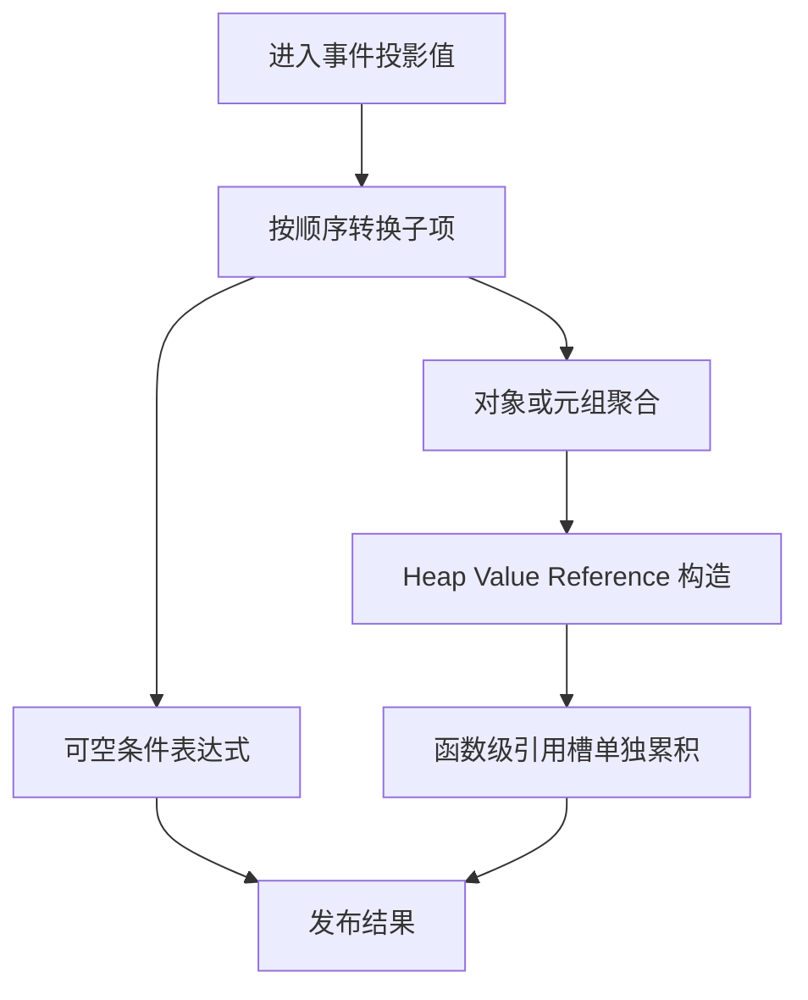

# 出站转换自举

## Intent：最终目标

迁移 iteration_value 的 output=true 转换，使嵌套聚合、可空分支和最终对象
构造均由 RX/ZX 静态生成，移除正式路径对 conversion_seed 的出站依赖。

## Data：可用证据

基线提交 9d71f095。原实现先获取当前类型布局，依次转换对象字段或元组元素，
然后构造结果。Optional 直接返回条件表达式；只有 Object/Tuple 执行 construct。
普通 List 直接返回，buffered List 出站仍不可达，不在本阶段添加 transfer。

已有转换计划提供前序进入、后序退出事件；已有原子投影、聚合、Optional
构造可复用。ZX 直接调用 RX 已有真实消费代码，因此共享构造流程可以保持
在 RX 中，不需要专用 Native 语义回调。

## Edges：边界与限制

- 所有子转换保留原顺序，分配与赋值保留在对应表达式块内，不提前到可空分支外。
- Tuple 原先先 cast，再交给 construct，origin 看到 Builtin，不主动添加 origin。
- 复用同一个 AST Context，不能每个节点清空 Context 或重设 field_base。
- 引用槽声明单独归入 Lower.reference_storage，不混入 iteration owner/defer。
- 类型句柄提前准备须保持无 fresh、无局部声明的性质，生成代码保持零成本。
- Native 仅保留资源、类型句柄及拥有型 AST 导入；其他状态转换与原生桥仍待迁移。

## Answer：交付与成功标准

共享构造 RX 接受已存在 Context；origin 可读取旧 AST 与当前生成段，保持
原节点形态判断。出站事件循环复用现有投影和聚合逻辑，再调用共享构造。
完整路径贯通后集中执行既有回归、两代产物对照、受影响生成器性能对照，
提交推送全部改动并确认工作区干净。性能固定基线不重置。

## 自我复核

不能只验证输出值：必须核对可空分支惰性、后序 fresh、reference_storage
归属和 Tuple 的已有 cast 包装。出站转换完成不代表 state_value 全部转换
或编译器整体自举完成。

## 贯通后的复核与测量

构造流程提取到共享 apply.rx，独立入口仍负责初始化和发布。origin 通过
expression_base 区分旧 AST 与当前 Context 段，按节点读取所需列，不把整张
嵌套数组转为另一种表示。Reference 的 storage.tags/offsets 单独累积，变量
索引继续使用共享 Context 的累计变量索引，不重复偏移。

资源导入拆开通用 AST/字段与 iteration declarations：出站的变量属于
reference_storage，不能把非空变量表与空 iteration 声明一同校验导入。
此问题在静态复核时修正，两个作用域各自导入一次。

Native 构建 38/38、Source 构建 20/20 通过。两代 main 的 2,638 个文件、
collections 的 50 个文件仅工具身份 `.zxc-inputs` 不同。固定 141 入口输入
4 轮交替运行、取后三轮中位数：CPU 5.37→5.31 秒，wall 1.17→1.15 秒，
峰值 RSS 495,697,920→494,239,744 字节，内存保持同一量级。相对长期 CPU
5.34 秒基线约 -0.03 秒，基线不重置。固定输入的 2,268 个文件仅工具身份不同。

原始结果位于 `.zig-cache/cold-build-analysis/outbound-conversion/` 下
fixedpoint-result.json、runtime-comparison.json、fixedpoint.log、performance.log。

现有编译器检查 372/372 通过；相关回归 734/734 构建步骤、2,261/2,261
检查通过，合计 2,633 项。覆盖函数分析、值返回、集合更新、Task、typed try、
索引、loop 列、求值顺序、契约、嵌套缓冲、输入不可变性和复合引用，未新增
测试用例。日志为 compiler-tests.log 与 related-tests.log。

11 个本次 RX/ZX 文件通过格式和 lint，最长 ZX 文件 141 行。正式出站入口
仅在 seed 配置时保留 conversion_seed；generated_analysis 路径调用 Source
事件转换与共享 RX 构造。Native 类型句柄和 AST 资源适配器仍属于过渡依赖。
