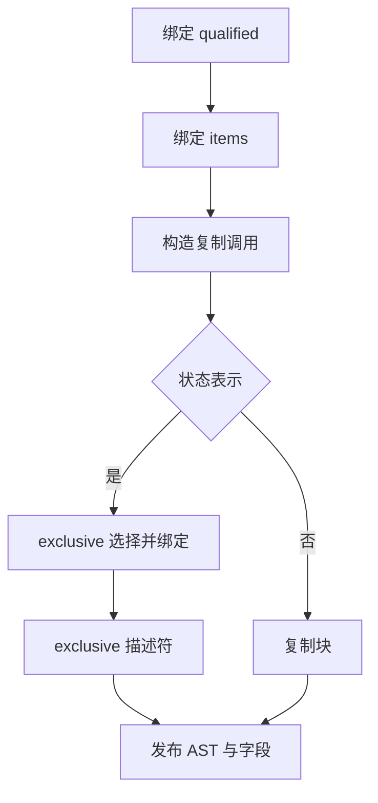

# 列表增长归一化自举

## Intent：最终目标

将 normalize 的绑定、复制分支、独占选择及结果描述符构造迁入 RX/ZX。
保持已实现的自举、缓冲协议、求值顺序、capture 和累计性能标准。

## Data：可用证据

基线 a3029af2。既有 growth/apply、bind、block 与 state/list 权限、tag
已由 Source 实现，可以复用。原实现先绑定 qualified、items，构造惰性复制
分支；选中状态表示时检查 exclusive，最后返回 exclusive 描述符。

## Edges：边界与限制

Native 保留已有 buffered 早退、类型句柄准备、ownership.clip 与通用外层
aggregate.finish 适配；这些依赖仍为待迁移职责，不宣称完整增长机制已自举。
Source 不新增 Native 语义回调，不改变复制的实际时机或数量，不新增运行层。
类型准备不得改变 fresh 序号；保留原分支与最终块名称顺序。

## Answer：交付与成功标准

完成正式与 seed 接线；两代产物一致、固定 141 入口性能对照、相关既有行为
检查和源码 lint 通过后统一提交推送。CPU 固定基线约 5.34 秒，最近正式
工具约 5.41 秒；不重置累计基线。未验收前不宣称本阶段完成。

## 实现与自我复核

Source 复用 GrowthInput、GrowthOutput、Branch 和既有 apply/bind/block；新增
输入只保存归一化特有的 selected/layout/field_base，没有复制通用增长协议。
RX 显式连接 initialize、prepare、copy、selected 的 select/record 或 copied、
publish。Native 使用同一拥有型 AST 导入路径，并追加描述符的两项字段。

原生 layout 解析提前到 Source 调用前，断言不改变 serial；字段基址在类型
准备后快照。外层 finish 仍负责容纳 clip 产生的变量及赋值，不把这些语句
错误地塞进仅支持常量的 Source copied block。capture 在 execute 栈帧内
构造，整个 Source 调用同步完成；新的字段名在 scratch 释放前拥有型复制。

只读复核未发现 fresh、惰性复制、字段基址或文本生命周期的具体偏差；该复核
只覆盖本次 diff，不能代替产物和运行回归。10 个 Source 文件 fmt/lint 通过。

## 产物与性能证据

Native 38/38、Source 20/20 构建通过；两代 main 的 2,692 文件及 collections
的 50 文件，差异均仅为 `.zxc-inputs` 工具身份。固定 141 入口的 2,268
文件亦仅工具身份不同，所测应用生成形态未变化。

无其他构建干扰的八轮交替对照，剔除两组首轮后的中位数：CPU
5.39→5.41 秒，wall 1.17→1.18 秒，峰值 RSS
495,403,008→493,944,832 字节。CPU 差额为用户接受的 0.02 秒；当前
正式工具 5.41 秒与上一阶段记录持平，较固定约 5.34 秒基线累计约 +0.07
秒。继续保留累计警戒，不把每阶段容差重新当作可用预算，也不声称稳定提速。

原始记录位于被忽略的 `.zig-cache/cold-build-analysis/growth-normalize/`：
`native.log`、`production.log`、`final-fixedpoint-result.json`、
`fixedpoint.log`、`runtime-comparison.json`、`performance.log`。

## 行为验收与阶段交付

编译器 22/22 构建步骤、372/372 检查通过；相关回归 761/761 步骤、
2765/2765 检查通过，合计 3,137 项。覆盖函数分析、值返回、更新、Task、
typed try、字符串索引、loop 列、求值顺序、契约、嵌套缓冲、输入不可变性、
复合引用及不可变列表的源码/库路径。未新增测试用例。完整记录为上述目录中
`compiler-tests.log` 和 `related-tests.log`。

本阶段交付归一化生成逻辑的 RX/ZX 实现及正式/seed 接线，所有 Source 文件
通过格式和 lint，最长 ZX 为 56 行。Native ownership.clip、buffered 事实与
类型句柄、通用外层块包装、增长 helper 定义和 renew 路径仍需后续迁移；
完整自举的传递依赖审计及阶段自编译尚未完成。
