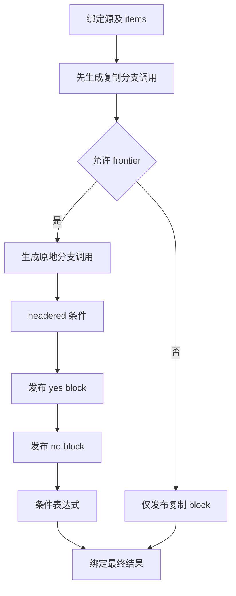

# 列表扩容调用与分支组装自举

## Intent：最终目标

迁移 reserve、reserveBounded、copy、retract 的调用 AST，以及状态列表 reserve
的完整选择和结果组装。复用既有静态 Zig 扩容函数，不改变缓冲区协议。

## Data：可用证据

基线提交 510c70ee。普通 reserve/copy 生成带 capture 的调用并绑定一次结果；
retract 为不带 allocator 的无返回调用。shared_types 决定 helper 是否经 zx_abi
访问。所有 helper 定义、normalize/renew 仍为后续职责，不借此阶段宣称完整。

状态 reserve 先绑定源，再产生复制分支（operand），可选原地扩容分支，随后
构造 headered 条件、yes block、no block，最后绑定选择结果。fresh 顺序决定
名称，分配和赋值必须仍留在分支内。函数调用处语句与全局 AST 块语句分开维护。

## Edges：边界与限制

- 原生仅准备元素类型及资源索引并拥有型导入，不新增语义回调。
- reserve/bounded/copy 设置 uses_allocator；retract 仅保留现有标记。
- Source 参数、callee、调用和结果绑定顺序与原实现一致，保留 capture。
- Source 子块按 yes→no 发布，no 调用的 fresh 仍先于 yes；不提前执行任一分支。
- 新名称来自 scratch，使用完整拥有型文本导入，不沿用静态文本借用捷径。
- ordinary Zig、静态链接、零额外应用运行层、无额外用户载荷复制。

## Answer：交付与成功标准

共享 RX 明确参数、callee、调用及结果阶段；状态 reserve RX 表达复制、可选
扩容与结果汇合。完整贯通后，集中执行两代产物、固定输入性能与既有行为回归，
提交推送所有变更。固定 CPU 基线约 5.34 秒，上一阶段累计约 +0.05 秒，不重置。

## 自我复核

不能把 AST 构造顺序混同于应用运行顺序；即使 no 调用 AST 先构造，其实际
调用仍受分支惰性保护。不得把分支绑定混入调用处 flat body，或互换 block 名称。

实现复核补齐通用 flat expression 导入，使 retract 可以使用与其他调用相同的
Source 发布路径。Native prepare 只返回无捕获临时指针的资源结构；捕获边界
在 execute 的局部对象中保存，并在同一帧同步调用 Source，避免指向已返回
prepare 帧的临时结构。修复后重建最终工具，早期工具不作验收证据。

## 性能验收与限度

两代 main 的 2,682 文件、collections 的 50 文件仅工具身份 `.zxc-inputs`
不同；固定 141 入口输入的 2,268 文件也仅工具身份不同。Native 38/38、Source
20/20 构建通过。初始四轮 CPU 5.39→5.43 秒，已扩大为八轮交替运行，取后七
轮中位数：CPU 5.38→5.41 秒，wall 1.16→1.17 秒，峰值 RSS
493,961,216→497,205,248 字节。固定 CPU 基线约 5.34 秒，累计约 +0.07 秒，
仍在用户 0.1 秒容差内，但接近边界，后续不能重置基线继续累积。

为定位增量，分别计时 Source 发射、表达式导入、块导入和 flat 导入，再补齐
整个 execute 调用前后。按各操作最后的二次幂采样及实际计数约束，总调用链
上界约 13 毫秒，scratch 无溢出。共用 2,283 生成函数、12,395 顶层类型定义
逐字一致，未发现全局表示变化。上述证据只能解释部分 CPU 差额，剩余尚未
完全归因，不将其表述为已证明无开销或全部噪声。未发现可改变下一步决策的
高可信定位项，停止扩大猜测并进行行为回归；所有临时探针已删除。

原始证据位于 `.zig-cache/cold-build-analysis/growth-calls/`：
final-fixedpoint-result.json、verified-runtime-comparison.json、final-fixedpoint.log、
verified-performance.log、profile-full.log、total-profile.log。诊断工具不作为
最终性能样本；verified-production 已移除探针，源码恢复后与该工具一致。

## 行为与格式验收

编译器 372/372 检查通过，相关回归 761/761 构建步骤、2765/2765 检查通过，
合计 3,137 项，覆盖函数分析、值返回、更新、Task、typed try、索引、
loop 列、求值顺序、契约、嵌套缓冲、输入不可变性、复合引用及不可变列表
源码/库路径。未新增测试用例。22 个 RX/ZX 文件通过格式和 lint，最长 ZX 文件
93 行。完整日志为 compiler-tests.log、related-tests.log。
