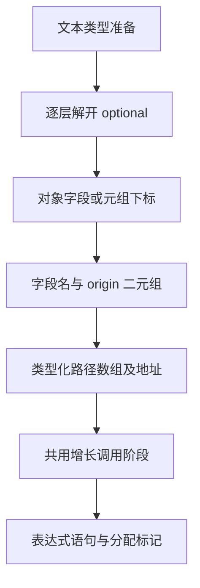

# 增长续用路径自举

## Intent：最终目标

将 renew 的可空类型遍历、对象/元组路径命名、来源名称与结构化调用生成迁入
RX/ZX，复用已有增长调用阶段。保留普通 Zig、静态链接、零额外应用复制。

## Data：可用证据

基线 dc3586c2。原 renew 按路径逐层解开 optional，构造每层的字段名与 origin
二元组，再生成 `try zxRenew(allocator, &state, &paths, exact)`；shared_types
决定 helper 是否经 zx_abi 访问。原调用通过 allocator 参数设置 uses_allocator。
已有 Source 类型表、origin 命名、整数打印与 AST tuple/array 原语可直接复用。

## Edges：边界与限制

Native 保留已有 bufferedPath 早退和只读类型表/AST资源适配，不新增语义回调。
renewValue 的计划遍历及所有权裁剪、zxRenew helper 定义仍为后续迁移职责。
路径空值、optional/object/tuple、capture 与 shared 命名空间行为保持一致。
不新增测试用例，不修改运行库或依靠源码模板；所有名称和字符串由 printer
按结构化 AST 输出。性能沿固定约 5.34 秒 CPU 基线，最近阶段约 5.41 秒。

## Answer：交付与成功标准

完整贯通 Source、正式 Native 适配及 seed；两代生成产物与固定 141 入口全部
文件对照，受影响的既有行为回归和格式/lint 通过；验证实际 CPU、wall、RSS
及累计趋势后统一提交推送全部变更。不得把本阶段作为完整自举完成的证据。

## 实现与自我复核

新增 Renew 增长操作；独立 RX 只负责类型准备、路径遍历、数组构造及共用
apply/publish 接线。共用参数构造为 Renew 生成 allocator、状态地址、路径数组
地址及 exact；结果阶段发布 expression statement，不创建绑定或占用 fresh。
Native 提取已有 publish 资源导入供两种适配复用，未新增编译器语义回调。

Source member 遵守原接口的内部前置条件：路径成员仅选择对象或元组；optional
逐层剥离。该接口没有作为对外任意类型查询发布；非法非聚合路径的失败形式
不作为等价证明。合法输入的字段、origin、空路径、shared、capture、allocator
与 serial 经只读复核未发现具体差异，仍待产物与行为验收。

10 个 RX/ZX 文件通过 fmt/lint；Native 首代引导 38/38 构建步骤通过。原生
capture 与调用同帧存在，返回 AST 的名称及数组在 scratch 释放前拥有型导入。

## 固定输入性能

八轮交替运行、剔除两组首轮后的中位数：CPU 5.40→5.39 秒，wall
1.17→1.16 秒，峰值 RSS 494,157,824→493,617,152 字节。2,268 文件
差异仅 `.zxc-inputs`。仅据此说明未见本阶段退化，不把微小差额扩大为稳定
提速或内存收益；当前 CPU 较固定约 5.34 秒基线累计约 +0.05 秒。

原始报告位于被忽略的 `.zig-cache/cold-build-analysis/growth-renew/`：
`runtime-comparison.json` 与 `performance.log` 保存工具摘要、八轮原样本及
文件对照；`native.log`、`production.log` 保存实际构建命令。

## 两代产物与编译器检查

Native 38/38、Source 20/20 构建步骤通过。两代 main 的 2,699 文件与
collections 的 50 文件仅工具身份记录不同，完整报告为同一目录中的
`final-fixedpoint-result.json` 和 `fixedpoint.log`。

编译器 22/22 步骤、372/372 检查通过，记录为 `compiler-tests.log`。相关
行为回归结果见下节；产物一致不能单独证明完整语义或自举完成。

## 行为验收与阶段交付

相关回归 761/761 构建步骤、2765/2765 检查通过，与编译器合计 3,137 项；
完整日志为 `related-tests.log`。覆盖函数分析、值返回、更新、Task、typed try、
索引、loop 列、求值顺序、契约、嵌套缓冲、输入不可变性、复合引用和不可变
列表的源码/库入口。未新增测试用例。日志中的 allocation sweep completed
来自既有测试成功完成后的 debug 输出，与最终退出码和通过汇总一起判断。

10 个 Source 文件通过格式及 lint，最长 ZX 为 117 行。Native 原算法只留在
seed 分支，正式路径的成员遍历、命名、数组和调用 AST 来自 RX/ZX；资源桥
只借用类型表并拥有型导入输出。此阶段没有完成 renewValue 计划调度、共享
helper 定义、全部状态桥移除及最终 seed→stage1→stage2→stage3 闭包验收，
整体目标继续。
