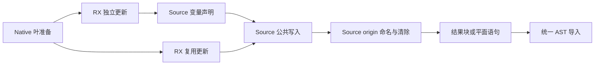
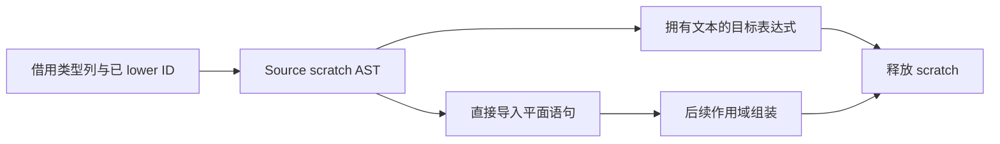

# 对象字段更新发射自举

## Intent：最终目标

迁移独立对象更新与作用域复用更新的声明、值绑定、字段赋值、origin 清除和结果块
构造，复用同一 Source 写入算法与既有 origin 命名规则。

## Data：可用证据

起点 f27986df，工作区干净。object_update.lower 与 scope/reuse.append 都在 Native
重复构造字段赋值和 origin=null。Source 已有变量、绑定、赋值、field、block 原语；
types/state/origin 已实现对象 origin 名称避碰，可直接复用而无需复制规则。

## Edges：边界与限制

- object_update.match 仍依赖 Lower 状态，作为独立待迁移叶保留；不宣称其规则迁移。
- Native 准备 self.expr/layout/fresh 叶，保留原调用和 fresh 顺序；不复制 IR 表。
- Source origin 避碰可能在 scratch 创建文本，导入表达式必须持有文本所有权。
- 作用域输出是平面语句，应直接导入 ArrayList，不先写全局语句表再重复存储。
- 复用原 schema、列长度和布局检查，不通过源码片段或 RawCode 生成 Zig。
- 不新增测试用例；阶段验收和性能仅覆盖实际影响，固定基线不重置。

## Answer：交付格式与成功标准

两条 RX 流程共享 Source write，ZX 保持原子 AST 构造；Native 仅准备叶及导入数据。
完整产物一致、阶段自编译、相关现有回归和成本验证后统一收口、提交并推送。

## 实现与所有权

独立更新通过 expression.rx 编排初始化、变量声明、公共写入和结果块；作用域更新
通过 statements.rx 编排初始化、公共写入和列发布。公共 write 绑定修改值一次，按
类型表 first[type_id] + field 定位字段，赋值后用既有 origin 算法选择避碰名称并清空
来源。新增 context 的 binding、assignment、null_value，继续使用统一 AST 原语。

Native 仅准备 layout/expr/fresh 叶、借用 TypeTable 列并导入结果。standalone 的
fresh 顺序仍为 updated、叶求值、operand、block；作用域为叶求值、operand。
生成表达式的位置可以调整，输出语句的初始化、求值和写入顺序保持。origin 后缀
可能在 scratch 中产生，表达式导入拥有文本；平面语句只借用 Lower 持有的 fresh
名称，其生命周期覆盖后续 AST。临时 arena 在导入完成后释放。

import_rows 提取原有完整检查为 check，复制导入继续先检查再提交。新的平面语句
导入器复用 schema、列长度、offset 和布局检查，再限制可导入标签，直接追加
ArrayList；不把语句先写进全局表再读出一遍。此接口是物理 AST 适配，仍属过渡
依赖。match 资格规则保持原实现，初始 Native seed 通过编译选项保留旧发射。

## 阶段与成本证据

初始 seed 构建 Source 工具 37/37 步骤通过，再由其构建下一代工具 19/19 通过。
两代对当前 158 入口、2355 模块生成的全部 2413 文件比较，仅 .zxc-inputs 工具
身份标记不同。此证据不等于完整自举，Native 传递依赖仍需继续迁移。

成本对照采用冻结 141 入口 manifest，关闭 resident，每次新输出和生成缓存，
前后工具交替四轮，首轮保留，中位取随后三轮。旧工具为 f27986df 阶段的
ordered-bootstrap，新工具为本阶段 production-bootstrap。全部 2268 文件仅身份
标记不同。

| 指标          | 修改前       | 修改后       | 变化         |
| ------------- | ------------ | ------------ | ------------ |
| CPU 中位      | 5.26 秒      | 5.32 秒      | +0.06 秒     |
| 墙钟中位      | 1.15 秒      | 1.18 秒      | +0.03 秒     |
| 峰值 RSS 中位 | 497,451,008B | 494,354,432B | 在历史波动内 |

CPU 仍低于固定约 5.34 秒比较基线；没有重置累计基线。新 RSS 四轮为
493.5/495.8/481.3/494.4MB，旧为 488.5/499.4/495.7/497.5MB，不据此宣称新增
内存收益。本阶段目的为迁移发射语义，没有测到提速收益。

新安装工具首轮墙钟 3.00 秒，CPU 5.38 秒，内部 infer/emit/write 为
536/421/62ms；后续墙钟 1.17～1.19 秒。额外首次等待延续上一阶段现象，尚未归因，
不将温态墙钟报告为首次启动时间，也不归因于已证实的 Source 算法问题。

构建、逐文件摘要、原始计时和比较脚本保存在被忽略的
.zig-cache/cold-build-analysis/object-update；固定输入与工具摘要见
runtime-comparison.json。性能比较在其他构建前单独运行。

## 验收与自我复核

- 13 个新增及修改 ZX/RX 文件逐项 fmt/lint 通过，未新增测试用例。
- 编译器 21/21 构建步骤、372/372 现有检查通过。
- function-analysis、value-return、function-updates、zx-tasks 四个相关目标
  354/354 构建步骤、636/636 直接 Zig 检查通过，并完成目标中的 Node 行为检查。
- 只读审查核对 fresh 顺序、字段索引、origin 文本生命周期、AST 导入和 seed 分支，
  未发现阻塞问题。现有检查与全产物一致性覆盖本轮改动，未据此宣称通用形式化证明。

本阶段迁移的是对象字段更新的完整结构化发射职责，不包含匹配资格及 Lower
状态。Native layout/expr/fresh 叶和物理 AST 导入仍为过渡依赖；完整自举仍未完成。
没有通过退回 Native 发射或扩大对象复制来消除迁移开销。CPU 相对本轮旧工具增加
0.06 秒，仍在固定累计边界以内，但应继续跟踪趋势，不能将容差视作下一轮预算。
已有约 27.3% 的 RSS 收益来自此前构造工作区生命周期修复，不归功于本轮迁移；
本轮没有验证或改善 Zig 后端冷构建峰值。
