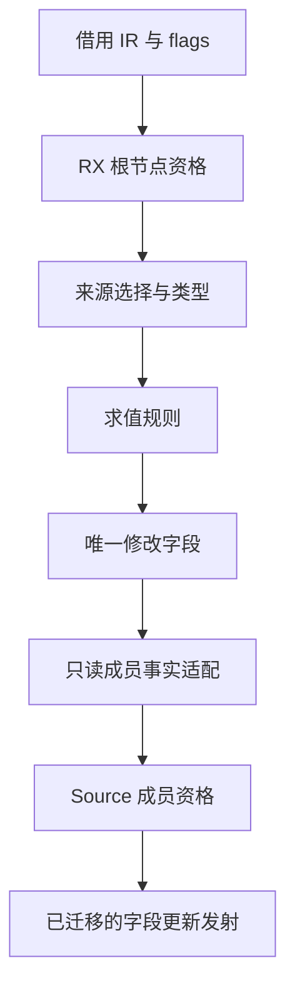

# 对象更新资格规则自举

## Intent：最终目标

将 object_update.match 的结构、flags、类型、求值、单字段规则迁入 RX/ZX，连接上一阶段
结构化发射，并保持现有优化及性能。完整自举目标不变。

## Data：可用证据

起点 64e41799，工作区干净。原判定只读 ExpressionTable、TypeTable、符号类型、
uniqueness flags 和三张 Lower 成员表。类型与表达式可借用 SoA；flags 为已有 u8
位布局。状态表仍由 Native 持有，直接查询是常数级，复制整表或线性查找不可接受。

## Edges：边界与限制

- 规则迁移与状态迁移分开报告，不把成员事实适配说成完整自举闭包。
- Source candidate.rx 编排结构资格、来源选择、求值校验和唯一修改字段搜索。
- Native 仅借用列、查询成员事实和转换标量结果；不新增编译器专用回调或复制 IR。
- 原实现只选第一个同类型字段来源，flags 缺失视作 plain，borrowed 短表视作 false。
- 保持纯查询语义；判定拒绝路径的工作顺序可能调整，须检查成本。
- 不新增测试；复用既有阶段自编译、产物比较及相关检查。固定性能基线不重置。

## Answer：交付格式与成功标准

规则以 Source 为准，Native seed 保留原实现用于初始引导。核对产物、行为和成本后，
统一提交全部变更并推送；明确剩余 Native 状态与适配边界。

## 实现与成本模型

Source root 检查状态模式、对象/类型、selected/borrowed、cache 事实、plain 及字段
数量；source 按原字段存储行序选首个同索引 Field→同类型 Reference，再验证 plain
及符号类型。evaluation 校验求值前缀，changed/unchanged 查找唯一修改字段，result
发布标量 Change。RX 显式表达空结果、阶段依赖、短路和结果汇合。

Native matching 只借用描述符及读取成员表。cache 事实在 candidate 前提供，
state/stack 事实在 previous 已确定后读取；Native 不组合成员资格，eligible 决定
是否接受。两次 Source 调用之间的成员数据适配仍为 Native 过渡边界，不能说完整
职责闭包已经迁移。对稳定合法 IR，成员检查后置不改变结果；最终被成员规则拒绝
的候选可能多做结构扫描，实际成本对照覆盖这一变化。

flags 直接借用已有 packed(u8) 列；normalize/renew 使用既有 Source 常量，短 flags
继续默认 plain，borrowed 短表默认 false。没有全表复制、稠密状态镜像或线性成员
查询。Input 的列、视图和数组包装仅含借用描述符，不复制底层数据。

Native 实际调用 executeValue，使用零字节 FixedBufferAllocator。未分区生成体的
candidate 闭包 14 文件与 eligibility 1 文件均未见堆申请、reserve、renew 或数组
复制，可空结果是内联标量记录。公开 executeIn 的候选结果装箱仍存在，但不在
Native 实际调用链；不能只搜整个 facade 就断言热路径分配。

原 Native 发射与匹配统一保存在 object_update/seed.zig，仅用于初始引导；匹配
算法逐句保留。Source changed 的结束校验通过 loop.return 调用结果函数，未在
loop 后接取值；所有新增 ZX 均小于 240 行，格式与 lint 检查通过。

## 验收证据

初始 seed 构建 Source 工具 37/37 步骤通过，随后 Source 构建下一代工具 19/19
通过。两代对当前 160 入口、2367 模块生成的全部 2427 文件比较，仅 .zxc-inputs
工具身份标记不同。

- 12 个新增 ZX/RX 文件逐一 fmt --check 与 lint 通过。
- 编译器 21/21 构建步骤、372/372 现有检查通过。
- function-analysis、value-return、function-updates、zx-tasks 共 354/354 构建
  步骤、636/636 直接 Zig 检查通过，并执行目标中的 Node 行为检查。
- 未新增测试。只读审查核对了首个来源选择、flags 位、单字段规则、Native 边界
  和实际生成闭包，没有发现正确性或生命周期阻塞。

性能比较在其他构建前单独运行，沿用冻结 141 入口 manifest，关闭 resident，
每轮使用新输出与生成缓存，新旧交替四轮，首轮保留，中位取随后三轮。旧工具为
64e41799 的 production-bootstrap，新工具为本阶段 production-bootstrap，全部
2268 文件仅身份标记不同。

| 指标          | 修改前       | 修改后       | 变化        |
| ------------- | ------------ | ------------ | ----------- |
| CPU 中位      | 5.28 秒      | 5.30 秒      | +0.02 秒    |
| 墙钟中位      | 1.16 秒      | 1.16 秒      | 持平        |
| 峰值 RSS 中位 | 488,505,344B | 496,812,032B | +8,306,688B |

旧 RSS 四轮为 499.5/480.0/495.4/488.5MB，新为 483.0/488.3/498.3/496.8MB；
两组有明显重叠，仍在近期约 480～500MB 波动区间。记录本轮中位增加并继续跟踪，
不据此声称内存改善；实际匹配闭包没有新增堆分配。CPU 仍低于固定约 5.34 秒
比较基线，没有把上一阶段作为新的累计起点，也没有把容差视作可重复领取的预算。

新安装工具首轮墙钟 2.99 秒、CPU 5.36 秒，内部 infer/emit/write 为
536/418/73ms；后续墙钟 1.14～1.16 秒。首次额外等待尚未归因，保留原始数据，
不把温态中位当作首次启动时间。

构建命令、日志、工具摘要、逐文件比较、计时和闭包清单保存在被忽略的
.zig-cache/cold-build-analysis/object-match。对应文件为 fixedpoint-result.json、
runtime-comparison.json、candidate-allocation-audit.json；文档按 IDEA 记录目标、
证据、边界和验收格式。

## 自我复核与后续边界

本轮推进的是判定规则的 Source 归属，连接上一阶段发射；没有宣称完整 Lower
或状态自举完成。cache/state/stack 的存储及适配仍需迁移。后续通用稀疏状态迁移
不能直接换成稠密顺序：cache 唯一 iterator 在 state_value/root 中消耗 fresh serial，
改变遍历顺序会影响生成文本；保存/恢复整张表及 Lower 克隆也需同时核对。

RX 的结构判定编排是真实流程，Native 没有再次实现或组合资格规则；成员事实
适配仍明确保留为待迁移依赖。完整自举还需关闭这些 Native 传递依赖并完成最终
阶段审计，当前目标保持进行中。

最终整理将原匹配集中到既有 seed 文件并移除未使用导入后，初始引导再验证
37/37 步骤通过。该工具按最终源码重新生成的 2427 文件与已验收生产工具结果
仅身份标记不同，结果见 final-source-check-result.json。此整理没有改变匹配算法，
复用已取得的行为和性能证据，未重复整组检查或计时。
