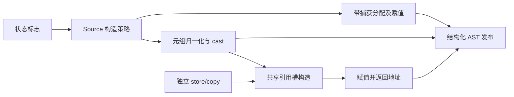
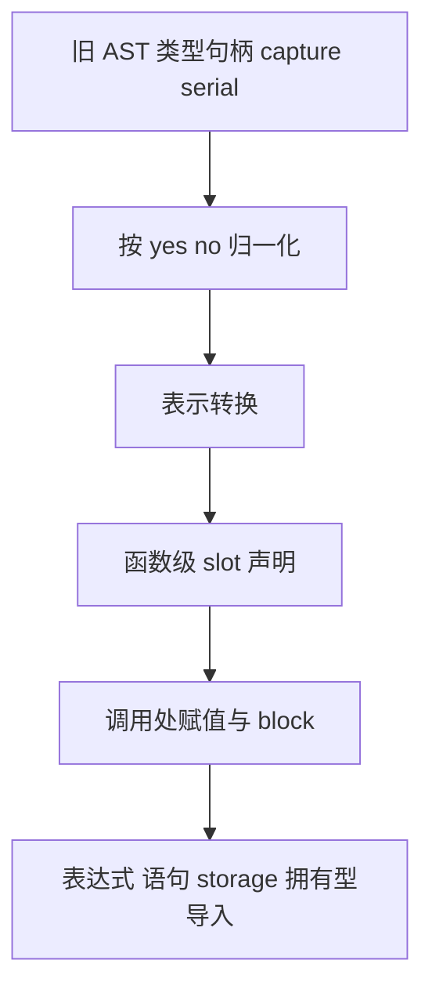

# 对象构造与引用槽自举

## Intent：最终目标

迁移出站转换依赖的通用对象构造、状态引用槽存取和元组 origin 归一化规则，
保留堆分配、状态值与状态引用三种表示，以及实际求值和捕获顺序。

## Data：可用证据

基线提交 b536976b。Lower.construct、reference.store/copy、origin.tuple 仍在
Native。类型句柄获取仅构造静态类型 AST 与缓存，不调用 fresh，不添加局部
语句或 reference_storage，因而可先准备句柄再进行 Source 构造。

上阶段固定输入 CPU 为 5.37 秒，长期未重置基线约 5.34 秒，累计约 +0.03 秒。

## Edges：边界与限制

- Source 决定 Heap/Value/Reference，Native 仅提供现有状态标志及类型句柄。
- Heap 仍先执行带 capture 的 allocator.create，再在指针位置求值、赋值，
  返回转换后的指针；保留 operand、block 命名顺序。
- Reference 先归一化并 cast，再产生 state_reference、提升函数级 undefined
  slot，在调用处赋值并返回地址；copy 返回 slot 本身，不返回地址。
- origin 仅扩展元素数恰等于 IR arity 的裸 Tuple；已含 origin、其他形态保留。
  Conditional 按 yes→no 递归，并完整保留 condition/capture/error_capture。
- AST 旧前缀借用期间保持稳定，新增名称和数组编号元数据拥有型导入；不复制
  用户载荷，不新增 Native 语义回调、模板或运行库。
- outbound 转换、origin.name/clear 及 Native 资源/AST 物理存储仍待迁移。

## Answer：交付与成功标准

RX 表达三路径与引用槽流程，ZX 实现规则和归一化算法。复用统一 Context，
补齐可保留 capture 的条件节点及解引用节点。集中执行现有回归、两代产物
对照和固定输入性能验收后，提交推送全部改动。

## 自我复核

Source 使用显式帧保持原 yes→no 递归顺序，不能只比较最终 arity。
类型准备前移仅依赖已核对的无 fresh/局部语句性质，不能任意重排用户求值。
本阶段不代表完整出站转换或全量自举已经完成。

## 自举发现的生成质量缺陷

扩展模型后，既有 imports/key 的 builtin_arguments[builtin] 暴露嵌套数组读
路径缺陷：原生成器先把整张 u32[][] 转成内部描述符数组，引入不必要的
zxReserve 和 OutOfMemory，而原只读函数仅声明 IndexOutOfBounds。

修复 lower 的嵌套数组 index/length：仅在无 iteration_value/loop_fields、
inlineStored 嵌套列表且 abiProjection 能证明原 ABI 来源时，直接读取原切片。
索引仍复用原边界/capture 构造，随后仅以 .value 规则转换选中元素；不能把
ABI 元素交给按内部布局读取的 elements.read。缓存、normalize、renew 的原
守卫完整保留。没有扩大错误集、按文件硬编码或撤回 Source 自举实现。

## 嵌套数组表示误判的根因

本阶段首次测量 CPU 5.34→5.40 秒，峰值 RSS 492,896,256→809,353,216
字节，不能作为可交付结果。临时 arena 未溢出，持久 AST 导入累计约 2 MB，
不能解释约 316 MB 的增长；空 AST 视图试验无收益，已撤回并删除临时探针。

实际触发点是元组归一化读取 `table.tuple[payload]` 后 push：原 element_storage
把任意 Index→Push/Concat 都视为外层数组需要保存可增长描述符。类型事实在
整个编译批次共享，因此一处只读表达式使通用 u32[][] 表示改变，进而增加
其他分析循环中的描述符转换和分配。不是用户数据需要复制，也不是 Source
调用临时内存未释放。

Source 与 seed 同步改为从 ListUpdate.value 追踪写回需求，剥 Scope，沿
TupleField(0)→Push/Concat 追踪到 Index；仅此时标记写回目标的元素存储。
`.with` 已统一降为 ListUpdate，无需第二套规则。连续 push/concat 仍可识别，
不会授予独占修改资格，原独占性分析保持独立。此追踪不解析 Reference 别名，
未识别形态使用普通不可变列表表示，不声称完成跨绑定容量优化。

## 验收结果

- Native seed 构建 38/38、Source 自举构建 20/20；两代 main 的 2,629 个文件、
  collections 的 50 个文件均仅工具身份 `.zxc-inputs` 不同。
- 固定 141 入口输入，4 轮交替运行、取后三轮中位数：CPU 5.35→5.38 秒，
  wall 1.20→1.18 秒，峰值 RSS 495,173,632→491,847,680 字节。
  相对长期 CPU 5.34 秒基线累计约 +0.04 秒，不重置基线；先前 809 MB 的
  异常增长已消除。固定输入的 2,268 个文件仅工具身份不同。
- 原始记录位于 `.zig-cache/cold-build-analysis/object-construction/` 下
  `final-fixedpoint.log`、`fixedpoint-result.json`、
  `final-performance.log`、`final-final-runtime-comparison.json`。

回归额外暴露 AST enum view 校验依赖调用方编译期预算的问题；在 compatible
内部设置与现有 rows/import_rows 一致的预算，保持完整成员映射校验。
该调整无运行时代码，不重复性能计时。

现有编译器检查 372/372 通过；相关回归（包括函数分析、值返回、集合更新、
Task、typed try、索引、loop 列、求值顺序、契约、嵌套缓冲、输入不可变性与
复合引用）补跑全部通过。首轮有 1,769 项已通过、4 个编译工具被同一编译期
预算问题阻断；修复后复用缓存继续验收，未新增测试用例。24 个本阶段 RX/ZX
文件已通过格式和 lint，ZX 最大 108 行。完整结果见 final-compiler-tests.log
与 final-related-tests-fixed.log。
