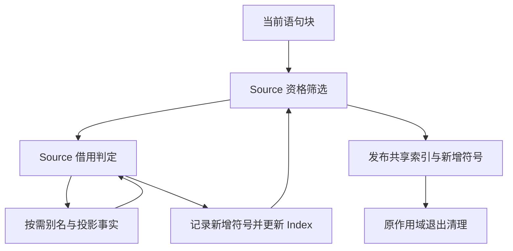
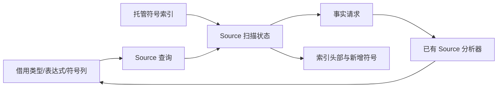

# 局部值借用与栈登记自举

## Intent：最终目标

将局部值借用判定、当前语句块的栈符号登记及可空调用借用选择完整迁入 Source，
保留别名/投影分析的惰性、登记顺序、共享符号索引和退出清理契约。

## Data：可用证据

起点 9518180b，工作区干净。值调用策略及基础 AST 已自举，locals.zig 仍持有上述
规则和登记遍历。input_aliases、projections、类型关系、Index 已有 Source 实现。
参数递归 borrow 还有独立缓存与求值职责，本轮不把其迁移状态混入局部登记完成度。

## Edges：边界与限制

- register 只扫描当前 Block 的 Constant，正序处理；不递归子块、不处理 Destructure。
- 资格顺序保持 selected→Object/输出后代→已有成员→borrowed；先 added.push，再 insert。
- borrowed 保留 represented 早退、Call 的 external/constructed 判断，随后只对五类
  投影检查 inputProjection→Aliases→Projections；仅缺失时由 RX 调用已有分析器。
- RX 内部按阶段继续同一候选，不重复登记，不重复执行已完成的资格判断。
- Index 保留托管布局，通过 stack_symbols.current() 发布，维持继承作用域共享头部；
  返回仅本轮新增符号，原调用者继续退出清理。不宣称 OOM 后事务回滚。
- Scope.binding.borrow 特例继续归 Scope，不混入普通 const 的 borrowed 规则。
- optionalCall 保留缓存/标记与类型/共享短路顺序，宿主只执行获准的 borrowInvocation。
- 不复制整表、不新增语法或专用语义桥；不新增测试，集中验收并统一提交推送。

## Answer：交付与成功标准

正式 locals 的规则、遍历和新增符号状态来自 Source，Native 只借用事实、发布索引
与只读事实缓存，并执行获准的调用。产物与行为保持，无累计性能退化；英文提交推送，工作区干净。

## 执行与自我复核

### 实现

- candidate/advance 只扫描当前 Block 的 Constant，保持声明顺序和资格筛选顺序；
  borrowed=false 时先追加新增列表，再更新已有 core Index。只返回本轮新增符号。
- borrowed/input_projection 统一原有借用规则。resolve.rx→resume.rx/project.rx
  按需直接调用已有别名与投影 RX 分析器；阶段标记跳过已完成的 inputProjection
  和别名判断，命中别名后不触发投影分析。
- 每个候选保留已计算的两张缓存表；Native 只借用事实、发布缓存与共享 Index，并
  执行 Source optional 谓词获准的 borrowInvocation，没有 Native 分析调度循环。
- optional 保留入口标记、缓存、normalize/renew、Optional Call、represented、
  Object/Tuple child、共享关系和 value_functions 的短路顺序。
- 跨生成 bundle 的 Index 通过既有 columns.view 重建描述符，保留 storage 与容量；
  仍写入 stack_symbols.current()，没有把继承作用域复制成独立索引。
- 原实现保留在 locals_seed.zig；Scope.binding.borrow 特例保持原职责，未混入查询。

### 语义与生命周期复核

借用类型、表达式、Control 和符号列；Native 局部描述符覆盖同步调用，Source 不把
这些临时描述符存入长期结果。已有 bool 缓存以 plain 头部进入，只读消费；新缓存由
Lower allocator 持有，发布时仅提取 items，不复制事实表。

生成复核确认 Walk.index 使用私有托管 State，未冻结为 raw Index；循环入口对两列
Index 的既有 renew 不位于逐候选路径。resolve 未见 descriptor create/dupe，optional
完整查询闭包未见分配。索引增长、首次别名/投影分析及新增符号列表仍按需分配，
不将整个 register 误称为零分配。

OOM 仍中止整个 Lower；本阶段不承诺撤销已经发生的底层容量变化。正常完成后，
原 statements/scope 调用者继续按新增列表执行退出删除，登记与清理契约保持。

### 验证证据

- 第一代工具构建 39/39、正式工具构建 21/21 步骤通过。
- 两代产物核对：main 2704、collections 64、growth 310 个文件分别一致，唯一
  差异为 `.zxc-inputs`。
- 编译器检查 372/372 通过，23/23 步骤；相关行为 1586/1586 通过，700/700
  步骤，共 1958 项。不新增测试。范围覆盖值返回、函数更新、owned input、复合引用、
  不可变列表、嵌套缓冲、Task、统一库、RX Parallel、原生引用和值边界、聚合循环与
  字段所有权。最终日志为 final-compiler-tests.log 和 final-related-tests.log。

### 性能证据

正式生成器使用同一冻结输入：141 个入口、2220 个模块、2268 个文件。
八轮交替测量，剔除首轮；每轮均无复用，计时期间无其他构建。

| 对照              | CPU 中位数     | 墙钟中位数     | 峰值 RSS 中位数            |
| ----------------- | -------------- | -------------- | -------------------------- |
| 阶段前 → 阶段后   | 5.31 → 5.31 秒 | 1.14 → 1.13 秒 | 487276544 → 492273664 字节 |
| 固定基线 → 阶段后 | 5.34 → 5.29 秒 | 1.17 → 1.12 秒 | 493273088 → 491847680 字节 |

阶段配对 CPU 差值中位数 0.00 秒，固定基线 −0.03 秒。阶段 RSS 上浮约 5 MB，
固定基线对照略低，当前数据未见累计增长；不把单组噪声或小幅时间差声称为确定收益。
固定基线 SHA-256 保持
`8f1e7cee1eadb3ea0f6f7150bab951c55672ce294e4fbe7c50d5858723bdd92d`。

阶段产物仅输入追踪文件不同；累计对照的清单与类型差异仍只涉及已核验的 SHA256
接口，精确校验通过，没有整体豁免类型文件。原始证据保存于忽略目录
`.zig-cache/cold-build-analysis/value-locals/`。

### 自我批判

本轮完成 locals 的规则与登记职责，并将惰性分析编排留在 Source；完整参数递归
borrow、Scope 自身资格规则和 Lower 宿主状态仍待迁移。完整自举还需正式传递依赖
审计及约定的阶段自编译，不能以本轮产物一致代替。性能结论只覆盖当前 arm64
工具链与冻结生成输入，不等价于冷 LLVM 构建或其他平台收益。
