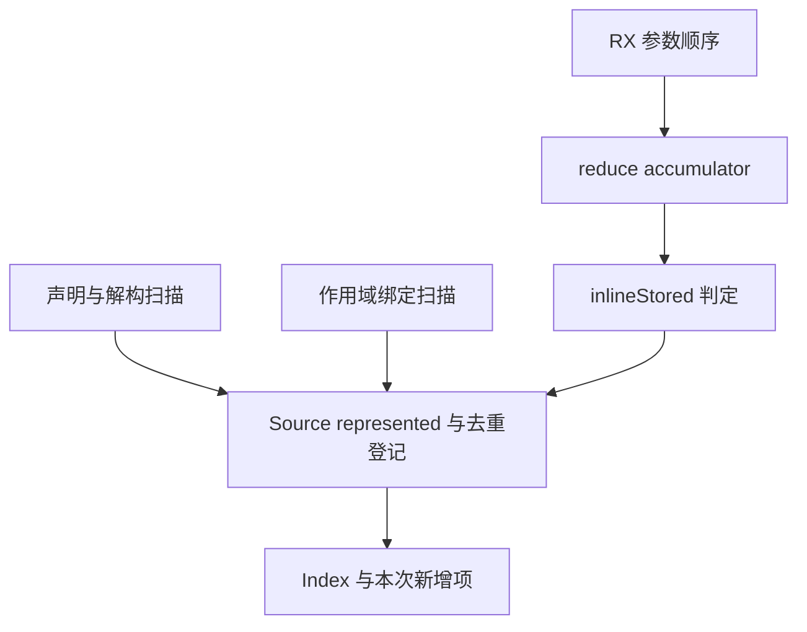
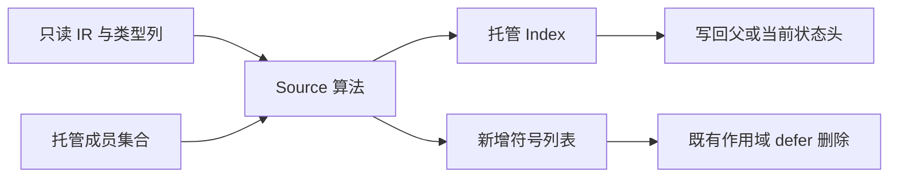

# 局部状态符号登记自举

## Intent：最终目标

将普通声明、解构、作用域绑定与集合回调参数的状态符号筛选和登记迁入 RX/ZX。
保留原顺序、稀疏集合容量及父子 Lower 共享；返回本次新增项用于既有 defer 清理。

## Data：可用证据

起点 94af81b1，工作区干净。locals.zig 三入口仍在正式路径，成员集合与状态类型
查询已经自举。直接借用 Control、Scope symbols、Transform parameters 与类型列。
不构造候选数组或完整 IR mask；新增项列表是作用域退出所必需的 delta。

## Edges：边界与限制

- 参数先登记 reduce accumulator，再按 inlineStored 登记 element；嵌套列表的
  element_storage 与普通对象条件保持，不用 InlineRows 替代。
- Source 使用原 core/integer/index；executeState 输入和输出保留容量许可。
  写回 Members.current 指向的状态头，不能破坏 task/contract 的父集合继承。
- represented 在查询集合前判断；已有成员不进入 added，退出时不得删除继承项。
- OOM 与旧实现一样终止当前 Lower，不承诺事务回滚或在失败后继续使用旧状态头。
- 编排只静态生成普通 Zig；不添加运行库、专用桥或测试用例。
- 布局转换、AST 缓存及其他 Lower 状态仍是后续自举职责，本阶段不代表整体完成。

## Answer：交付格式与成功标准

三个正式入口由 Source 完成筛选和登记，Native 仅借用列及读写容量状态头。
完整功能贯通后集中验证既有行为、两代产物、生成闭包与受影响路径累计性能；
所有未提交内容统一验收、英文提交并推送，确认干净且无未推送提交。

## 执行与自我复核

生成闭包复核发现，首版把 Index 包在未构造的只读 Input.source 中，私有入口仍
需要从 ABI 指针转成托管值，keys/buckets 会变为 plain。修正为每个入口直接携带
Index；只读 Facts、Control 和符号列继续借用，循环另捕获只读依赖，不保留整个
含 Index 的输入。probe 的 executeState 已直接接收和返回原托管 Index 类型。

Native 各入口在调用栈中持有 Facts 与 Elements 描述符，生命周期覆盖同步调用；
没有返回局部描述符指针。返回的新增符号内存属于 Lower allocator。SymbolId
底层 u32 在编译期核对，参数和结果只借用原始 u32 存储，不逐元素复制。

Native 引导构建通过 39/39 步，Source 正式工具构建通过 21/21 步。
两代使用同一清单生成 main 2704、collections 64、growth 164 个文件，均仅
.zxc-inputs 不同；这证明本阶段产物稳定，不代替最终传递依赖审计。

### 成本证据

冻结 141 个入口、2220 个模块；每组交替八轮，排除首轮取中位数。计时在其他
构建和行为检查之前隔离进行，固定 anchor 未重置。

| 对照                 | CPU 秒      | wall 秒     | 峰值 RSS 字节         |
| -------------------- | ----------- | ----------- | --------------------- |
| 阶段前 → 本阶段      | 5.30 → 5.27 | 1.14 → 1.12 | 494501888 → 492945408 |
| 固定 anchor → 本阶段 | 5.37 → 5.32 | 1.18 → 1.15 | 487211008 → 492617728 |

阶段配对 CPU 差值中位数为 -0.03 秒。RSS 各组原始样本约 452～475 MiB，
两组对照中位变化方向相反且分布重叠，不宣称稳定内存收益或稳定退化。
这些数字仅覆盖当前 arm64 生成器，不代表完整冷构建或 LLVM 峰值。

阶段前后 2268 个文件仅 .zxc-inputs 不同。累计对照仅多出先前已验收的 SHA256
流式接口签名及类型清单哈希；沿用精确 ABI 校验，没有豁免整个 types.zig。
固定 anchor SHA256 为
`8f1e7cee1eadb3ea0f6f7150bab951c55672ce294e4fbe7c50d5858723bdd92d`。

实际 executeState 闭包未见无条件全成员复制。首次非空扫描遇到 plain 空集合时，
通用循环 renewal 会为 keys/buckets 各建立一个空缓冲头；inactive 和空遍历没有
此分配，已有 exclusive 列直接复用。当前安全延迟 renewal 只覆盖受保护的直接
ListUpdate，不能未经跨调用写入证明就放开 add/insert Call。保留这项已识别的
小额成本并纳入整轮计时，不伪造 writable 空头或新增预扫描、候选数组来掩盖它。

本地证据位于 `.zig-cache/cold-build-analysis/state-local-registration/`，包含
native.log、production.log、final-runtime-comparison.json、
cumulative-runtime-comparison.json、final-fixedpoint-result.json 及精确校验脚本。
构建产物和日志均不提交。

### 行为验收

编译器既有检查通过 372/372 项（23/23 步）；值返回、函数更新、输入所有权、
复合引用、不可变列表、嵌套缓冲、Task、库运行、RX 并行及原生引用分析/IR 检查
通过 1414/1414 项（631/631 步），合计 1786 项。本阶段没有新增测试。
证据为 final-compiler-tests.log 与 final-related-tests.log。

复核确认只删除本次新增项，继承集合经 current 状态头共享，解构空位、已有符号
和重复候选均保持原语义。正式 Native 只进行列借用、枚举表示转换与状态头回写；
旧登记算法仅保留为 seed。没有将编译成功或两代一致等同于整个 Lower 自举完成。

### 后续边界

静态核对确认普通入站 `.value / .value_layout / .row_value` 连同
`elements.convert(input=true)` 是闭合转换子图：Optional/Object/Tuple 子模式
统一为 value，列表分为 borrowed 包装、连续对象行解引用及 nested-list 递归。
后续可复用现有事件树、AST context、reserve 与 reference slot；不能预先在
Native lower 列表叶子，否则会改变 source/reserve/element/index 的 fresh 顺序。
这项仅完成边界分析，尚未实现；出站、borrow、view 与外围 Lower 状态继续待迁移。
