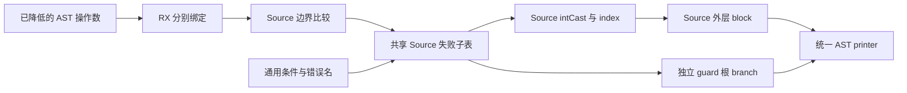
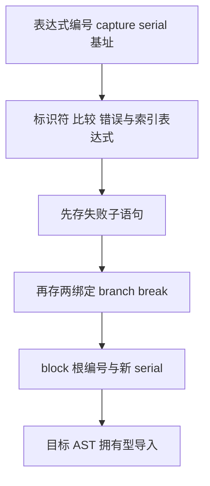

# 带边界检查索引与错误分支自举

## Intent：最终目标

迁移投影发射所依赖的 checked index 与通用 failIf 的完整结构化 AST 生成。
保留操作数的一次求值、顺序、捕获边界、临时名称与全局子表布局。

## Data：可用证据

基线提交 45ab9890。intrinsics.index 先将 values 与 position 分别绑定到两个
operand，再比较 offset >= source.len。失败后返回错误或跳到 capture 边界，
成功路径执行 intCast/index。failIf 同时服务 contracts、列表更新、splice 及
缓冲修改，不能只验证投影消费者。长期固定 CPU 基线约 5.34 秒。

## Edges：边界与限制

- 即使两个 AST 参数编号相同，也保留两个绑定，不合并求值。
- fresh 顺序为 operand、operand、block；failIf 本身不消耗 fresh。
- 失败子表先写入全局，外层两 constant、branch、break 四行随后写入。
- 无 capture 时子表为 return error；有 capture 时为同名 constant 与 break。
- index 的 Source 动态名称拥有型导入；guard 仅借用原有错误名/capture 文本。
- 不改变应用数据表示、分配行为、uses_allocator 标记或普通 Zig 输出形态。
- 完整投影发射及递归缓冲创建/转换仍是后续职责，本阶段不能替代整体自举。

## Answer：交付与成功标准

RX 表达绑定、检查、失败子表、值投影和最终发布；ZX 实现原子构造。
共用失败子表逻辑，补齐通用 ErrorValue 与 Result AST 列能力，不新增模板、
源码片段或 Native 语义回调。集中运行既有索引/错误顺序回归、两代产物对照及
受影响生成路径性能验收，然后提交推送全部变更。

## 自我复核

Source 编译时临时 AST 表与拥有型文本导入存在成本，必须实测，不能仅因输出
一致而假定无退化。scratch 的父 arena 实际回收仍由工作区生命周期决定。
禁止为移植而简化原捕获规则或借用会随 scratch 释放的 fresh 名称。

## 验收证据

证据目录 `.zig-cache/cold-build-analysis/checked-index/`，日志及 JSON 本地忽略。

- Native 首代构建 38/38，Source 生产构建 20/20。
- 20 个修改的 Source 文件均格式化且 lint 通过；新增 ZX 最长 61 行。
- 编译器检查 372/372；相关回归 649/649 步、2,109/2,109 项，共 2,481 项通过。
  相关目标包括 function-analysis、value-return、function-updates、zx-tasks、
  typed-try-runtime、string-index、loop-columns、evaluation-order 与 contracts。
  没有新增测试用例，行为证据均来自既有回归。
- 两代主模块各 2,556 文件，集合模块各 50 文件，仅 `.zxc-inputs` 身份记录不同。
- 固定输入 141 入口、2,220 模块、1,982 函数文件，前后各 2,268 文件，
  逐文件 SHA-256 仅 `.zxc-inputs` 不同。

相同工具链、resident=0、无并发构建下四组交替测量；保留首次样本，
后面三组中位数如下。原始记录在 runtime-comparison.json。

| 指标     |    上阶段终版 |    本阶段终版 |      变化 |
| -------- | ------------: | ------------: | --------: |
| CPU      |        5.35 s |        5.33 s |   -0.02 s |
| 墙钟     |        1.19 s |        1.17 s |   -0.02 s |
| 峰值 RSS | 492,453,888 B | 493,010,944 B |     +0.1% |
| 工具大小 |   6,032,704 B |   6,051,056 B | +18,352 B |

相对未重置的长期 CPU 基线约 5.34 秒，累计差异约 -0.01 秒。当前证据未显示
累计退化；这些小幅差异不作为稳定加速或内存收益。本测量仅覆盖固定输入
生成器，不代表完整冷构建的 LLVM 时间与峰值内存。

## 交接边界

index 与 failIf 正式路径的规则、命名和结构化 AST 构造已迁至 Source，首代引导
仍保留 seed。Native 只组装请求、管理 scratch、导入 AST、同步 serial，并继续
承载 AST 物理存储；这些过渡边界不等于自举完成。递归投影发射依赖已进一步
减少，但其自身及缓冲创建/转换仍需迁移。
