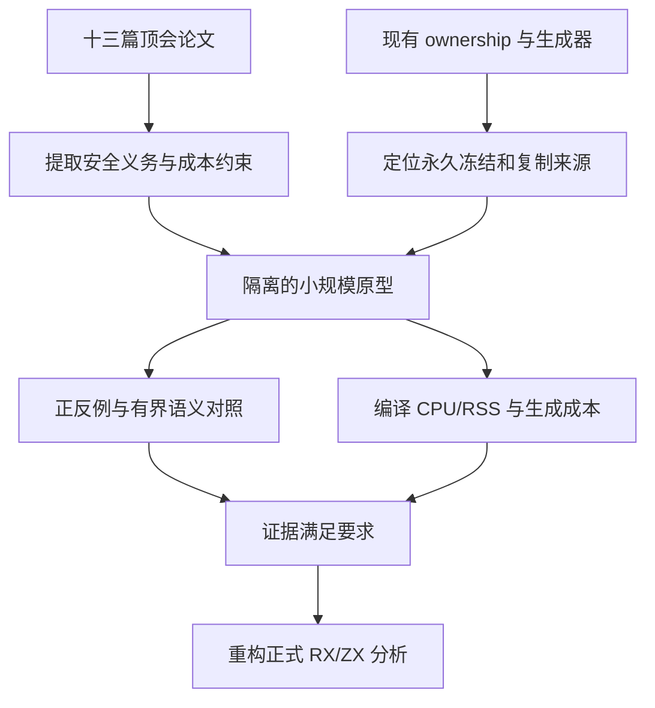

# 所有权分析论文与小范围验证

## Intent：最终目标

减少已经结束使用的视图对来源的限制，减少可避免的数据复制和所有权误拒绝；
维持无需生命周期标注、不可变语义、zero runtime、zero copy 和低编译成本。

用户明确要求：先收集至少十篇相关顶尖论文，再做小范围验证；方案与性能满足要求后，
才能重构正式所有权分析。当前处于论文收集和现状诊断阶段，尚未重构正式分析器。

## Data：可用证据

### 当前实现

- `ownership/runtime/execute/calls.zx` 在 CallResult 释放新增临时 loan；借用返回值和
  可写 Store 会触发保留借用。这是现有行为，不需要用户写生命周期参数。
- `ownership/runtime/execute/scope.zx` 的只读引用绑定执行永久 borrow，再 Freeze。
- `ownership/facts/rewrite/state.zx` 将 Owned/Loaned 降为 Borrowed；释放操作只恢复
  Loaned，不能恢复 Borrowed。ScopeFinish 丢弃快照，没有按别名最后使用恢复来源。
- `ownership/runtime/model.zx` 没有 borrower→source 关系和每笔 loan 的存活记录。
  因此不能把 permanent 改成 false，或将 Borrowed 无条件改回 Owned。
- Place/layout 已有字段路径；borrowing/query 能识别精确 Field/TupleField 投影。
  genz 的 scope/reads 有最后读取算法，但其 binding 粒度不构成别名未逃逸证明。
- `ownership/runtime/snapshots/save.zx` 通过 concat 保存完整 facts/memo；这是另一个
  需要计量的分析成本点，不能与“死借用”直接混成同一原因。

### 内存归因边界

此前无探针生成器测量为约 495 MB RSS；Zig 后端单进程约 2.2 GB 是另一个测量对象。
见[工作区生命周期记录](生成器工作区生命周期与峰值收口.md)。当前冻结输入生成器
约 492 MB；这些数字不是本轮完整冷构建的新测量。

死视图可能使对象存活更久、失去复用机会，但目前没有证据证明它解释了 LLVM 的
数 GB 峰值。需要分别测量分析快照、生成的复制/分配、实际存活对象和后端 IR 成本。

### 论文筛选

以下十三篇均为 POPL、PLDI、OOPSLA、ICFP 正式论文。按问题相关性选择，不能声称
存在“全球最顶尖”的客观全排序。优先研究近期工作，基础论文用于安全契约和成本边界。
每条“用于 zxc”都是本项目推论，不等同于论文已经证明 zxc 实现正确或性能更好。

| 编号 | 论文                                                                                                          | 会议/年份   | 首要用途                 |
| ---- | ------------------------------------------------------------------------------------------------------------- | ----------- | ------------------------ |
| 1    | Fully-Automatic Type Inference for Borrows with Lifetimes                                                     | OOPSLA 2026 | 无标注借用推导           |
| 2    | When Lifetimes Liberate: A Type System for Arenas with Higher-Order Reachability Tracking                     | OOPSLA 2026 | arena 与资源存活分组     |
| 3    | Tracking Borrows with Regular Expressions                                                                     | OOPSLA 2026 | 字段路径、循环借用摘要   |
| 4    | From Linearity to Borrowing                                                                                   | OOPSLA 2025 | 借出与权限恢复的语义     |
| 5    | Tree Borrows                                                                                                  | PLDI 2025   | 别名优化的安全约束       |
| 6    | Oxidizing OCaml with Modal Memory Management                                                                  | ICFP 2024   | 独占性、局部性与栈分配   |
| 7    | Polymorphic Reachability Types: Tracking Freshness, Aliasing, and Separation in Higher-Order Generic Programs | POPL 2024   | 按需可达性与函数摘要     |
| 8    | Sound Borrow-Checking for Rust via Symbolic Semantics                                                         | ICFP 2024   | 分支合并和循环安全       |
| 9    | Reference Counting with Frame Limited Reuse                                                                   | ICFP 2022   | 防止为复用滞留过多内存   |
| 10   | Perceus: Garbage Free Reference Counting with Reuse                                                           | PLDI 2021   | 最后使用与不可变数据复用 |
| 11   | Reachability Types: Tracking Aliasing and Separation in Higher-Order Functional Programs                      | OOPSLA 2021 | 嵌套对象依赖关系         |
| 12   | Stacked Borrows: An Aliasing Model for Rust                                                                   | POPL 2020   | 明确指针别名优化契约     |
| 13   | RustBelt: Securing the Foundations of the Rust Programming Language                                           | POPL 2018   | 原生边界与安全扩展证明   |

#### 1. Fully-Automatic Type Inference for Borrows with Lifetimes

William Brandon、Benjamin Driscoll、Frank Dai、Jonathan Ragan-Kelley、Mae Milano、Alex Aiken。
[作者说明](https://www.languagesforsyste.ms/publication/fully-automatic-type-inference/)，
[正式出版](https://doi.org/10.1145/3798221)，[项目](https://morphic-lang.org/)。

自动推导借用与生命周期，不要求用户标注；不能完成推导的程序可插入引用计数操作。
用于 zxc：借鉴自动推导和调用摘要；不能直接引入其 RC 兜底，因为 zxc 的运行时约束不同。
当前已核对作者摘要、正式元数据和项目说明；出版方 PDF 返回 403，未声称全文精读。

#### 2. When Lifetimes Liberate

Siyuan He、Songlin Jia、Yuyan Bao、Tiark Rompf。
[正式出版](https://doi.org/10.1145/3798254)，
[作者全文 v3](https://arxiv.org/pdf/2509.04253)。

区分单独资源、词法作用域资源和 arena 分组资源，通过可达性保证安全。
用于 zxc：分别推理可借用期与整块 arena 回收时机；不能根据一个视图死亡就释放含有
其他活对象的 arena，也不为采用论文引入新的用户语法。

#### 3. Tracking Borrows with Regular Expressions

Todd Nowacki、Sam Blackshear、John Mitchell、Shaz Qadeer、Ilya Sergey。
[作者全文](https://ilyasergey.net/assets/pdf/papers/regex-borrows-oopsla26.pdf)，
[正式出版](https://doi.org/10.1145/3839521)，
[作者实现](https://github.com/ilyasergey/lean-move/tree/oopsla26-artefact)。

以正则语言表达字段访问路径，用导数、路径闭包和空语言检查组织借用推理。
用于 zxc：借鉴路径摘要，评估是否比逐点整表快照更省；Move 对引用存入数据结构
有限制，不能未经证明照搬到允许嵌套引用的 ZX。原型先用精确路径，不急于引入正则求解器。

#### 4. From Linearity to Borrowing

Andrew Wagner、Olek Gierczak、Brianna Marshall、John M. Li、Amal Ahmed。
[作者全文](https://johnm.li/from-linearity-to-borrowing.pdf)，
[正式出版](https://doi.org/10.1145/3764117)。

从线性资源逐步建立不可变借用、词法生命周期、再借用与可变借用的语义。
用于 zxc：明确暂时禁用哪些权限、何时能恢复；结束借用不能恢复借出前就不存在的
独占资格。其词法模型本身不提供最后使用分析算法。

#### 5. Tree Borrows

Neven Villani、Johannes Hostert、Derek Dreyer、Ralf Jung。
[作者项目与全文入口](https://plf.inf.ethz.ch/research/pldi25-tree-borrows.html)，
[正式出版](https://doi.org/10.1145/3735592)。

用树形别名模型定义 Rust unsafe 内存访问允许的优化，兼顾更广的合法访问模式。
用于 zxc：作为“恢复独占权限后能否复用”的安全审查材料；它是操作语义与别名模型，
不是直接替换静态 liveness 的算法。本轮已核对作者与会议说明，全文仍需补读。

#### 6. Oxidizing OCaml with Modal Memory Management

Anton Lorenzen、Leo White、Stephen Dolan、Richard A. Eisenberg、Sam Lindley。
[作者全文](https://antonlorenzen.de/oxidizing-ocaml-modal-memory-management.pdf)，
[正式出版](https://doi.org/10.1145/3674642)。

将 affinity、uniqueness、locality 分开推理，支持安全栈分配和不可变结构原地更新。
用于 zxc：不要把“只读借用结束”“具有独占资格”“可栈分配”合并成一个标记；
现有生成器若因布局或共享成员不能复用，单独缩短 loan 并不足够。

#### 7. Polymorphic Reachability Types

Guannan Wei、Oliver Bračevac、Songlin Jia、Yuyan Bao、Tiark Rompf。
[作者全文](https://continuation.passing.style/static/papers/popl24.pdf)，
[正式出版](https://doi.org/10.1145/3632856)。

保留一步可达关系，仅在需要时计算传递闭包，处理新鲜性与可达性多态。
用于 zxc：优先记录稀疏 borrower→source 边，冲突点才查询；避免每个程序点复制
完整别名闭包。如何实现可恢复 loan 和分支合并，仍需本项目单独验证。

#### 8. Sound Borrow-Checking for Rust via Symbolic Semantics

Son Ho、Aymeric Fromherz、Jonathan Protzenko。
[作者全文](https://arxiv.org/pdf/2404.02680)，
[正式出版](https://doi.org/10.1145/3674640)。

建立借用中心的符号语义及其与具体指针语义的联系，支持 join 和循环分析。
用于 zxc：借鉴分支合并的安全义务和循环不动点；不直接引入完整符号执行，避免
分析状态和编译成本膨胀。

#### 9. Reference Counting with Frame Limited Reuse

Anton Lorenzen、Daan Leijen。
[作者全文](https://www.microsoft.com/en-us/research/wp-content/uploads/2023/07/flreuse.pdf)，
[正式出版](https://doi.org/10.1145/3547634)。

指出复用分析可能因为保留候选对象而显著增加峰值空间，并提出 drop-guided reuse。
用于 zxc：复用候选应受存活边界约束；减少复制的优化必须同时检查峰值内存，不能
通过保留大量旧 buffer 换取较低的复制计数。RC 机制不直接移植。

#### 10. Perceus: Garbage Free Reference Counting with Reuse

Alex Reinking、Ningning Xie、Leonardo de Moura、Daan Leijen。
[作者出版页](https://www.microsoft.com/en-us/research/publication/perceus-garbage-free-reference-counting-with-reuse-2/)，
[作者扩展全文](https://www.microsoft.com/en-us/research/wp-content/uploads/2020/11/perceus-tr-v4.pdf)。

在显式控制流中精确放置引用计数和复用，服务于不可变语言的原地执行。
用于 zxc：最后使用必须与复用共同考虑；借鉴分析顺序，不添加专用引用计数运行库，
也不将其基准收益当作 ZX 的收益。

#### 11. Reachability Types

Yuyan Bao、Guannan Wei、Oliver Bračevac、Yuxuan Jiang、Qiyang He、Tiark Rompf。
[作者全文](https://continuation.passing.style/static/papers/oopsla21.pdf)，
[正式出版](https://doi.org/10.1145/3485516)。

用可达集合表达高阶值之间的共享和分离，为移动和所有权转移提供依据。
用于 zxc：借用关系需要跟随对象字段、元组和返回值传播；仅检查别名变量名的最后
出现位置不充分。泛型部分需结合第七篇，不能照搬早期模型。

#### 12. Stacked Borrows

Ralf Jung、Hoang-Hai Dang、Jeehoon Kang、Derek Dreyer。
[作者全文](https://plv.mpi-sws.org/rustbelt/stacked-borrows/paper.pdf)，
[正式出版](https://doi.org/10.1145/3371109)。

定义 Rust 内存访问的别名操作语义，使编译器重排具有可陈述的前提。
用于 zxc：审查借用结束后的复用是否仍有可观察旧别名；它不能单独证明静态分析
能接受更多程序，原生模块也不能被默认视为不保留输入。

#### 13. RustBelt

Ralf Jung、Jacques-Henri Jourdan、Robbert Krebbers、Derek Dreyer。
[作者项目](https://plv.mpi-sws.org/rustbelt/popl18/)，
[作者全文](https://plv.mpi-sws.org/rustbelt/popl18/paper.pdf)。

为 Rust 核心及 unsafe 库建立可扩展的安全基础。
用于 zxc：精化函数摘要不能越过原生接口契约；外部代码可能保留引用时，必须保留
保护或显式证明不逃逸。该形式化框架不是低成本编译实现的直接蓝图。

### 辅助工程材料，不计入十三篇论文

- [Rust NLL RFC](https://rust-lang.github.io/rfcs/2094-nll.html)：基于控制流存活点
  推导借用期限；特别注意分支、无出口循环与析构使用。
- [Rust 2026 Polonius Alpha 说明](https://blog.rust-lang.org/2026/08/04/enabling-polonius-alpha-on-nightly/)：
  提高流敏感精度有实际编译成本，部分最坏输入仍明显变慢；不能默认新算法免费。

## Edges：边界与限制

1. 不引入生命周期标注、专用运行库、动态借用检查、RC/GC 兜底或隐式数据复制。
2. 所有最终自有规则和状态仍由 RX/ZX 承担，不能用新原生专用桥绕过自举。
3. 对输入借用的资格、可释放数据、所有权转移与可原地复用分别建模。
4. 返回值、Store、Task、Parallel、未知原生调用、再借用、父子/兄弟字段重叠都要
   显式覆盖；不能以处理直线代码的原型推断完整所有权分析已正确。
5. 先拿真实计数区分全表快照、持久化事实、未结束 loan、布局复制与 LLVM 后端。
   不将所有 GB 峰值归因一个机制，也不重跑无关整机冷构建。
6. 只有原型给出精度收益及可控成本后才重构正式分析器。原型结果不能被伪装成
   已部署功能；保守边界要记录具体原因，不能静默恢复 Owned。

## Answer：交付与成功标准

论文集、现状根因、候选设计、原型实验和决策证据在本文件持续维护；不为每次观察
新增阶段文档。公开代码与复现材料的链接保留，原文不纳入 Git。

### 首轮候选，不是既定重构方案

优先验证“按需稀疏依赖 + 最后使用结束 loan”，与现有字段路径结合；同时测量
快照的增量保存是否有独立收益。不立即采用全程序 Datalog、通用正则求解器或
完整符号执行，也不直接替换整套 ownership。

最小原型先处理函数内直线、精确 Reference/Field/TupleField 的只读别名，保留
借出前资格及每个活跃依赖；多个别名要全部结束才能恢复。返回、存入对象、传递给
可能保留输入的函数、Store/Task/分支/循环先保留保护，同时记录其未支持原因。
后续扩大范围必须有对应语义证明与测试，不能让窄原型成为最终目标的替代品。

### 小范围实验顺序

1. 构造现状对照：死视图后消费来源、仍活视图、兄弟字段、多别名、别名链、
   重新赋值、返回视图、对象内视图、分支、循环、Task/Store 和错误出口。
2. 使用独立具体存储模型做有界执行对照，枚举小程序与路径，检查所有放行程序
   不会读取已复用/释放的旧存储。不能只断言新分析的输出与自身实现相符。
3. 对精度改善的真实 ZX 小例，检查前端是否减少误拒绝，生成 Zig 是否实际减少
   数据复制/分配；不要把描述符复制计为数组数据复制。
4. 分别测分析耗时、临时峰值/累计分配、生成器 CPU/RSS 和实际运行峰值；对
   函数大小、别名宽度、嵌套深度增加做趋势检查，避免位置×全部借用的稠密矩阵。
5. 使用相同输入/工具链交替比较；保持现有固定基线，遵守累计 0.02 秒 CPU、
   0.1 秒耗时容差与趋势要求。小例分析时间另报，不能只用总时间掩盖局部平方增长。
6. 确认后才迁入正式 Source ownership，运行既有行为和自编译验收，完整阶段
   统一提交推送。没有精度或成本收益则保留证据，调整候选而非强行重构。

### 当前状态与自我批判

论文元数据和主要机制已收集；十一篇可直接访问的全文已下载至忽略目录
`.zig-cache/cold-build-analysis/ownership-research/papers/`，来源、字节数与 SHA-256
记在同目录上级的 `papers.json`。原文不提交到仓库。部分全文仅阅读了相关段落，
未完成逐篇证明审查。
第一、第五篇当前主要依据作者页面，采用其具体算法前还需补全文与实现。
尚未运行新的所有权原型，也未声称减少了复制或冷构建内存。下一步先做最小反例和
成本计数，再决定借用关系表示；论文中的安全证明不能自动迁移到 ZX。
