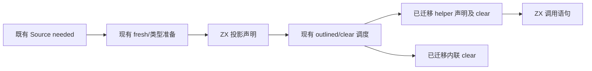
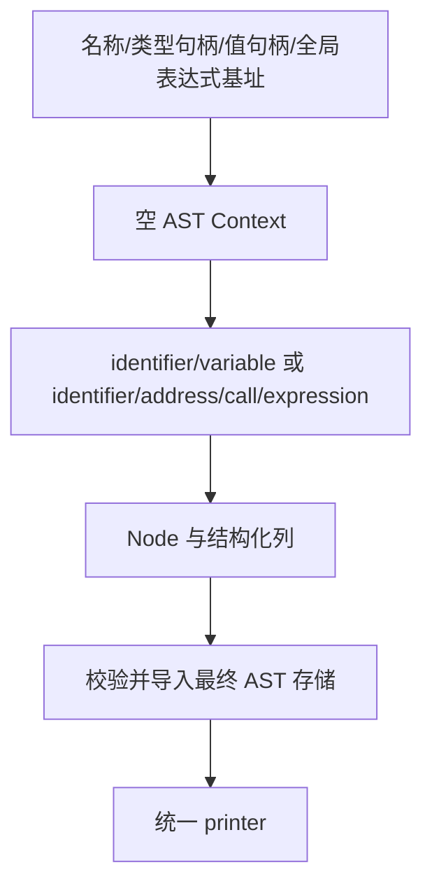

# 所有权投影与调用自举

## Intent：最终目标

将所有权投影的局部变量声明、标识符、辅助函数调用与表达式语句构造迁入 ZX。
复用结构化 AST 原语及统一 printer，保留不可变值的共享、求值次序与生成结果。

## Data：可用证据

上一阶段已迁移 helper 参数与函数声明；正式路径仍在 ownership.zig 手写投影变量，
outlined.zig 手写 identifier/address/call/expression。现有 Context 已具备所有必要
原语；这里没有通用语言能力缺口，不需要新增语法或专用原生语义接口。

投影声明按 identifier、variable 构造；调用按 callee identifier、address、call、
expression 构造。类型句柄准备只修改类型及 AST 表，不求值用户表达式；正式路径
先获得类型句柄再交给 Source 构造，不改变 fresh 序号或生成语句的执行顺序。
现有 Lower.call 的额外 allocator 检查对静态 helper 名称与 address 参数不适用。

## Edges：边界与限制

- 原逻辑只留在 seed 分支。正式路径直接消费 ZX 返回的 Context/Node。
- Native 仅借用输入与导入 AST，参数列表记录拥有最终存储，名称文本继续借用
  Lower allocator 的长期存储；scratch 只持有临时列和描述符。
- 名称生成、哈希、声明查重、类型句柄准备、clear 与 outlined 的外层调度仍待迁移。
  不将这两个内聚 AST 操作称作整个所有权流程自举完成。
- 不新增测试。按受影响的生成路径验证两代产物、既有行为及阶段/固定基线成本。

## Answer：交付与成功标准

正式投影与调用不再手写 AST。seed/Source 构建、两代产物与相应既有检查通过；
冻结 manifest 的阶段前后与固定 anchor 对照无累计退化。记录生命周期核对及
仍未迁移的职责，统一提交推送全部变更，确认工作区干净且无未推送提交。

## 执行记录

已接通两个 Source 构造入口及统一 Node 导入适配。Seed 构建通过 39/39 步，
Source 正式工具构建通过 21/21 步。两代生成的 main 2704 个文件、collections
50 个文件、growth 123 个文件均仅输入标识不同；编译器 372/372 项检查通过。
六组相关行为检查通过 350/350 步、1124/1124 项，合计通过 1496 项。

### 生成代码与生命周期

实际 growth 生成入口 ownership_projected 的两个名称引用、ownership_helper_invoke
的一个名称引用均直接包装 `in.name`。公开 ABI 转换不复制文本；底层 identifier、
variable 原语只追加文本切片描述符。调用参数列表的描述符在导入时获得最终拥有
的记录存储。Native statement importer 借用名称，其原始存储来自 Lower allocator，
不引用临时 AST 列；scratch 可在每次构造完成后释放。

### 性能证据

性能对照在其他构建和行为检查之前隔离执行。冻结 manifest 为 141 个入口、2220
个模块；每组交替八轮，排除首轮取中位数。两组产物的 2268 个文件均仅输入标识
不同，未改变生成形态。

| 对照                 | CPU 秒      | wall 秒     | 峰值 RSS 字节         |
| -------------------- | ----------- | ----------- | --------------------- |
| 阶段前 → 本阶段      | 5.30 → 5.32 | 1.14 → 1.14 | 490110976 → 492437504 |
| 固定 anchor → 本阶段 | 5.37 → 5.34 | 1.20 → 1.17 | 495403008 → 496173056 |

阶段增量在既定容差内，相对固定 anchor 没有累计 CPU/耗时退化；小幅 RSS 变化
不作为稳定收益或持续增长的证据。本轮没有重置固定基线，anchor SHA256 保持
`8f1e7cee1eadb3ea0f6f7150bab951c55672ce294e4fbe7c50d5858723bdd92d`。
这些数字仅覆盖生成器，不代表完整冷构建或 LLVM 阶段。

原始证据在 `.zig-cache/cold-build-analysis/ownership-projection/`：native.log、
production.log、final-runtime-comparison.json、cumulative-runtime-comparison.json。
两代和行为记录为 final-fixedpoint-result.json、final-compiler-tests.log、
final-related-tests.log，均属于忽略规则排除的本地证据，不提交构建产物或日志。

### 自我复核

本次消除了正式路径中的投影和调用 AST 手写构造，没有新增专用运行库或语义
回调。两个 ZX 入口各实现一个内聚 AST 操作，没有用无意义 RX 转发包装它们；
跨阶段的 needed/投影/outlined/clear 编排仍在 Native，后续必须迁入真实 RX。
Native 适配与外层流程仍然存在，阶段通过不能证明所有权模块已完整自举。
