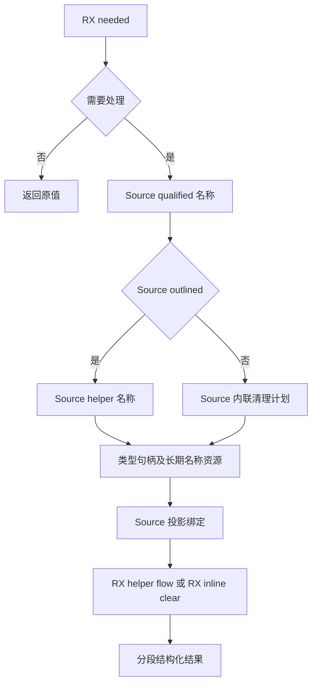
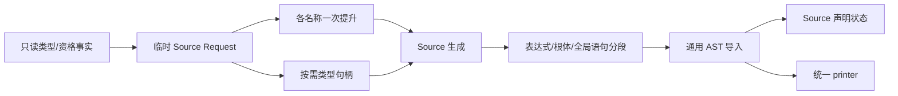

# 所有权投影流程自举

## Intent：最终目标

将 projected 的 needed、临时名称、outlined/inline 选择、绑定与清理连接迁入 RX/ZX。
Native 只准备类型句柄、提升需要长期持有的名称并导入结果，保持值共享和生成顺序。

## Data：可用证据

helper/flow 已在 RX 完成查重、清理、声明及调用；projected 仍由 Native 判断 needed、
fresh、绑定、选择 helper 或内联。本轮复用这些已有原语，不重写清理算法。

类型 AST 句柄由现有物理缓存按需提供，名称又需要覆盖 AST 生命周期，因此采用
Source 规划、资源准备、Source 生成。规划返回 qualified/helper 名称和可选内联计划；
Native 对每个新名称只复制一次，随后 AST 标识符与变量声明借用该长期文本。

## Edges：边界与限制

- Source 决定是否需要操作以及选择哪条生成路径；Native 的可选结果判断只应用
  资源请求。类型缓存、AST 存储及声明状态宿主持有仍属于过渡边界。
- 规划与生成使用同一份只读事实；所有类型资源解析后才借用 AST，避免扩容导致
  描述符失效。布局仅为内联 Reference 节点解析，不预构造所有类型表达式。
- qualified 的 serial 先更新，清理继续使用更新后的值，保持原来的 fresh 顺序。
- 增加通用 resetSha256，使宿主可仅提供栈空间，由 Source 在真正需要 helper
  名称时初始化；更新和 final 仍要求已初始化且独占的通用哈希状态。
- 根语句分段导入：投影变量借用已提升名称；清理体拥有化复制其临时文本。
  全局语句、引用存储与 root body 的载荷列分别处理，不混淆 offset 命名空间。
- 不新增测试。先贯通实际消费者，再按受影响路径集中验证产物、行为及固定
  累计性能；完整所有权和编译器自举仍需核对传递依赖与最终多阶段自编译。

## Answer：交付与成功标准

正式 projected 不再在 Native 中调度 needed、fresh、helper 或 inline。原值直通、
声明顺序、分支惰性和文本生命周期保持；两代与前后产物一致，既有相关检查通过，
无累计性能退化。全部变更统一提交推送后确认干净且无未推送提交。

## 执行记录

已接通 plan/build 两个 RX 入口，projected 原生入口只选择 seed 或资源适配器。
旧 helper、naming、outlined 正式 Native 控制文件已删除，原逻辑保留在 seed。
Seed 构建通过 39/39 步，Source 正式工具构建通过 21/21 步。

### 生命周期与语句范围复核

只读审计确认两个名称提升后实际传给 emitter，没有继续借用 Request 的 scratch
字节。binding、清理存储及 body 分别配对各自 Variables；binding 只进入调用者
flat body，不写入 global statements。即使 body 指向 reference_storage 本体，
也保持 binding、storage、body 的追加次序。serial 在 qualified 后推进，类型
句柄准备完成后才借用 AST。reset 先完整初始化 Hash，再发生 update/digest。

### 性能与产物证据

冻结输入为 141 个入口、2220 个模块；每组交替八轮，排除首轮取中位数，先于
其他构建及行为检查隔离测量。结果如下，不重置固定累计基线：

| 对照                 | CPU 秒      | wall 秒     | 峰值 RSS 字节         |
| -------------------- | ----------- | ----------- | --------------------- |
| 阶段前 → 本阶段      | 5.28 → 5.31 | 1.13 → 1.15 | 495304704 → 495386624 |
| 固定 anchor → 本阶段 | 5.36 → 5.30 | 1.18 → 1.14 | 495419392 → 487866368 |

阶段 CPU 的两个样本集中位数之差为 0.03 秒；七轮配对差值中位数为 0.02 秒，
处于既定容差边界。两项都保留，不用配对指标隐藏集中位数的增长。固定基线
CPU/耗时仍有改善；Source 名称格式化复用现有整数 printer，没有证据支持在此
重复改算法或反复计时。后续继续同时跟踪阶段与累计趋势，容差不逐次重新领取。
RSS 小幅变化不视为稳定收益。这些计时仅覆盖当前 arm64 生成器。

固定 anchor SHA256 保持
`8f1e7cee1eadb3ea0f6f7150bab951c55672ce294e4fbe7c50d5858723bdd92d`。
前后 2268 个文件中的函数实现一致，types.zig 仅新增 resetSha256 签名，清单仅
同步类型文件哈希。相对旧 anchor 的 ABI 增量也只包含已说明的四个流式接口，
校验脚本逐项剔除预期结构后核对剩余类型文本，没有豁免整个 types.zig。

两代生成 main 2704、collections 50、growth 164 个文件均仅输入标识不同。
本地证据在 `.zig-cache/cold-build-analysis/ownership-projection-flow/`：native.log、
production.log、final-runtime-comparison.json、cumulative-runtime-comparison.json、
validate_abi_additions.py、final-fixedpoint-result.json，构建产物和日志不提交。

### 既有行为检查

编译器检查通过 372/372 项；所有权、值返回、不可变列表、嵌套缓冲区、Task、
库运行、RX 并行以及原生引用分析/IR 检查通过 1414/1414 项（631/631 步）。
密码接口的既有分配与 AEAD/HMAC 检查通过 2/2 项，合计 1788 项。
对应 final-compiler-tests.log、final-related-tests.log、final-crypto-tests.log，
均使用本阶段正式 Source 工具或其生成接口；没有新增测试用例。

### 自我复核与剩余边界

规划负责真实语义选择，资源适配不重新计算 needed、fresh 或 outlined。Source
生成复用 helper/flow 和 clear/build，根语句按所有权分段，没有拼接 Zig 源码。
类型 AST 缓存解析、Source 状态的宿主持有、全局 AST 存储以及外围 Native 表达式
调度仍是过渡依赖；本阶段不能证明整个所有权依赖闭包或编译器已经完成自举。
