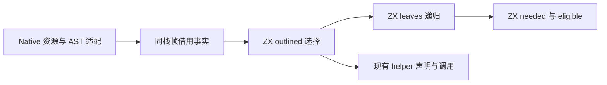
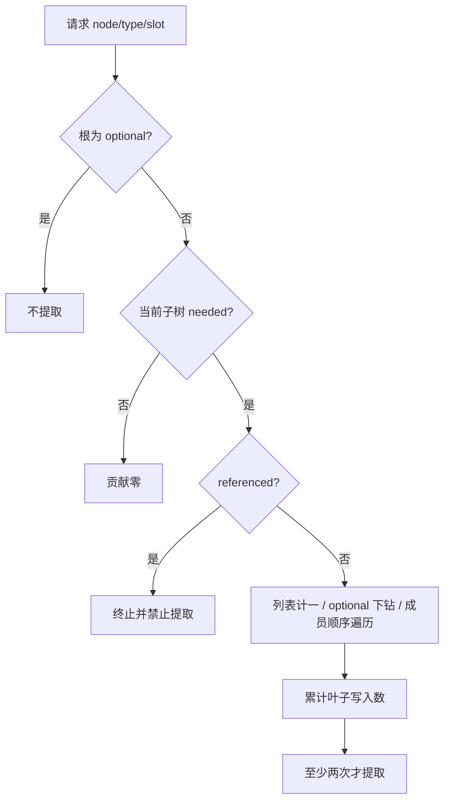

# 所有权裁剪专门化选择自举

## Intent：最终目标

将 outlined helper 的完整选择判定迁入 ZX，保持原有递归、短路、成员偏移和
至少两次写入的选择门槛。继续完整自举，不把判定迁移等同于整个所有权生成器完成。

## Data：可用证据

原实现位于 genz/src/zx/state_value/ownership/outlined.zig：可空根不使用 helper；
递归先判断 needed，不需要的子树贡献零；需要裁剪且 referenced 的节点禁止提取。
列表贡献一，optional 复用原 slot，对象及元组按成员顺序累加 count 和 slot。
任一子树禁止提取时立即终止，不继续推进偏移。needed、eligible 已由 ZX 实现。

原命名哈希按 state_name、零分隔符、逐槽 eligibility 字节串流输入 SHA256；声明
复用、AST 清理及调用仍在 Native。这些是后续待迁移职责，不能当作平台边界豁免。

## Edges：边界与限制

- 本次迁移完整选择职责，命名及 AST 构造不改，避免引入数组来模拟串流哈希。
- Source 直接复用 needed，递归和遍历属于一个内聚算法，不增加空壳 RX 包装。
- Facts、TypeTable 与 referenced 均只读借用；同步适配描述符保持在同一栈帧。
- 正式 executeValue 使用空 FixedBufferAllocator 验证无临时堆分配；不新增缓存。
- 旧算法仅留 seed。规则阈值在职责内 const.zx 导出，不在 Source 业务逻辑中裸写。
- 不新增测试用例，运行既有受影响检查；按实际生成变化做固定输入性能与累计对照。

## Answer：交付与成功标准

正式 helper 选择仅调用生成的 Source 判定，Native 不保留判定捷径。通过 seed/Source
工具构建、对应两代产物核对、既有所有权及值生成检查。固定 manifest 对照所有
产物，并记录当前阶段与已固定 anchor 的 CPU、墙钟及峰值 RSS，不能重设累计基线。
复核源码、生成闭包和实际适配生命周期；统一收口全部变更，提交推送后确认干净。

## 执行与复核

已实现 Source model/const/leaves/outlined，复用既有 growth 生成单元；Native
适配只准备借用请求并执行 executeValue。原叶子计数和阈值选择已移入 seed 文件。

Seed 构建 39/39 步、Source 正式工具构建 21/21 步通过。两代 main 各 2703 文件、
collections 各 50 文件、growth 各 71 文件，均仅 .zxc-inputs 身份标记不同。
编译器 23/23 构建步骤、372/372 项既有检查通过，未新增测试用例。

生成的 outlined 私有执行闭包共 9 个文件，静态检查未见分配、append、renew、
reserve 或 memcpy 标记；实际入口以零容量 FixedBufferAllocator 执行，正式工具
生成固定输入及自编译产物均通过。静态文本检查本身不是全程序零分配证明，此结论
只针对本判定闭包，并结合实际空分配器调用。Facts/TypeTable/source/input 描述符
都在同一同步调用栈帧中存活，输出仅 bool，不逃逸。

## 性能与累计趋势

固定输入沿用 readability-final/cache-closure/manifest.json，141 入口、2220 模块、
1982 个函数文件。八轮交替，保留全部原始样本，以去除每组首轮后的中位数对照：

| 指标     |           阶段前 |           阶段后 |
| -------- | ---------------: | ---------------: |
| CPU      |          5.40 秒 |          5.42 秒 |
| 墙钟     |          1.17 秒 |          1.18 秒 |
| 峰值 RSS | 493,879,296 字节 | 480,247,808 字节 |

阶段 CPU 差异约 +0.02 秒，墙钟 +0.01 秒，位于当前单阶段容差内；不把 RSS 差异
宣称为稳定优化收益。前后各 2268 个文件仅身份标记不同。正式工具体积
6,532,192→6,532,272 字节，不涉及完整冷后端构建的收益声明。

固定累计 anchor 仍为 inbound-conversion/production-bootstrap/bin/zxc-bootstrap，
SHA256 已核实为 8f1e7cee1eadb3ea0f6f7150bab951c55672ce294e4fbe7c50d5858723bdd92d。
同批八轮 anchor/当前对照 CPU 5.34→5.41 秒，墙钟 1.18→1.18 秒，RSS
495,861,760→494,911,488 字节，2268 个文件仅身份标记不同。累计 CPU 差额约
+0.07 秒，与此前热点诊断中记录的累计量级相同，不能按阶段重设基线或重复领取
容差；完整目标仍需继续定位并优化累计成本，不宣称全程性能问题已经解决。

报告位于被忽略的 .zig-cache/cold-build-analysis/ownership-outline/：native.log、
production.log、final-fixedpoint-result.json、allocation-inspection.json、
final-runtime-comparison.json、cumulative-runtime-comparison.json 与对应原始日志。

## 行为检查与自我复核

针对本次选择变化，运行既有 value-return、function-updates、owned-input、
compound-references、immutable-list、nested-buffer 六组检查：350/350 构建步骤、
1124/1124 项通过，连同编译器共 1496 项。复用未改变的历史检查证据，不机械重跑
缓存失效或其他无关场景。完整日志为 related-tests.log。

本次 diff 复核：optional 根提前拒绝；needed 在 referenced 前；无需求子树返回零；
拒绝在子树间传播后不继续累加；有效成员才推进偏移；缺失 counts 仍按零处理。
未改变 helper 的哈希、声明去重、AST 构造和调用顺序。Source 最长 96 行、最长
内容行 71 列，保留语义空行，没有新增运行时或专用语义回调。

本阶段完成的是完整选择职责的逻辑迁移。Native Lower、事实存储/借用适配、
helper 命名和声明生成、clear/projected AST 等仍为过渡依赖；最终还需传递闭包
审计及完整 seed→stage1→stage2→stage3 验收。两代字节一致和通过检查不单独证明
完整自举，也不证明历史累计 CPU 差额已消除。全部变更统一提交推送后继续推进。
