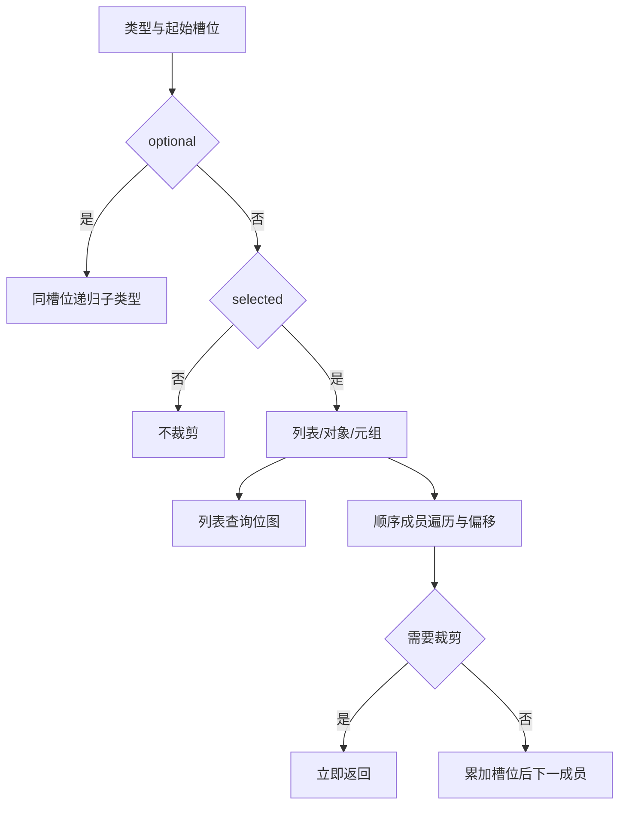

# 所有权裁剪判定自举

## Intent：最终目标

迁移 ownership.eligible 与 ownership.needed 的完整判定规则，正式生成器通过
Source 查询转移位图和递归类型，不改变裁剪、共享、借用或复制行为。

## Data：可用证据

基线 c869eee6。原 eligible 先检查表达式槽位前缀，再查询 u64 位图。needed
先解开 optional，再按 selected 与类型分支；对象和元组保持成员顺序、槽位
偏移，命中第一个需裁剪成员后立即返回。不存在的 slot_counts 项视为零。
现有 Source 类型表及整数/位图能力可表达同一算法。

## Edges：边界与限制

只读事实和类型表直接借用，不复制底层数据或建立每查询缓存表。递归共享
同一 Facts，不逐层重建环境；查询无动态分配，Native 只提供资源描述符。
Source 与 seed 保持相同有效输入契约、短路、偏移和错误顺序。

实际裁剪 AST、outlined 规则及其他 Native 状态仍待后续迁移；本阶段只完成
资格与需求判定，不宣称全部所有权机制或完整自举完成。不新增测试用例。

## Answer：交付与成功标准

正式入口和 seed 连通后集中检查两代及冻结输入产物、相关现有行为、格式
和 lint，测量 CPU/wall/RSS 与固定约 5.34 秒 CPU 基线的累计趋势；若退化，
保留已迁移规则并定位优化，完整收口后提交推送全部变更。

## 初始成本定位与集成调整

初始两代构建通过，八轮固定输入中位数 CPU 5.42→5.44 秒，产物仅工具身份
不同；相对固定约 5.34 秒基线已接近容差边界，暂不提交。临时 native probe
计时完整查询调用，每类最后二次幂样本 32,768 次：needed 54,516 mach ticks、
eligible 4,935 ticks；当前 timebase=125/3 ns，总调用量小于两倍最后样本，
按调用量外推的量级约 5 毫秒。因各查询成本不恒定且没有最终完整总计时，
不能把该外推作为严格全程上界，也不足以独立排除查询成本；没有继续针对数毫秒查询添加缓存或新短路桥。探针已按原字节移除。

Source 规则保留，新增判定入口改为现有 growth 独立生成单元，避免给主单元
追加公开入口。只读事实查询与既有状态生成共用该单元，布局/元数据仍由
columns 检查，不改变算法、输入或所有权。后续正式对照重新验证该集成。

## 最终集成与累计对照

判定入口移入现有 growth 单元，正式 Native 39/39、Source 21/21 构建通过。
Source 递归和规则保留，没有增加缓存或 Native 判定捷径。生成闭包检查中
eligible 的 5 个文件、needed 的 7 个文件没有分配调用标记；两代实际运行
也持续使用零容量 allocator。报告为 `allocation-inspection.json`。

无探针八轮交替对照，CPU 中位数 5.44→5.43 秒，wall 1.21→1.21 秒，
RSS 492,879,872→494,862,336 字节，输出仅 `.zxc-inputs` 不同。前一工具
的同路径时间也有波动，不能把跨批次数字直接相减作为累计差额。

继续使用历史 5.34 秒报告所对应的固定基线软件：inbound-conversion 的
production-bootstrap，SHA256 为
`8f1e7cee1eadb3ea0f6f7150bab951c55672ce294e4fbe7c50d5858723bdd92d`。
身份已核实，原报告为 object-construction/runtime-comparison.json，没有以
本阶段重新设置基线。同批次八轮固定基线对照 CPU 5.37→5.40 秒，累计
差额约 +0.03 秒，wall 1.18→1.16 秒，RSS
493,633,536→494,108,672 字节；2,268 文件仅工具身份不同。

原始报告位于被忽略的 `.zig-cache/cold-build-analysis/ownership-query/`：
`final-runtime-comparison.json`、`final-performance.log`、`anchor.json`、
`cumulative-runtime-comparison.json`、`cumulative-performance.log`。
历史绝对值及同批次差额同时保留，后续继续按该软件身份追踪，不重复领取容差。

## 两代产物与阶段检查

两代 main 2,703 文件、collections 50 文件、growth 67 文件仅工具身份不同；
完整报告为 `final-fixedpoint-result.json`、`final-fixedpoint.log`。编译器
23/23 构建步骤、372/372 检查通过，记录为 `compiler-tests.log`。

Source 规则只读取借用 Facts，Native 适配的事实、类型表和请求描述符保持在
同一同步栈帧中；输出仅 bool。只读复核未发现 optional 顺序、位图边界、
缺失 count、成员偏移或短路差异。3 个 Source 文件格式与 lint 已通过；
实际裁剪与 outlined AST 的迁移仍是下一职责。

## 行为验收与阶段交付

相关回归 802/802 构建步骤、2915/2915 检查通过，与编译器合计 3,287 项。
完整日志为 `related-tests.log`，未新增测试。范围包含函数分析、值返回、
更新、Task、typed try、索引、loop、求值顺序、契约、嵌套缓冲、输入不可变性、
复合引用、不可变列表和缓存所有权的源码/库入口。

正式资格与需求规则均来自 ZX；Native 仅准备同步借用描述符并返回布尔值，
旧判定只留 seed。3 个 Source 文件格式/lint、Native Zig 格式与 diff 检查
通过，最长 ZX 为 83 行。没有保留探针、额外查询缓存或非 Source 判定捷径。
实际 clear/projected AST、outlined 选择、资源/状态桥以及最终自举闭包和阶段
链仍未完成，整体目标继续。
