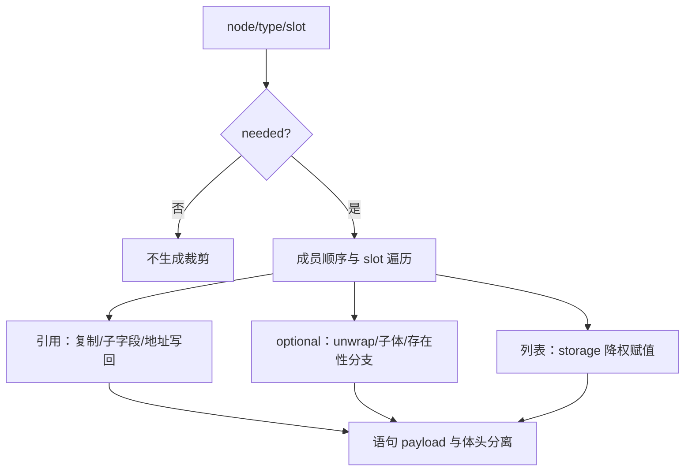

# 所有权裁剪语句生成自举

## Intent：最终目标

将所有权 clear 的实际遍历及语句生成迁入 RX/ZX，复用列表降权、引用槽与结构化
AST 原语，保留 optional 分支惰性、引用副本生命周期和成员偏移。不撤回既有迁移。

## Data：可用证据

原 ownership.zig 的 clear 先判断 needed，再区分引用对象、optional、列表、对象
和元组。引用对象先复制到函数级槽，逐字段裁剪，再将地址写回；optional 只在存在
时执行子体；列表写 storage；对象和元组按顺序推进 ownership slot。

已有 Source construction/reference/slot、state/list/permission 与 choose，以及
AST assignment、branch 原语可复用。缺少的是分离外层语句体与嵌套语句存储的
通用组装接口，不能为此回调 Native 语义或拼接 Zig 源码。

## Edges：边界与限制

- 补齐通用 ast/body 原语：body 只保存 tags/offsets，语句 payload 保存在 Context。
  不复制全部语句列，也不重复创建无用 header 后再截断。
- Source plan 只保留 needed 子树，按原顺序生成进入/退出事件及成员名；Native
  根据 plan 准备引用对象布局句柄，不决定裁剪规则或语句形式。
- emit 的 RX 显式连接初始化、算法遍历与发布；遍历内部节点分派留在 ZX。
- 只读事实借用，Source 草稿使用可释放 scratch，导入长期 AST 时保持所有权。
- 旧 clear 仅留 seed；类型句柄准备、Native 事实存储及 AST 适配仍是过渡依赖。
- 不新增测试用例。先贯通，再验收；分配、生成形态变化须检查固定输入性能及累计值。

## Answer：交付与成功标准

正式 clear 的规则、遍历与语句形式均来自 RX/ZX；Native 只承担暂存资源和类型/AST
适配。通过 seed 与 Source 正式构建、两代产物、实际生成闭包和既有所有权行为检查。
记录同输入阶段前后及固定 anchor 的 CPU、wall、RSS；发现开销继续优化，不恢复旧
Native 正式实现。验收后统一提交推送，确认无未提交、未推送内容。

## 执行记录

已贯通 Source 裁剪计划、事件生成、分离语句体原语及 Native 资源适配；旧实现移入
clear_seed.zig。当前尚未验收，不能据此宣称本阶段或完整自举完成。

首轮修正了计划节点 ID 的 u32→u64 索引宽度。随后 Source 自编译报告 OutOfMemory；
临时边界探针确认计划与生成均成功，失败发生在 AST 导入。根因是通用 body 共享
完整 payload，但原导入器要求 payload 列长度与选定 header 数严格一致；ReleaseSmall
下原 InvalidAst→unreachable 路径使错误表现失真，并非已证明的物理内存耗尽。

新增通用 node/import_selected：校验已选择 header 的枚举布局、字段模式和逐列索引
边界，只把选中的行导入最终 AST；原严格导入入口保留原契约。Source 不必为外层体、
分支体及引用槽复制完整 payload。新适配对 InvalidAst 使用明确 panic，不使用无
检查的 unreachable 掩盖错误。Native 枚举/整数布局仍由既有 compatible 校验，
没有放宽类型兼容规则。临时探针已从源码移除。

修复后 seed 39/39、Source 正式工具 21/21 步通过，原失败 ordered 路径成功；固定
141 入口、2220 模块输入的前后各 2268 产物仅 .zxc-inputs 身份标记不同。该次产物
核对与构建同时运行，只证明输出一致，不用其中耗时作为性能证据。

两代 main 各 2703、collections 各 50、growth 各 108 文件，仅身份标记不同。
编译器 372/372 项检查通过；value-return、function-updates、owned-input、
compound-references、immutable-list、nested-buffer、evaluation-order 共
499/499 构建步骤、2209/2209 项通过，合计 2581 项。未新增测试。

收口复核进一步补齐所选行的分配失败回滚：如果同一行后续字段复制失败，释放已经
复制的字段并恢复该行所有列长度；已完成的前序行保持有效。该错误路径修正不改变
正常生成规则与 AST 布局，保留以上行为证据；最终工具重建与产物核对待完成。

## 最终工具与性能门槛状态

补齐回滚后的最终 seed 39/39、Source 工具 21/21 步构建成功；最终正式工具为
ownership-clear/final-production/bin/zxc-bootstrap，SHA256 为
d63dd063ddbafb40d2c263a5c834c4a459edfb034a139937f7134ed97dc3b05e。

以下均为独立运行的八轮交替对照，保存首轮样本，以其余七轮中位数报告；每组
2268 文件均仅 .zxc-inputs 不同：

| 对照                     | CPU 前→后    | wall 前→后   | RSS 前→后（字节）   |
| ------------------------ | ------------ | ------------ | ------------------- |
| 阶段前→最终工具          | 5.43→5.43 秒 | 1.18→1.19 秒 | 495255552→486572032 |
| 固定历史 anchor→最终工具 | 5.35→5.44 秒 | 1.18→1.20 秒 | 493830144→492191744 |
| 回滚修正前→最终工具      | 5.43→5.44 秒 | 1.18→1.19 秒 | 483786752→487505920 |

初步工具的阶段对照为 5.43→5.41 秒，初步 anchor 对照为 5.37→5.39 秒；这些小幅
收益没有在最终批次稳定复现，不作为已交付优化。回滚前后差异约 0.01 秒，尚无
证据将约 0.09 秒累计差额全部归因于此错误路径修正；阶段前后最终对照 CPU 持平。

固定 anchor 软件身份没有重置：inbound-conversion/production-bootstrap/bin/zxc-bootstrap，
SHA256 仍为 8f1e7cee1eadb3ea0f6f7150bab951c55672ce294e4fbe7c50d5858723bdd92d。
当前累计 CPU 差额约 +0.09 秒，性能门槛尚未收口，不能宣称本阶段验收完成或完整
自举达成。保留本次迁移，下一步定位累计开销；未提交、未推送这批未完成验收的变更。

最终工具体积 6621504 字节，阶段前 6532272 字节；不将生成器 RSS 对比解释为
完整 LLVM 冷构建内存问题已经解决。记录与脚本在被忽略的
.zig-cache/cold-build-analysis/ownership-clear/ 下，最终报告分别为
verified-runtime-comparison.json、verified-cumulative-runtime-comparison.json、
cleanup-runtime-comparison.json，早期样本仍保留。

最终工具的两代产物复核已通过，main/collections/growth 分别为 2703/50/108 文件，
仅身份标记不同；最终编译器检查仍为 23/23 步、372/372 项通过。源码中已无临时
探针。相关 2209 项行为证据对应正常生成路径，回滚修正未改变该路径的语句形式。

累计批次按已有日志提取阶段墙钟中位数：anchor/当前 infer 为 537/535ms，emit
为 419/438ms，write 为 68/73ms。infer 未显示增长，emit 增加约 19ms，是下一步
定位线索；这些是阶段墙钟，不能当作阶段 CPU 或直接据此归因某个函数。下一步先
对 emit 内部实际执行开销取证，复用已有 levels/visit 诊断，并避免重做已失败的
complete 标量返回、增长表索引等无收益试验。

## 累计性能收口更新

以上未达标记录是收口过程的历史状态。当前保留三项 Source 优化：query 外部缓存
命中直接返回，类型查找分别扫描 base/delta，目标 kind 预编码后逐行比较字节。
原型与失败试验见同日《生成器CPU热点诊断》，没有恢复任何裁剪迁移。

最终正式工具改为 type-code-production/bin/zxc-bootstrap，SHA256 为
cb70d7c2e8e9946a97596274f9e61b10a64e6d7279f54840218f6d91fffb6f3c，体积 6620944 字节。
固定 anchor 与最终工具八轮交替 CPU 5.37→5.30 秒，wall 1.18→1.14 秒，RSS
493780992→489996288 字节；同一 141 入口/2220 模块的各 2268 产物仅身份不同。
累计性能门槛已达到，基线身份没有重置。没有在工具运行时加入新的专用运行层。

最终 seed 39/39、Source 21/21 步构建通过。两代 main 2704、collections 50、growth
108 文件仅身份不同，编译器 372/372 项通过。相关完整行为回归仍在运行，结束后
统一提交所有未提交内容；完整自举及剩余 Native 状态/资源桥仍不能宣称完成。

## 阶段最终验收

最终相关检查 802/802 构建步骤、2915/2915 项通过，与编译器 372 项合计 3287 项。
记录为 type-code-related-tests.log、type-code-compiler-tests.log。未新增测试用例，
没有为了形式重复验证不受影响的场景。

本次 diff 自我复核：缓存命中不补记 reads，raw/Unknown 保持原求值；base/delta
顺序与未命中 id 保持；字节 kind 使用现有编码函数及常量；Source 裁剪分支、引用槽
和语句导入均保留正确性证据。Node 稀疏导入的 schema/边界校验及 OOM 单行回滚
保持，原严格导入 API 没有放宽。失败候选和探针均不在最终源码中。

整体自举仍未完成：Native Lower、事实/AST 物理存储与资源适配、helper 名称和声明
生成等依赖仍需迁移，最终传递闭包审计和 seed→stage1→stage2→stage3 链未完成。
本次只收口裁剪语句生成职责及其累计性能，不把字节一致或检查通过替代完整自举。
全部未提交变更统一提交推送后确认工作区与远端同步。
