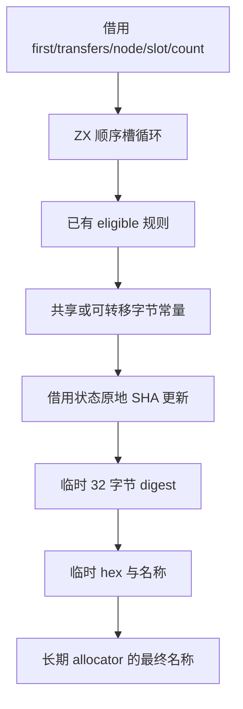

# 所有权辅助函数命名自举

## Intent：最终目标

将 helper 名称的输入编排、逐槽资格哈希与名称格式化迁入 RX/ZX，保持名称字节、
顺序及有界临时空间；不为接口迁移构造完整资格数组或分片数组。

## Data：可用证据

原实现顺序为 state_name、零分隔字节、各槽 eligible 的零/一字节，最后以小写
十六进制加 zx_weaken_ 前缀。eligible 规则已在 Source。现有 sha256Parts 只有
完整分片列表接口，不能承接逐槽更新而不额外组装列表。

复用 std:bytes AtomicRows 的宿主借用资源契约，为 std:crypto 补充 Sha256State
不透明引用及 updateSha256、updateSha256Byte、digestSha256。宿主初始化标准
Zig SHA-256 状态并保持栈上生命周期；Source 只借用该资源，所有更新及 final
均直接调用 Zig 标准库。单字节更新使用 Native 栈字节，不分配单元素数组。

## Edges：边界与限制

- 该资源是显式可变的原生哈希状态，需要独占访问；没有 concurrent 标记，不得
  并发更新，也不得在宿主结束后保存引用。final 只调用一次。
- 状态类型必须精确为 std.crypto.hash.sha2.Sha256；不把 core 的可选 x86 加速
  变体强转为标准状态。当前验证机器为 arm64，两者使用同一实现；本轮没有
  x86 性能证据，不声称跨架构性能收益。
- RX 显式编排前缀、资格槽更新和格式化，ZX 保留内聚循环与 eligible 算法。
- Native 只初始化通用哈希资源、借用资格输入及持有最终名称；标准库 digest、
  hex 和 join 的临时结果使用栈优先 scratch，最终名称只复制一次至长期存储。
- state_name 的现有生成、声明查重、整体所有权编排及状态适配仍待迁移。
- 不新增测试；复用 seed 对照、两代生成及已有行为检查验证真实名称消费。

## Answer：交付与成功标准

正式 helper 名称算法来自 RX/ZX，无资格数组、动态回调或专用运行库。标准接口
与真实消费者贯通后集中验收：seed/Source 构建、两代产物与受影响既有检查通过，
生成代码没有循环内单字节集合分配，阶段及固定基线对照不出现累计退化。
收口所有变更，提交推送后确认干净且无未推送提交。

## 执行记录

已接通标准流式借用接口、三个 RX 阶段与正式名称消费者。接口类型先于函数
声明；资格循环初始计数器显式为 u32，保持 slot 运算的原始宽度。

Seed 构建通过 39/39 步，Source 正式工具构建通过 21/21 步。两代生成 main
2704 个文件、collections 50 个文件、growth 134 个文件，均仅输入标识不同。

### 生成形态与成本

实际生成的 slots 函数在 while 内直接调用 updateSha256Byte；没有单元素数组、
完整 flags 数组或分片列表分配。loop 计数器的 ABI 临时记录创建位于循环外，
当前实现仍有这类通用记录装箱，不能称作完全没有临时分配。名称阶段的 scratch
先使用 std.heap.page_size_min 大小的栈缓冲（当前 arm64 macOS 为 16384 字节），
结果只持有长期 allocator 中的最终文本。

冻结 manifest 为 141 个入口、2220 个模块；每组交替八轮，排除首轮取中位数。
性能对照在其他构建及行为检查之前隔离执行。

| 对照                 | CPU 秒      | wall 秒     | 峰值 RSS 字节         |
| -------------------- | ----------- | ----------- | --------------------- |
| 阶段前 → 本阶段      | 5.31 → 5.33 | 1.14 → 1.14 | 491962368 → 488538112 |
| 固定 anchor → 本阶段 | 5.36 → 5.29 | 1.18 → 1.14 | 493633536 → 492666880 |

阶段增量在既定容差内，固定基线未见累计 CPU/耗时退化；不把小幅 RSS 差异
解释为稳定收益。固定 anchor SHA256 保持
`8f1e7cee1eadb3ea0f6f7150bab951c55672ce294e4fbe7c50d5858723bdd92d`。
数字覆盖当前 arm64 生成器，不代表完整冷构建或其他架构的性能。

前后 2268 个文件中的函数实现一致。types.zig 出现预期 ABI 增量：一个不透明
状态、两个调用参数元组、三个 Native 函数签名及类型导出；.zxc-files 仅类型文件
的哈希变化。独立核对脚本剔除这些精确结构后与旧 types.zig 一致，没有把整份
类型文件差异直接豁免。两代对照使用相同新接口，所以产物仍完全对齐。

原始证据在 `.zig-cache/cold-build-analysis/ownership-name/`：native.log、
production.log、final-runtime-comparison.json、cumulative-runtime-comparison.json、
validate_abi_additions.py、final-fixedpoint-result.json。阶段对照脚本最初只接受
输入标识差异而报错；核对 ABI 增量后复用已有有效样本，没有重复计时。

编译器 372/372 项通过；使用本轮生成的完整标准 ABI，直接运行现有 crypto
资源检查 2/2 项通过，覆盖既有 AEAD、HMAC、派生与分配失败清理。新流式接口
由正式 helper 命名真实消费，两代完整函数产物对照验证名称与原算法一致；没有
新增测试用例。相关日志为 final-compiler-tests.log、final-crypto-tests.log。

所有权六组及不透明引用分析/IR 既有检查通过 372/372 步、1192/1192 项，日志为
final-related-tests.log；与编译器及 crypto 合计 1566 项通过。

### 自我复核与剩余边界

通用标准库平台接口调用 Zig SHA-256，没有保存编译器专用规则或状态；资格规则
与流式更新顺序来自 RX/ZX。借用状态仍由宿主栈初始化，不能把资源适配和整体
所有权状态管理也算作已迁移。声明查重及外层跨阶段编排仍需继续完成。
