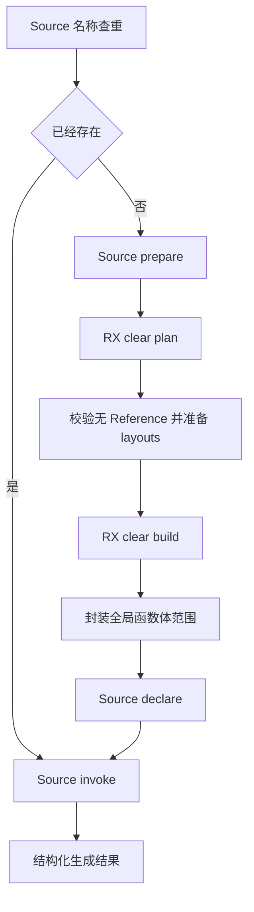
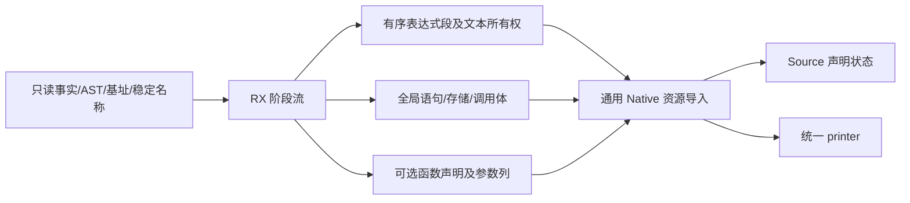

# 所有权辅助函数编排自举

## Intent：最终目标

将 outlined helper 的查重、参数准备、清理规划、函数体封装、声明及调用阶段真正
连接在 RX 中。Native 仅借用输入、导入 AST 分段及持有资源，不继续调度这些语义阶段。

## Data：可用证据

此前各原语已来自 ZX，但 outlined.zig 仍在 Native 中依次判断、调用 clear、拼装
body 范围及追加调用。本轮复用已有 helper、clear 与声明查重原语，构建真实 RX
分支：已有声明直接调用；没有声明才构造一次，再调用。每个 valid 检查保留短路。

三个不变量经源码核对：

- leaves 与 clear/append 均先执行同一 needed，再检查 referenced；已选中的
  outlined helper 不包含 Reference 操作。Source 构造零 layouts，并显式拒绝
  不满足该前提的计划，不需要新的 Native 类型查询回调。
- clear/list 的 literal 查询输入是当前 Context 新建的 Headered Binary 节点，
  不读取 prepare 参数节点。AST 可在 prepare 前借用，但清理表达式基址必须加上
  prepare 的增量长度，保证新节点都在正确 Context 中解析。
- clear.body 只替换 headers，共享 statements payload。先存 clear.statements，
  再追加 clear.body headers，函数体 start 等于原 statement_base 加 nested 长度。
  通用 import_selected 重映射载荷 offset，不改变分支中的绝对语句范围。

## Edges：边界与限制

- 所有 Outline facts 从筛选到生成保持只读；不能在两者之间变更资格或引用事实。
- 表达式分段保持 prepare/clear/declare/invoke 的原有顺序；只有 clear 分段需要
  拥有化复制临时文本，其他段借用稳定 helper 名称或静态参数名称。
- 函数参数继续一次导入全局 field_columns，声明追加仍消费 Source table。
- 缓存命中时不调用 prepare、plan、clear 或 declare；只生成调用语句。
- outlined 选择、类型句柄准备、名称生成入口及整体 projected/inline 选择仍由
  Native 连接，AST 物理存储与资源适配仍待迁移，不宣称整个所有权模块完成。
- 不新增测试；对实际改变的分配和生成路径做阶段/固定累计性能与既有行为检查。

## Answer：交付与成功标准

RX 源码直接显示缓存分支和完整 helper 阶段依赖，Native 不保留正式 prepare/clear/
declare/invoke 调度。前后及两代产物对齐，相关既有检查通过，无累计性能退化；
统一提交推送全部变更，确认工作区干净且无未推送提交，并记录未迁移边界。

## 执行记录

已接通 RX flow 及 Native 分段导入，旧构造移入 outlined_seed。原先单独注册的
prepare/declare/invoke Native 入口合并为一个 flow 入口，原 ZX 文件仍由 RX 直接
复用。Seed 构建通过 39/39 步，Source 正式工具构建通过 21/21 步。

### 性能证据

冻结 manifest 为 141 个入口、2220 个模块；每组交替八轮，排除首轮取中位数。
对照先于其他构建与行为检查隔离执行。阶段前后 2268 个文件均仅输入标识不同。

| 对照                 | CPU 秒      | wall 秒     | 峰值 RSS 字节         |
| -------------------- | ----------- | ----------- | --------------------- |
| 阶段前 → 本阶段      | 5.32 → 5.28 | 1.14 → 1.13 | 494190592 → 497336320 |
| 固定 anchor → 本阶段 | 5.32 → 5.30 | 1.15 → 1.14 | 488816640 → 483360768 |

未见累计 CPU/耗时退化，RSS 小幅波动不作为稳定变化证据。固定 anchor SHA256
保持 `8f1e7cee1eadb3ea0f6f7150bab951c55672ce294e4fbe7c50d5858723bdd92d`。
相对旧 anchor 的差异仍仅有已验证的 SHA-256 标准接口 ABI 增量及清单哈希。
这些数字仅覆盖当前 arm64 生成器，不代表完整冷构建或其他架构的性能。

本地证据在 `.zig-cache/cold-build-analysis/ownership-helper-flow/`：native.log、
production.log、final-runtime-comparison.json、cumulative-runtime-comparison.json。
两代生成 main 2704 个文件、collections 50 个文件、growth 156 个文件均仅输入
标识不同。编译器 372/372 项检查通过；所有权六组、任务、库入口及 RX 并行
检查通过 609/609 步、1346/1346 项，合计 1718 项通过。未新增测试用例。
构建产物与日志不提交，相关证据为 final-fixedpoint-result.json、
final-compiler-tests.log 和 final-related-tests.log。

### 自我复核

阅读 RX 可以看见缓存分支、阶段依赖与失败短路，ZX 不再隐藏整个 helper 总控。
Native 中的可选声明判断和文本借用模式只用于资源导入；函数是否新建、清理体
如何生成及何时构造调用均由 RX 决定。输入名称生命周期、Source 临时文本拥有化
及单次字段导入仍遵守原成本模型。外围 outlined 选择、类型与名称入口、内联
清理选择及 AST 存储桥仍是明确的未完成项。
