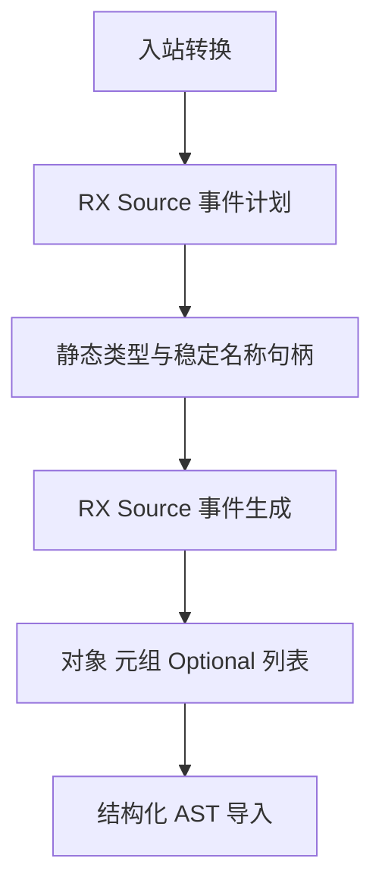
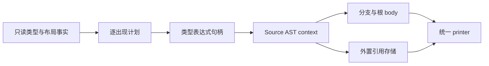

# 普通入站值转换自举

## Intent：最终目标

将 value、value_layout、row_value 的完整递归转换迁入 RX/ZX，包括其列表子转换。
保留原算法、共享身份、分支惰性、引用存储及 fresh 顺序，不新增专用原生语义桥。

## Data：可用证据

起点 6c9ad788。普通入站转换只递归 value；连续对象行直接解引用，嵌套列表递归
value，没有 outbound、borrow 或 view 回边。已有结构化 AST、reserve、列表标记、
引用槽及事件遍历可复用，未发现语言能力缺口。

## Edges：边界与限制

- Source 计划逐出现节点，Value 节点保留原值；对象与元组字段正序。
- 根模式只影响根 aggregate 的 origin；optional 与其他子节点重置为 value。
- Optional 只在 yes 内执行子 body；Reference undefined slot 外置，赋值留在 body。
- 列表保持 source bind、reserve、element、index、递归及完成块的名称顺序。
- Native 只按计划准备类型句柄与稳定字段名称，再导入 Source 结构化结果。
- 不新增测试；先贯通再集中验收，性能与固定 anchor 同时比较，不重置基线。
- 出站、borrow、view、类型缓存与外围 Lower 状态仍是过渡依赖。

## Answer：交付与成功标准

正式普通入站转换不依赖 Native 递归语义；Source RX 编排计划和生成的阶段，ZX
保留内聚事件算法。核对生成产物、既有行为、两代稳定性及累计性能；统一提交推送。

## 执行与自我复核

已接入 plan/build 与 emit/build 两个 RX 入口。正式 conversion 的三种入站模式
进入新适配器；旧逻辑继续供 seed 使用，其他模式仍保留现有实现。

Source 计划按出现节点生成 enter/exit 事件；可空和列表保留独立当前 body，
对象与元组按原序组装，引用槽在成员处理后创建。新增通用 body/binding 沿用
已有 body/assignment 的共享 payload 与独立 headers 约定。

复核纠正两项具体错接：列表转换使用普通 raw slice Reserve，不能复用会读取
.items 的 StateList.reserve；ast/fresh 不自动加下划线，因此 element_/index_
前缀显式对齐 Native fresh。修正后 Native 构建 39/39、Source 构建 21/21 通过。

### 生命周期与顺序

类型句柄先按计划解析，serial 与辅助声明数保持不变。Native 在 Lower allocator
中生成稳定 origin 名称，Object 字段名借用 TypeTable，items/storage 为静态常量；
输出字段只借用这些稳定字节。Tuple 数字投影及 fresh 动态文本进入表达式/语句
拥有型导入，不能继续借用临时工作区。Variables、全局语句、root body 及 storage
分别配对导入，避免不同 payload offset 范围混用。

Rows 保持 source bind→普通 Reserve bind→element_→index_→递归转换→完成块。
Optional 先 unwrap 并转换 child，再判空及封装 yes body；没有提前执行受保护的
运行时转换。列表完成描述符保持 Shared，空分支保持 Plain，没有改成 Exclusive。

### 隔离性能及产物证据

冻结 141 个入口、2220 个模块；每组交替八轮，排除首轮取中位数。计时先于其他
构建和行为检查，固定 anchor 未重置。

| 对照                 | CPU 秒      | wall 秒     | 峰值 RSS 字节         |
| -------------------- | ----------- | ----------- | --------------------- |
| 阶段前 → 本阶段      | 5.32 → 5.33 | 1.15 → 1.16 | 491257856 → 493813760 |
| 固定 anchor → 本阶段 | 5.32 → 5.31 | 1.17 → 1.14 | 494993408 → 495009792 |

阶段配对 CPU 差值中位数为 +0.01 秒；同时保留阶段与累计结果，不把容差逐次
重新领取。RSS 样本有较大波动，阶段约 +2.4 MiB、累计约 +16 KiB 的中位变化
不当作稳定内存收益或退化。此处仅覆盖当前 arm64 生成器，不代表完整冷构建。

阶段前后 2268 个文件仅 .zxc-inputs 不同。累计对照仅包含此前已验收的 SHA256
流式接口 ABI 与相应清单哈希，逐项校验预期结构，其余类型和实现保持一致。
固定 anchor SHA256 为
`8f1e7cee1eadb3ea0f6f7150bab951c55672ce294e4fbe7c50d5858723bdd92d`。

本地证据位于 `.zig-cache/cold-build-analysis/state-inbound/`：native.log、
production.log、final-runtime-comparison.json、cumulative-runtime-comparison.json、
精确 ABI 校验脚本；构建产物和日志不提交。

两代使用同一清单生成 main 2704、collections 64、growth 200 个文件，均仅
.zxc-inputs 不同；证据为 final-fixedpoint-result.json。编译器既有检查通过
372/372 项（23/23 步），证据为 final-compiler-tests.log。相关既有运行检查通过
1414/1414 项（631/631 步），覆盖值返回、更新、输入所有权、复合引用、不可变
列表、嵌套缓冲、Task、库运行、RX 并行与原生引用分析/IR；证据为
final-related-tests.log。合计 1786 项，未新增测试。

### 自我复核与剩余边界

计划与事件生成都来自 Source，没有拼接 Zig 文本、预先在 Native lower 列表叶子
或新增专用回调。生成产物一致与相关既有行为检查同时通过，仍不能据此覆盖所有输入。
类型缓存、AST 物理存储及导入、外围 Lower 控制仍是过渡依赖；出站、
borrow、view 尚未迁移。本阶段不能证明完整编译器依赖闭包或最终自举完成。
