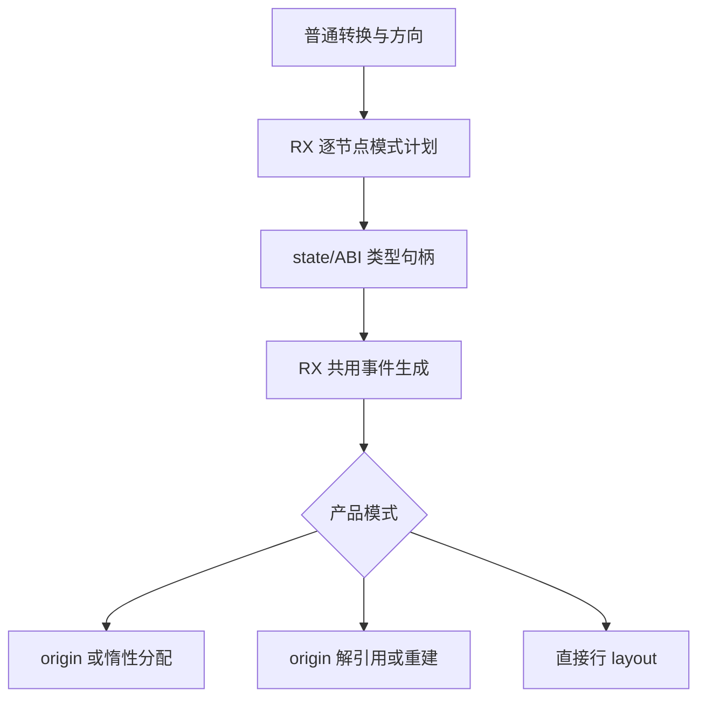

# 普通出站值转换自举

## Intent：最终目标

迁移 Pointer、Layout、RowLayout 的完整普通出站递归，与已完成入站共用事件树。
保留 origin 身份复用、惰性分配、错误传播与 fresh 顺序，不复制两套生成器。

## Data：可用证据

起点 9906db45，工作区干净。出站 Optional/产品的子模式均为 Pointer；列表嵌套
子节点为 Pointer，对象行则必须先 RowValue 再对该结果 Pointer。现有结构化
conditional、call、body、reserve 和引用槽足够表达，没有新增语言能力缺口。

## Edges：边界与限制

- 共享目录从 inbound 更名 conversion；计划按节点保存模式，入站行为保持。
- Pointer 有 origin 时返回原指针，缺失时才执行子体和 allocator.create；Layout
  复用 origin 的解引用，否则惰性重建；RowLayout 直接返回产品并接回子 body。
- 对象 Rows 两个子树顺序依赖，第二个读取第一个结果，不能重复投影原始行。
- Native 只按模式准备 state/ABI 类型资源与稳定名称，再导入结构化结果。
- 不新增测试，不改变运行库与静态链接原则；borrow、view 仍是后续职责。

## Answer：交付与成功标准

六种普通转换模式及其递归列表路径正式使用同一 RX/ZX 生成器；旧 Native 算法
仅供 seed。保持既有产物和行为，固定累计性能不退化，统一提交推送全部变更。

## 执行与自我复核

Source 共用树已完成接线：每个出现节点携带 Mode，子产品和 Optional 出站均为
Pointer；对象 Rows 的第二子节点引用第一子节点结果。Native 六种普通模式统一
进入 conversion_emission，原生递归仅保留在 conversion_seed。borrow/view 入口
保持原实现，不将其视为本阶段已完成。

Pointer 分配先于 origin 条件的 AST 构造，但其绑定、赋值及全部子转换 body
只写入冷分支；origin 有值时运行时不执行它们。RowLayout 直接接回子体，Layout
不创建新指针。Optional 直接封装 ABI optional，不走产品尾部。

Native 引导构建通过 39/39 步，Source 正式构建通过 21/21 步。只读源码复核未
发现模式、依赖顺序、资源类型、capture 或寿命缺口；后续用产物与行为证据验收。

### 开销差异与修正

初版阶段 CPU 5.31→5.34 秒，配对差中位数 +0.03 秒；累计对照为 5.37→5.33。
虽无累计退化，阶段增长已超出通常 CPU 容差，因此继续核对实际成本。

资源适配器曾为 RowLayout 准备不会被消费的 origin 名称，而原实现此模式直接
返回、完全不做该计算。已按同一语义 guard 跳过命名与分配，保留全部出站 Source
实现。修正后重建 Source 工具并使用新输出/缓存目录验证；一次命中旧缓存的启动
未产生生成阶段摘要，已排除，不当作有效计时样本。

修正后阶段 CPU 5.32→5.31 秒、wall 1.15→1.14 秒，2268 个产物仅输入标识不同。
初版及修正后数据均保留，避免用后一次结果覆盖诊断经过。最终记录如下；各组
冻结 141 个入口、2220 个模块，交替八轮并排除首轮，先于其他检查隔离测量。

| 对照                 | CPU 秒      | wall 秒     | 峰值 RSS 字节         |
| -------------------- | ----------- | ----------- | --------------------- |
| 阶段前 → 本阶段      | 5.32 → 5.31 | 1.15 → 1.14 | 493043712 → 482590720 |
| 固定 anchor → 本阶段 | 5.35 → 5.31 | 1.18 → 1.15 | 485785600 → 489291776 |

最终配对 CPU 差值中位数：阶段 0.00 秒，累计 -0.03 秒。阶段与累计 RSS 中位数
变化方向相反，样本范围重叠，不宣称稳定内存收益或退化。这里只测当前 arm64
生成器，不代表完整冷构建或 LLVM 内存峰值。

累计对照只包含此前已验收的 SHA256 流式接口 ABI 与对应清单哈希；精确校验
其余类型与实现保持一致。固定 anchor SHA256 保持
`8f1e7cee1eadb3ea0f6f7150bab951c55672ce294e4fbe7c50d5858723bdd92d`。

本地证据在 `.zig-cache/cold-build-analysis/state-outbound/`，包含 initial-* 诊断
记录、final-runtime-comparison.json、cumulative-runtime-comparison.json、
精确 ABI 校验脚本及 native/production 日志，均不提交。

### 阶段与行为验收

修正后 Native 构建再次通过 39/39，Source 构建通过 21/21；两代生成 main 2704、
collections 64、growth 203 个文件均仅输入标识不同，见 final-fixedpoint-result.json。
编译器既有检查通过 372/372 项（23/23 步），见 final-compiler-tests.log。
相关运行检查通过 1414/1414 项（631/631 步），覆盖值返回、函数更新、输入所有权、
复合引用、不可变列表、嵌套缓冲、Task、库运行、RX 并行与原生引用分析/IR；
见 final-related-tests.log。合计 1786 项，未新增测试用例。

### 自我复核与剩余边界

普通出入站共享同一计划/生成树，没有为迁移复制生成器或改变原算法。已定位
并去掉原实现不存在的 RowLayout 资源计算，没有撤回迁移。模式与结构化语句的
复核、产物一致与行为检查缺一不可，不能只以文件后缀或两代一致宣称整体完成。
borrow/view、类型缓存、AST 物理存储和外围 Lower 仍有原生过渡依赖，完整自举
及最终依赖闭包验收尚未完成。

### 后续职责核对

Borrow 可在共用树中独立迁移：产品/Optional 子模式保持 Borrow，List 切入普通
出站；必须单列传入调用者 storage 的 state_borrow 槽，不能混入 reference_storage。
其声明在 Optional/父产品冷分支之外，赋值仍在 fallback 内。View 另需保留实际
private/public 类型句柄相等时的整棵直返、origin 复制及对象行列表零逐项转换。
当前仅完成静态边界核对，未将两项记为已实现。
