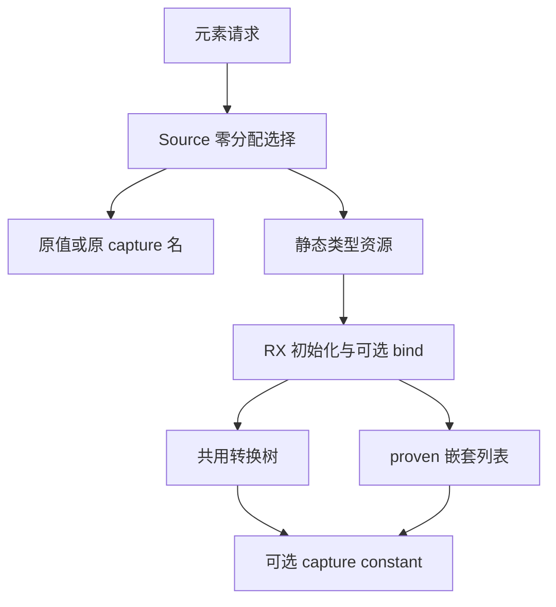
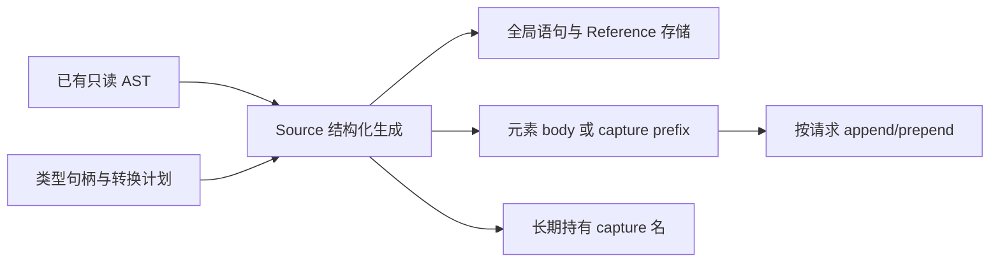

# 状态元素读写自举

## Intent：最终目标

迁移元素 read/write/typeExpr/inlineStored/storedList/captureName 的正式规则与
capture 前缀组装，保留嵌套列表共享、边界与 fresh 顺序，复用转换和列表原语。

## Data：可用证据

起点 ae717d88，工作区干净。所有普通转换和 View 已自举；elements.convert 已
仅由 seed 调用。元素消费者覆盖索引、更新、集合构造、transform、排序和谓词。
旧实现非活动/未使用/未 represented 路径不创建转换工作区，必须保留。

## Edges：边界与限制

- Source choice 零容量查询先判断 capture used、active，再查 inline 与表示。
- Read 对连续对象行先 bind 再 RowValue；Write 为 RowLayout，其他分别 Value/Pointer。
- 嵌套 stored List 两方向都 bind→items→Headered→false unique→proven→record，
  保留 header 且清除 unique，不用仅接收 shared bool 的转换 record 替代。
- capture 在 callback/context 已 lower 后生成，fresh element_→Read→原名 constant，
  最后将整个 prefix 插入既有 body 最前，不能前移 fresh 或 Reference storage。
- 类型资源与结构化导入由宿主适配；不修改 Lower.index 的 abiNestedItems 成功路径。
- 不新增测试，集中验收产物、既有行为、固定累计性能；不引入专用运行库。

## Answer：交付与成功标准

正式元素边界规则与前后缀组装来自 RX/ZX；Native 仅准备静态资源、导入、prepend。
全部既有行为和产物保持，累计性能符合标准，统一英文提交并推送所有变更。

## 执行与自我复核

### 实现

- `analysis/state/elements/query.zx` 统一选择读取、写入、capture 和类型表示。
  未使用 capture、非活动状态和无转换路径在创建工作区前返回；查询使用零容量 allocator。
- `build.rx` 显式编排初始化、可选 bind、普通转换或 stored List、capture constant
  与发布。普通路径复用已有 conversion 计划与生成器，不复制算法。
- stored List 保留旧实现的绑定与 fresh 顺序、Headered 权限和 false unique，
  继续复用 list 原语；capture prefix 在回调 lower 完成后插入 body 最前。
- Native 只借用类型表、准备资源、导入结构化结果和 prepend。旧实现归入
  `elements_seed.zig`，仅供 seed 使用；正式路径调用 RX/ZX。
- 共用 conversion 的资源准备与结构化导入分离为 `prepare` / `apply`，保留原有行为。
  跨编译单元 AST 通过既有 `columns.view` 转换描述符，不复制底层 AST。

### 语义与生命周期复核

逐项核对原实现的早返回、类型表选择、求值与 fresh 顺序、capture 名称以及列表权限。
只读分析复核未发现额外整表复制或生命周期问题：capture 描述符和 optional conversion
payload 在同步执行期间由调用栈持有；返回名称需要持久化时只提升一次到 Lower allocator。

本阶段完成元素边界的规则与组装迁移；Native Lower 的其他职责仍在，不能据此宣称完整自举。

### 验证证据

- Native 工具构建：39/39 步骤；正式工具构建：21/21 步骤。
- 编译器既有检查：372/372 通过，23/23 步骤。
- 两代产物核对：main 2704、collections 64、growth 233 个文件各自一致；
  唯一差异为输入追踪文件 `.zxc-inputs`。
- 相关既有行为检查：1414/1414 通过，631/631 步骤；与编译器合计 1786 项。

### 性能证据

测量正式生成器的同一冻结输入：141 个入口、2220 个模块，2268 个产物文件。
八轮交替执行，剔除首轮，测量时无其他构建干扰；不将后端 Zig 构建混入生成器时间。

| 对照              | CPU 中位数     | 墙钟中位数     | 峰值 RSS 中位数            |
| ----------------- | -------------- | -------------- | -------------------------- |
| 阶段前 → 阶段后   | 5.34 → 5.32 秒 | 1.16 → 1.15 秒 | 493797376 → 487129088 字节 |
| 固定基线 → 阶段后 | 5.36 → 5.32 秒 | 1.19 → 1.15 秒 | 494583808 → 490160128 字节 |

阶段配对 CPU 差值中位数为 +0.01 秒，固定基线配对为 −0.04 秒；两组中位数之差与
配对差值不是同一统计量。结果未见累计退化，不将微小差异解释为确定性加速。
固定基线 SHA-256 保持
`8f1e7cee1eadb3ea0f6f7150bab951c55672ce294e4fbe7c50d5858723bdd92d`。

阶段对照只有 `.zxc-inputs` 不同。累计对照还包含清单和 `types.zig` 的已知 SHA256
公开接口变化；脚本逐项校验这些差异，没有整体豁免类型文件。

原始构建、产物和测量证据保存在忽略目录
`.zig-cache/cold-build-analysis/state-elements/`：`native.log`、`production.log`、
`fixedpoint-validation.log`、`final-compiler-tests.log`、`final-related-tests.log`、
`final-runtime-comparison.json` 与 `cumulative-runtime-comparison.json`。

### 自我批判

本轮已将规则选择和 AST 组装移入 Source，Native 仍承载静态资源桥接；完整自举还需
继续审计传递依赖及完成约定的阶段自编译。性能结论仅适用于当前 arm64 工具链和固定
生成输入，不外推为冷 LLVM 构建或其他平台的收益。
