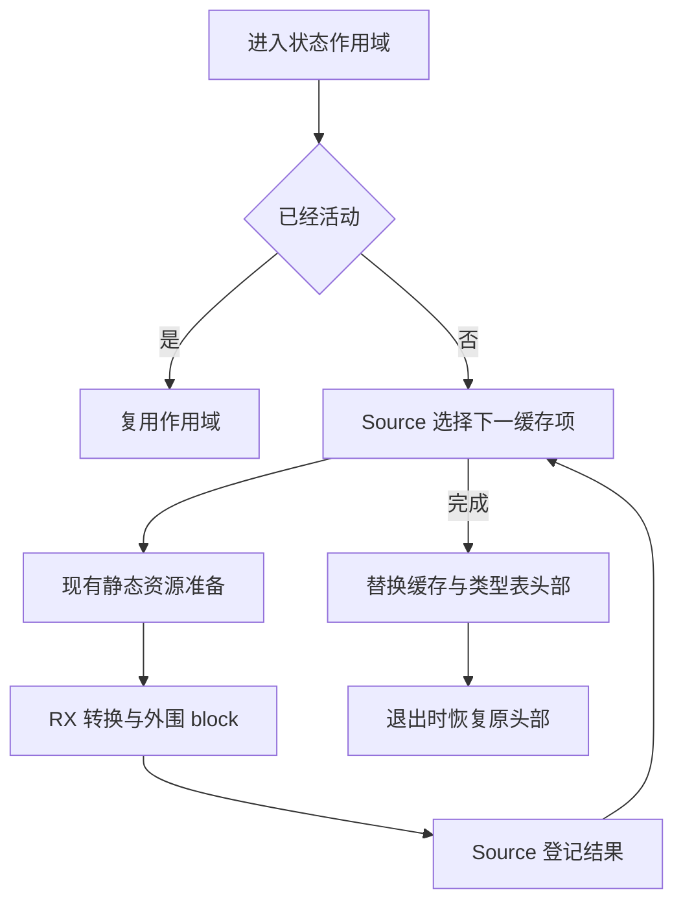
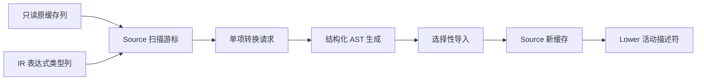

# 状态入口缓存自举

## Intent：最终目标

将状态入口的缓存转换协议、遍历与登记、外围表达式块组装迁入 RX/ZX，保持原有
求值、资源准备和 fresh 顺序；已活动的状态入口仍直接复用当前作用域。

## Data：可用证据

起点 df2d1561，工作区干净。`state_value/root.zig` 当前逐项遍历表达式缓存，
调用已自举的 Value 转换，再无条件生成外围 block，登记到新缓存，最后切换类型表。
restore 恢复进入前的类型表、布局表、缓存和 active 标记。
既有 core integer map 已提供 next/put；共用 conversion 已支持 Value 与结构化导入。

## Edges：边界与限制

- 不能为迁移预先收集或复制整表，也不能预先生成所有转换计划；逐项恢复执行。
- 缓存扫描与登记由 Source 实现，宿主只服务现有静态类型资源及结构化 AST 导入。
- 即使元素无需转换，也保留外围 block；转换内部 block 和外围 block 的 fresh 顺序不变。
- 新缓存完成后才替换 Lower 头部；进入失败不提前替换缓存或 active。
- 保存与恢复 Native Lower 字段头部仍是过渡适配，不宣称完整 Lower 状态已自举。
- 不新增测试。集中核对两代产物、受影响的既有行为和固定基线累计性能。

## Answer：交付与成功标准

可运行的正式 Source 入口缓存转换；原产物与行为保持、无累计性能退化。
阶段结束统一验收全部变更，英文提交并推送，工作区干净。

## 执行与自我复核

### 实现

- `entry/advance.zx` 先登记上一项结果，再借用原缓存的 metadata、keys、values
  和表达式类型列选择下一项。新缓存从 empty 开始，沿原槽位顺序调用已有 map.put。
- `entry/emit/build.rx` 区分是否需要 Value 转换，依次编排转换、无条件外围 block
  与结果发布；使用共用 conversion 和 AST 原语，未新增源码片段或运行库。
- `state_value/entry.zig` 驱动单项请求，准备静态资源并导入结果。每项完成后才进入
  下一项；Lower 的缓存、类型表和 active 在所有请求完成后一次替换。
- `root.zig` 保留原始 seed 分支及宿主描述符保存/恢复，正式分支调用 Source 协议。
  这些 Lower 字段头部仍是过渡状态适配，不属于本阶段已完成的 Source 状态模型。
- 为复用现有 map.next，补齐 Source 包入口声明；没有新增集合算法或语言语法。

### 语义与生成闭包复核

核对已活动入口、空表入口、最后一项提交、失败时发布时机、迭代顺序和 fresh 顺序。
Source 只保存新缓存、游标和当前请求标量；旧表是每次调用借用的事实列。

构建发现复用 Cache 类型会把只读旧表接口归入可变状态表示，已将 Facts 与执行状态
分开表达。生成闭包中旧表使用 raw 只读列，新表保留既有 StateList 描述符；未发现
逐项整表复制。外围 block 始终在内部转换之后生成，未 represented 的值也保留 block。

Source AST 操作仍存在部分短期描述符装箱；它们不复制缓存数据列，并在单项工作区
结束时释放。本轮未将这些装箱称为零分配，也未为其另加专用原生捷径。

### 构建与产物证据

- 第一代工具：39/39 构建步骤通过；正式工具：21/21 构建步骤通过。
- 本阶段两代核对：main 2704、collections 64、growth 252 个文件分别一致，
  唯一差异为输入追踪文件 `.zxc-inputs`。
- 编译器既有检查：372/372 通过，23/23 步骤；相关行为检查：1414/1414 通过，
  631/631 步骤，共 1786 项。

### 性能证据

采用同一冻结输入的正式生成器：141 个入口、2220 个模块、2268 个产物文件。
八轮交替执行，剔除首轮；计时阶段没有同时执行其他构建。

| 对照              | CPU 中位数     | 墙钟中位数     | 峰值 RSS 中位数            |
| ----------------- | -------------- | -------------- | -------------------------- |
| 阶段前 → 阶段后   | 5.34 → 5.32 秒 | 1.16 → 1.15 秒 | 492945408 → 494485504 字节 |
| 固定基线 → 阶段后 | 5.36 → 5.33 秒 | 1.18 → 1.15 秒 | 496091136 → 495370240 字节 |

阶段与固定基线的配对 CPU 差值中位数均为 −0.02 秒。阶段 RSS 有约 1.5 MB
波动，固定基线对照略低；未见累计性能退化，不把这些微小差异声称为确定性收益。
固定基线 SHA-256 仍为
`8f1e7cee1eadb3ea0f6f7150bab951c55672ce294e4fbe7c50d5858723bdd92d`。

阶段产物仅 `.zxc-inputs` 不同；累计产物还包含此前 SHA256 接口相关的清单和类型
变化，使用既有精确校验逐项核对，没有整体豁免类型文件。

原始证据在忽略目录 `.zig-cache/cold-build-analysis/state-entry/`，包括构建日志、
`fixedpoint-validation.log`、`final-runtime-comparison.json`、
`cumulative-runtime-comparison.json` 和最终行为检查日志。

### 自我批判

本阶段将缓存转换算法及 AST 边界组装交给 Source；Native 仍持有 Lower 及其描述符，
并服务静态资源。完整自举仍需迁移后续职责和状态模型，审计正式传递依赖，完成约定
阶段自编译。性能证据只覆盖当前 arm64 工具链和冻结生成输入，不等价于冷 LLVM
构建或其他平台的结论。
