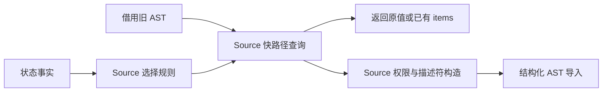
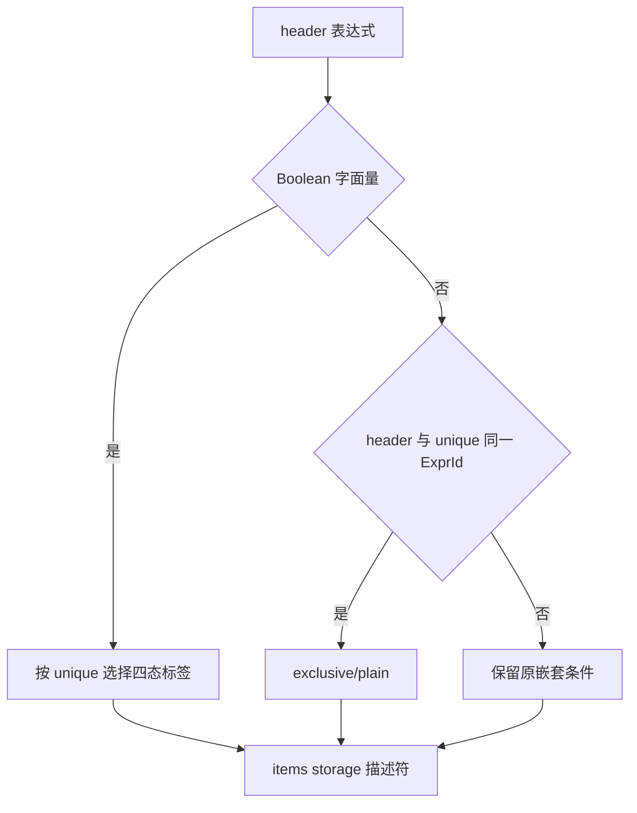

# 状态列表描述符与权限自举

## Intent：最终目标

迁移只读视图依赖的通用状态列表描述符与权限谓词，保留零拷贝切片、四态存储
协议及静态 AST 折叠。完整视图转换和扩容策略仍需后续迁移。

## Data：可用证据

基线提交 95665ad6。view 使用 list.borrowed/items，其他真实消费覆盖集合、
排序、增长、更新、投影、所有权和 SIMD。现描述符固定为 items/storage 两字段，
四态顺序 plain/owned/shared/exclusive 为 0/1/2/3；headered 用 >=2，writable
用 %2!=0。类型 definition 仅 seed 类型声明消费，正式类型声明已来自 Source。

## Edges：边界与限制

- selected 先短路 state_active；inactive 时不能访问可能为空的选择表。
- owned/wrap/items 未选择时原值返回，不预备 State 类型；create/proven/borrowed
  不增加这一门禁。
- choose 仅折叠 AST Boolean；proven 保留 Boolean header 优先，再判断 ExprId
  相等，最后生成动态条件表达式，不能改为结构相等。
- items 只对精确两字段且顺序为 items/storage 的对象直接投影，其他生成成员访问。
- 描述符顺序、state_types 选择、无 fresh、无运行时语句及分配的性质保持。
- reserve 保留原扩容职责，不为迁移描述符新增 Native 语义回调。

## Answer：交付与成功标准

复用 Context 及统一 printer，用 Source 查询避免无操作路径产生 AST 或类型。
Native 仅准备类型句柄和借用列、导入结果。贯通后集中执行固定输入性能、
两代产物、现有行为回归，提交推送全部改动。固定性能基线不重置。

## 自我复核

不能把状态表示选择等同于所有 create 的前提，不能提前求值未选择路径的
类型句柄；ExprId 相等优化与字面量折叠是两个独立证明。

## 性能定位与自我复核

首轮 CPU 5.36→5.40 秒，不能把每阶段的微小增长视为新预算。尝试用已有
importComptime 在编译期执行 Source 操作资源策略，跳过简单操作的预查询；
复测仍约 5.40 秒，未见可辨收益，已撤掉该尝试及策略入口，保留完整迁移。

导入成本核对发现：本模块只生成静态 items/storage 字段名及四态枚举名，
原 Native builder 借用这些文本；通用 append 却会为非空文本列分配临时切片
描述符，并逐项复制文本。改用既有 appendBorrowingText，保留所有列与节点
校验，临时的非文本嵌套数组仍拥有型导入。字段名仍为静态引用，不借用 scratch
中生成的名称。此优化限于已核对文本来源的列表描述符，不扩大到含 fresh 名称
或动态文本的其他发射器。

expression 仍经既有 Lower 求值一次；Lower 调度、扩容与其他 Native 资源边界
仍待迁移。本阶段不把整个列表或视图转换宣称为完整自举。

## 最终生成器对照

保留静态文本借用后，Native 38/38、Source 20/20 构建通过；两代 main 的
2,659 文件、collections 的 50 文件仅工具身份 `.zxc-inputs` 不同。固定 141
入口输入，4 轮交替运行、取后三轮中位数：CPU 5.38→5.39 秒，wall 1.18→1.16
秒，峰值 RSS 491,864,064→495,075,328 字节，保持同一量级。固定输入的
2,268 文件仅工具身份不同。长期 CPU 基线约 5.34 秒，累计约 +0.05 秒，
不重置基线，后续继续跟踪总量，不能重复领取每阶段容差。

记录在 `.zig-cache/cold-build-analysis/state-list/` 的
borrowed-text-fixedpoint-result.json、borrowed-text-runtime-comparison.json、
borrowed-text-fixedpoint.log 与 borrowed-text-performance.log。未采用的策略
试验记录保留在 optimized-* 文件，不能混作最终实现的验收证据。

编译器 372/372 检查通过，相关回归 761/761 构建步骤、2765/2765 检查通过，
合计 3,137 项。额外复用既有 immutable-list 回归，覆盖 reverse、sort、
splice、with 的源码和库路径及旧值保留；未新增测试用例。14 个本次 RX/ZX 文件
通过格式和 lint，最长 ZX 文件 109 行。日志为 compiler-tests.log、related-tests.log。
