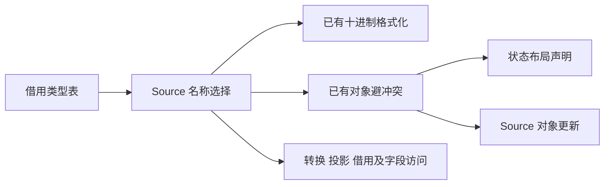
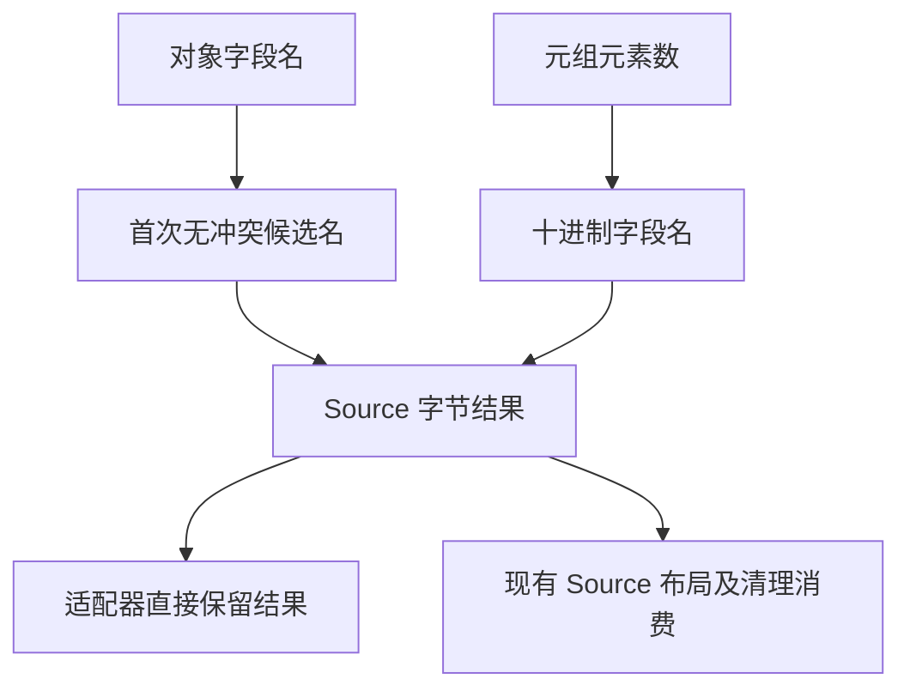

# 状态来源命名自举

## Intent：最终目标

完成 state_value/origin 剩余命名规则迁移，统一复用已有 Source 名称避冲突
算法，并移除未消费的清理入口。与已迁移的 tuple 归一化一起，正式 origin
接口只保留资源适配。

## Data：可用证据

基线提交 a8bd6016。对象 origin 默认 zx_origin，遇到同名字段依次尝试编号；
元组 origin 是元素数的十进制字段名。analysis/types/state/origin.zx 已实现
对象避冲突，printer/text/integer 已提供相同十进制规则，无需重新发明算法。

全仓库核对发现 origin.clear 无任何调用；真实生产清理已在 Source 的
object_update/emit/write.zx 中生成，scope/reuse 正式路径也复用该实现。
因此删除未消费的 Native clear，而不新建一个同样没有消费的 Source 清理流程。
原函数要求可赋值 lvalue，并不是一般只读值；误加临时绑定会改变引用重定向
语义，这也是不能照着死入口机械迁移的原因。

上一阶段固定输入 CPU 5.31 秒，长期固定 CPU 基线约 5.34 秒，基线不重置。

## Edges：边界与限制

- Source 决定元组名称与对象避冲突，默认名称保持借用静态字节。
- 清理继续消费已有 Source 对象更新，保持原流程和引用资格，不新增未消费模块。
- 名称返回使用既有生成函数的值接口与 Lower allocator，直接保留最终字节，
  不为适配器额外复制名称；临时分配及累计内存按实际测量验收。
- Native 仅提供借用类型表、类型句柄、IR/AST 索引及物理导入；旧实现仅 seed。
- 不新增运行库、模板或专用 Native 语义回调，不改变值的所有权及共享关系。

## Answer：交付与成功标准

命名 Source 函数复用现有算法，删除无消费的 Native 清理入口。
贯通后集中执行两代产物对照、固定输入生成器性能与现有行为回归。全部通过
后统一提交推送并确认工作区干净。完整自举仍需其他职责和传递依赖继续迁移。

## 自我复核

核对真实调用闭包，不能把未消费的函数搬成 RX/ZX 就算完成迁移。
新名称来源必须与状态类型声明使用同一避冲突规则，避免布局与访问名称不一致。

## 生成形态与性能验收

检查新增 origin_name 的生成入口及实际分区函数：默认对象候选指向静态
zx_origin 字节，查找循环状态为栈局部，只有冲突分支调用整数增长缓冲。
executeValue 返回候选的 items 切片，没有为返回名称创建堆对象或额外复制。
元组及冲突编号保留数字缓冲的容量，未把这种元数据分配等同于用户数据复制。

Native 构建 38/38、Source 构建 20/20 通过；两代 main 2,641 文件、collections
50 文件均仅工具身份 `.zxc-inputs` 不同。固定 141 入口输入、4 轮交替运行，
取后三轮中位数：CPU 5.37→5.37 秒、wall 1.17→1.18 秒、峰值 RSS
495,648,768→494,632,960 字节。固定输入的 2,268 文件仅工具身份不同。
相对长期 CPU 约 5.34 秒基线约 +0.03 秒，本阶段没有观测到增长；不把前次
单次测量 5.31 秒与本次环境下的 5.37 秒直接相减，保留交替对照的原始样本。

原始记录位于 `.zig-cache/cold-build-analysis/origin-naming/` 下
fixedpoint-result.json、runtime-comparison.json、fixedpoint.log、performance.log。

编译器现有检查 372/372、相关回归 734/734 构建步骤与 2,261/2,261 检查通过，
合计 2,633 项，未新增测试用例。日志为 compiler-tests.log、related-tests.log。
新增 name.zx 已通过格式与 lint。调用闭包确认正式 origin 仅保留借用类型表、
调用 Source 与返回资源结果的适配；seed 分支保留原命名算法用于初始引导。
