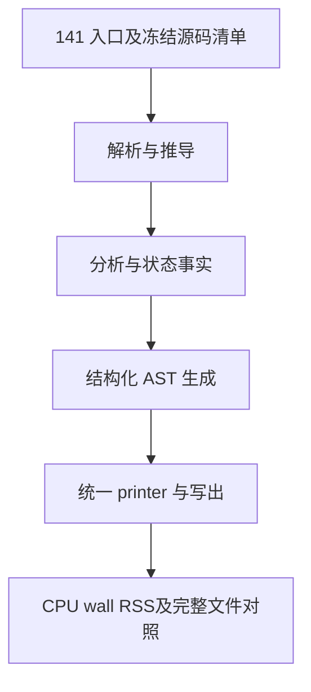

# 生成器 CPU 热点诊断

## Intent：最终目标

保留已实现的自举，将累计生成器 CPU 增长压回稳定范围。优先消除重复计算、
不必要的转换、分配和描述符搬运，以证据决定优化范围。

## Data：可用证据

基线提交 2368e23a。固定 141 入口输入，长期 CPU 基线约 5.34 秒，最近八轮
交替对照 5.38→5.41 秒，累计约 +0.07 秒。此前增长调用完整区间上界约 13
毫秒，scratch 不溢出；共用 2,283 函数及 12,395 顶层类型定义未变化，不能
继续把差额归因于已排除的全局表示变化。

正式工具的短栈采样保存实际 PID、命令及地址，但分区内部符号已裁剪。使用
现有 generated-debug 选项、保持 ReleaseSmall，构建诊断工具，仅用于定位。
诊断工具的运行时间不能与正式裁剪工具直接比较。

## Edges：边界与限制

- 不撤回任何迁移，不改变应用语义、所有权、错误顺序或生成器可信边界。
- 不新增专用 Native 语义桥、运行库、模板或原始 Zig 源码生成。
- 每次只验证一个有实际证据的成本假设；无收益的试验撤回并保留诊断记录。
- 不为普通格式或命名重复性能计时；正式验收使用固定输入、工具链及原始样本。
- 不新增测试用例，复用受影响的现有检查；达到阶段标准后统一提交推送全部内容。

## Answer：交付与成功标准

记录热点、可证伪假设、最小修复、正式性能及产物对照。保留固定基线与累计
趋势，避免把局部样本当整轮占比。未取得实现和验收证据前不宣称优化完成。

## 定位与候选

保留符号的短窗口采样中，`levels/visit.zx` 为主要可识别非等待热点；该窗口
不能换算整轮 CPU 占比。实际递归函数栈帧为 `0x830`，包含强制内联的
`complete`。缓存命中分支存在；`known.with` 直接原位更新，没有整表复制。

原 Native 的增长查询使用 HashMap，Source `want` 使用线性扫描。临时探针
核对固定 141 入口，增长表最大值依次为 2、5、8。探针已恢复，当前不扩展
索引能力，也不把线性扫描直接归为本输入的主要成本。

本候选仅改两个 Source 文件：`complete` 接收和返回 Knowledge，不再携带
known、reads、destination；`visit` 在原来的最终时刻更新缓存并返回记录。
请求顺序、缓存行为、物化和错误顺序保持不变。它避免完整 Output 经过归并
函数传入传出，也使该函数回到既有的普通标量返回调用资格；不修改通用内联
阈值、不增加路径或函数名特例。

可证伪假设：递归查询中减少状态结果传递、缩小强制内联体，正式工具 CPU
应下降且固定输入的全部非指纹产物保持一致。若无收益，恢复两个 Source
文件，不为保留这个候选放松任何门禁。

## 验收与决定

八轮交替运行、剔除每组首轮后的 CPU 中位数为 5.41→5.45 秒，墙钟
1.17→1.18 秒，峰值 RSS 中位数 486,981,632→495,108,096 字节。2,268
文件对比仅 `.zxc-inputs` 不同。生成代码证实 complete 使用普通标量返回与
只读指针输入，但这种形态未带来实测收益；两个 Source 文件已按 HEAD 字节
恢复，不保留该试验。没有为已恢复的候选重复执行完整回归或阶段自编译。

当前未交付 CPU 优化，也没有新自举迁移。已排除增长表规模过大和归并函数
携带完整 Output 这两个当前候选；后续沿已有迁移边界继续实现，必要时再对
实际新增成本取证，不重复这些无收益路径。长期基线约 5.34 秒，正式工具
当前对照中位 5.41 秒，累计约 +0.07 秒；基线未重置。

原始证据位于被忽略的 `.zig-cache/cold-build-analysis/generator-profile/`：

- `symbols-live-sample/sample.txt`：实际活动窗口及 PID、符号栈。
- `disassembly.txt`：同诊断二进制反汇编，不能用于正式工具地址归因。
- `growth-probe-run.log`：增长表最大值与真实 141 入口运行。
- `value-native.log`：候选构建记录。
- `value-runtime-comparison.json`、`value-performance.log`：八轮样本、工具
  摘要、文件摘要对照与中位数。

## 自我复核

符号缺失不是函数不存在或被内联的证据。源码相同不能单独排除编译布局成本，
短窗口样本也不能精确解释全部 CPU 差额；只按证据推进下一步。
