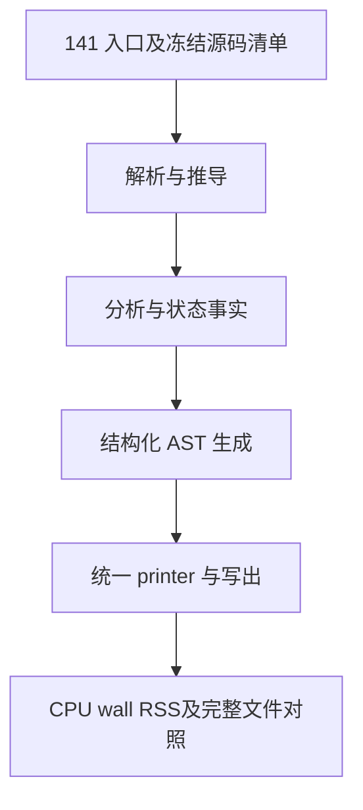

# 生成器 CPU 热点诊断

## Intent：最终目标

保留已实现的自举，将累计生成器 CPU 增长压回稳定范围。优先消除重复计算、
不必要的转换、分配和描述符搬运，以证据决定优化范围。

## Data：可用证据

基线提交 2368e23a。固定 141 入口输入，长期 CPU 基线约 5.34 秒，最近八轮
交替对照 5.38→5.41 秒，累计约 +0.07 秒。此前增长调用完整区间上界约 13
毫秒，scratch 不溢出；共用 2,283 函数及 12,395 顶层类型定义未变化，不能
继续把差额归因于已排除的全局表示变化。

正式工具的短栈采样保存实际 PID、命令及地址，但分区内部符号已裁剪。使用
现有 generated-debug 选项、保持 ReleaseSmall，构建诊断工具，仅用于定位。
诊断工具的运行时间不能与正式裁剪工具直接比较。

## Edges：边界与限制

- 不撤回任何迁移，不改变应用语义、所有权、错误顺序或生成器可信边界。
- 不新增专用 Native 语义桥、运行库、模板或原始 Zig 源码生成。
- 每次只验证一个有实际证据的成本假设；无收益的试验撤回并保留诊断记录。
- 不为普通格式或命名重复性能计时；正式验收使用固定输入、工具链及原始样本。
- 不新增测试用例，复用受影响的现有检查；达到阶段标准后统一提交推送全部内容。

## Answer：交付与成功标准

记录热点、可证伪假设、最小修复、正式性能及产物对照。保留固定基线与累计
趋势，避免把局部样本当整轮占比。未取得实现和验收证据前不宣称优化完成。

## 定位与候选

保留符号的短窗口采样中，`levels/visit.zx` 为主要可识别非等待热点；该窗口
不能换算整轮 CPU 占比。实际递归函数栈帧为 `0x830`，包含强制内联的
`complete`。缓存命中分支存在；`known.with` 直接原位更新，没有整表复制。

原 Native 的增长查询使用 HashMap，Source `want` 使用线性扫描。临时探针
核对固定 141 入口，增长表最大值依次为 2、5、8。探针已恢复，当前不扩展
索引能力，也不把线性扫描直接归为本输入的主要成本。

本候选仅改两个 Source 文件：`complete` 接收和返回 Knowledge，不再携带
known、reads、destination；`visit` 在原来的最终时刻更新缓存并返回记录。
请求顺序、缓存行为、物化和错误顺序保持不变。它避免完整 Output 经过归并
函数传入传出，也使该函数回到既有的普通标量返回调用资格；不修改通用内联
阈值、不增加路径或函数名特例。

可证伪假设：递归查询中减少状态结果传递、缩小强制内联体，正式工具 CPU
应下降且固定输入的全部非指纹产物保持一致。若无收益，恢复两个 Source
文件，不为保留这个候选放松任何门禁。

## 验收与决定

八轮交替运行、剔除每组首轮后的 CPU 中位数为 5.41→5.45 秒，墙钟
1.17→1.18 秒，峰值 RSS 中位数 486,981,632→495,108,096 字节。2,268
文件对比仅 `.zxc-inputs` 不同。生成代码证实 complete 使用普通标量返回与
只读指针输入，但这种形态未带来实测收益；两个 Source 文件已按 HEAD 字节
恢复，不保留该试验。没有为已恢复的候选重复执行完整回归或阶段自编译。

当前未交付 CPU 优化，也没有新自举迁移。已排除增长表规模过大和归并函数
携带完整 Output 这两个当前候选；后续沿已有迁移边界继续实现，必要时再对
实际新增成本取证，不重复这些无收益路径。长期基线约 5.34 秒，正式工具
当前对照中位 5.41 秒，累计约 +0.07 秒；基线未重置。

原始证据位于被忽略的 `.zig-cache/cold-build-analysis/generator-profile/`：

- `symbols-live-sample/sample.txt`：实际活动窗口及 PID、符号栈。
- `disassembly.txt`：同诊断二进制反汇编，不能用于正式工具地址归因。
- `growth-probe-run.log`：增长表最大值与真实 141 入口运行。
- `value-native.log`：候选构建记录。
- `value-runtime-comparison.json`、`value-performance.log`：八轮样本、工具
  摘要、文件摘要对照与中位数。

## 自我复核

符号缺失不是函数不存在或被内联的证据。源码相同不能单独排除编译布局成本，
短窗口样本也不能精确解释全部 CPU 差额；只按证据推进下一步。

## 裁剪迁移后的当前采样与缓存入口候选

当前源码继续使用 ReleaseSmall、generated-partitions=2，仅用 generated-debug 保留
符号。首次两份样本只看到 dyld，不能归因；等待实际 RSS 超过 100MB 后重新采样，
记录 PID 74054 及其实际命令，捕获了工作线程。主要可识别热点仍为 levels/visit，
当前反汇编确认栈帧 0x830；这些短窗口不能报告为完整 CPU 百分比。

将 visit 拆为缓存入口与回调入口的方案会形成 ZX 模块循环，违反硬约束，已恢复
全部试验文件；没有放开循环依赖或保留无效接线。scalar 查询已支持 optional，
没有据此发明新能力或把现有借用调用简单判为复制缺陷。

新候选只修改已有 query：在进入递归 visit 前读取同一个已完成缓存；命中时直接
返回原 known/reads 与值，未命中仍调用原 visit，不改变递归、短路、缓存更新或
物化逻辑。query 的多个消费场景已存在；这避免部分外部查询命中时进入约 2KB 的
递归函数。可证伪假设是总体 CPU 应下降，且冻结输入的所有非身份产物保持一致。
重复的 miss 查询是代价，若抵消收益，只恢复此候选，保留所有裁剪迁移。

当前诊断与候选原件均在 ownership-clear 的忽略目录，不能用诊断工具耗时替代正式
工具对照。候选尚待构建与性能验收。

query 入口候选八轮正式对照 CPU 5.45→5.42 秒、wall 1.20→1.18 秒，2268 文件仅
身份标记不同；anchor/候选同批 CPU 5.36→5.42 秒，wall 均为 1.18 秒。约 0.03 秒
阶段收益仍不足以消除累计差额，暂保留候选并继续优化，未宣称性能门槛通过。

进一步尝试主 child 递归预查、提取共享 scalar lookup。只读复核未发现语义或生命周期
差异，但八轮对照 CPU 5.40→5.55 秒、wall 1.18→1.21 秒，RSS
492126208→494321664 字节；产物仍仅身份不同。此候选已按备份恢复 visit，删除
lookup 文件，并把 query 恢复为已测得收益的内联入口版本；没有撤回裁剪迁移。
重复检查和 helper 调用的合计成本不值得，后续不重复该方案。

## 类型去重查找的重复工作候选

第二项可识别热点 b6bac298… 对应 compiler/src/zx/analysis/semantic/types/find.zx。
当前生成代码确认：每行先算 shape，再判 kind；候选命中还经 row→equal 组装完整
Entry，并重复判定 kind/first/count。该查询只接收内部构造器维护同步列的类型表，
按 base、delta 顺序返回首次匹配；尚无可直接复用的持久结构索引。

候选仅调整该 Source 文件：先过滤 kind，再计算对应 shape；Scalar/Optional/List
由 kind+first 确认，Task 再比较 second；结构成员继续原 equal。未命中情况下 id
仍更新到最后一个 kind/shape 候选，与原逻辑一致。没有新增表、缓存键、碰撞策略或
原生语义回调。可证伪假设是减少扫描期字段读取及匹配期描述符构造，正式 CPU 应
下降且所有非身份产物一致；当前待验证。

kind/shape 前置候选未见收益：八轮 CPU 5.41→5.43 秒，wall 1.17→1.18 秒，产物
仅身份标记不同。该实现已恢复，不将减少源码读取次数当作机器级收益。

下一候选保留原 shape/equal 逻辑，只按 base、delta 分段扫描，避免每一行重复
比较 base_count、选择表及减去偏移。scan 接收前段最后候选 id，保持未命中结果；
第一段命中时不扫描第二段。不新增持久状态或索引，当前待验证。

分段扫描已通过 seed 39/39、Source 21/21 步。八轮正式工具对照 CPU 5.42→5.40 秒、
wall 均为 1.18 秒，RSS 493535232→491847680 字节，2268 文件仅身份标记不同。
这是目前可保留的第二项小幅收益；固定 anchor 累计对照仍待完成。

分段扫描的累计 anchor 对照为 CPU 5.35→5.40 秒、wall 均为 1.17 秒，仍有约
0.05 秒差额。进一步复用 core/type_table/code，在进入每段时将目标 kind 编码一次，
扫描时直接比较 u8，避免逐行解码 kind；候选已由 find 排除 Enumeration 和
NativeReference，余下合法 kind 的编码/解码互逆，未知字节仍不会匹配这些目标。
不引入裸编码、硬编码表或新的索引状态。

seed 39/39、Source 21/21 步通过，八轮正式阶段对照 CPU 5.40→5.34 秒、wall
1.17→1.15 秒，RSS 494239744→495304704 字节。2268 个文件仅身份标记不同。
RSS 的约 1MB 差异不视为稳定增长或收益，累计 anchor 验收仍待完成。

## 累计性能收口结果

目标 kind 预编码后的正式工具累计八轮 anchor 对照：CPU 5.37→5.30 秒，wall
1.18→1.14 秒，RSS 493780992→489996288 字节；2268 文件仅身份标记不同。
历史 anchor 的二进制身份保持不变，没有以候选重置基线。此前约 +0.09 秒差额
已在本批同输入、同工具链对照中消除；不把单批 RSS 差异宣称为稳定内存优化。

最终保留 query 外部命中返回、base/delta 分段扫描与 kind 一次编码；无环拆分、
递归 child 预查、kind/shape 前置/direct 快判等失败试验均已移除。Source 中没有
临时探针、额外持久状态、路径特例或原生编译器语义回调。

最终工具 type-code-production/bin/zxc-bootstrap 的 SHA256 为
cb70d7c2e8e9946a97596274f9e61b10a64e6d7279f54840218f6d91fffb6f3c。
两代 main/collections/growth 分别 2704/50/108 文件，仅身份标记不同；编译器
372/372 项通过。更广行为回归正在运行，性能结论基于独立运行时测量，不混入
诊断构建或检查并发。最终报告为 type-code-runtime-comparison.json 与
type-code-cumulative-runtime-comparison.json，所有试验原始报告保留在
.zig-cache/cold-build-analysis/ownership-clear/。

## 阶段最终验收

最终相关检查 802/802 构建步骤、2915/2915 项通过，与编译器 372 项合计 3287 项。
记录为 type-code-related-tests.log、type-code-compiler-tests.log。未新增测试用例，
没有为了形式重复验证不受影响的场景。

本次 diff 自我复核：缓存命中不补记 reads，raw/Unknown 保持原求值；base/delta
顺序与未命中 id 保持；字节 kind 使用现有编码函数及常量；Source 裁剪分支、引用槽
和语句导入均保留正确性证据。Node 稀疏导入的 schema/边界校验及 OOM 单行回滚
保持，原严格导入 API 没有放宽。失败候选和探针均不在最终源码中。

整体自举仍未完成：Native Lower、事实/AST 物理存储与资源适配、helper 名称和声明
生成等依赖仍需迁移，最终传递闭包审计和 seed→stage1→stage2→stage3 链未完成。
本次只收口裁剪语句生成职责及其累计性能，不把字节一致或检查通过替代完整自举。
全部未提交变更统一提交推送后确认工作区与远端同步。
