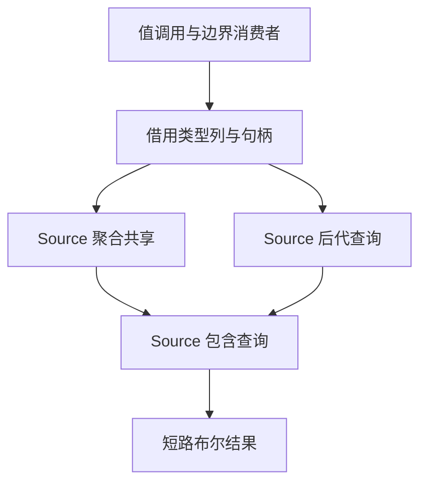

# 类型包含与共享查询自举

## Intent：最终目标

将值调用、作用域和迭代边界仍使用的 Native 类型后代与聚合共享谓词统一到现有
Source 类型关系实现，保持语义、递归与短路顺序以及无堆分配成本。

## Data：可用证据

起点 8980d831，工作区干净。`value_call/analysis.zig` 的 containsDescendant 和
sharesAggregate 仍有正式消费者；函数事实分析中已有 Source contains 与
shares_aggregate。Source descendant 当前通过临时 children/stack 列表遍历，
与 Native 的直接递归成本模型不一致，需要在接入前对齐。

## Edges：边界与限制

- contains 包括根自身，descendant 只检查子孙；不能混淆两者。
- 仅 Optional、List、Object、Tuple 沿子类型遍历；不穿透 Task 或 NativeReference。
- 聚合共享只对 Object/Tuple 产生匹配，保留输入树遍历和输出 contains 短路顺序。
- 不建立全表副本、临时类型列表、访问集合或新缓存；正式入口使用零容量 allocator
  验证无堆分配。递归栈与 Native 同阶。
- Native 仅借用类型列和传递整数句柄；旧算法供 seed，其他值调用与 Lower 仍待迁移。
- 不新增测试；核对生成产物、受影响的既有行为、阶段与固定累计性能。

## Answer：交付与成功标准

所有正式 Native 类型关系消费者调用统一 Source 谓词；语义及产物保持，无累计
性能退化。全部变更统一英文提交推送，工作区干净。

## 执行与自我复核

### 实现

- descendant 直接读取 Optional/List 的子句柄，或在 Object/Tuple 的子项范围内
  用标量 loop 调用已有 contains；移除 children、临时 stack、push/pop/concat。
- 正式 Native containsDescendant / sharesAggregate 只借用类型表并调用已生成的
  Source 入口；旧递归保留给 seed。contains 继续作为 Source 内部共用谓词，
  没有为私有调用额外创建转发入口。
- 两个正式入口均通过零容量 FixedBufferAllocator 执行。Native 只传递借用描述符
  和整数句柄；Input 与类型表描述符在同步调用期间由当前栈帧持有。

### 语义和成本复核

contains 先判断直接相等；descendant 从子项开始，未把 parent 本身算作后代。
Task、NativeReference、Enumeration、ErrorSet 与 Scalar 保持叶节点。
共享谓词只将 Object/Tuple 身份计入共享，保留输入树递归和输出 contains 短路。

旧 Source 的 stack 以反向 DFS 遍历成员；新实现按正向成员序，符合 Native。
对合法无环类型图的纯存在查询结果等价，不新增缓存或访问集合。

正式 Source 生成闭包复核：descendant 与 shared 各 4 个文件，未发现 create、alloc、
dupe、renew 或 reserve；子项选择只借用原始 `[]const u32` 描述符，递归参数在栈上
构造并同步消费。Source 错误集中仍包含 OutOfMemory，不代表存在分配路径。

### 验证证据

- 第一代工具构建 39/39、正式工具构建 21/21 步骤通过；正式生成期间执行零容量查询成功。
- 两代产物核对：main 2704、collections 64、growth 259 个文件分别一致，
  唯一差异为 `.zxc-inputs`。编译器既有检查 372/372 通过，23/23 步骤。
- 相关行为范围为值返回、原生值边界、聚合循环和字段所有权；不新增测试用例。
  首轮 253 项其他行为已通过，原生值边界的 32 项语义断言通过但报告泄漏，3 项
  分配失败检查失败。根因是测试辅助函数漏释放既有 summary.state.element_storage，
  每次完整分析均留下一个类型数大小的 bool 缓冲区；fixture 前后两次分析对应两处泄漏。
- 在既有 inspection 清理处补充 defer free 后，仅重跑失败目标：35/35 全部通过，
  21/21 步骤，无泄漏。复用其余 253 项成功证据，合计 288 项相关行为，加上编译器
  共 660 项。没有修改断言或绕过分配失败注入；生产源码未改变，不重复性能与产物核对。
- 日志分别为 final-compiler-tests.log、final-related-tests.log（保留首轮失败证据）
  和 repaired-native-value-tests.log。

### 性能证据

正式生成器使用同一冻结输入：141 个入口、2220 个模块、2268 个文件。
八轮交替测量，剔除首轮，计时期间无并行构建；每轮均为无复用生成。

| 对照              | CPU 中位数     | 墙钟中位数     | 峰值 RSS 中位数            |
| ----------------- | -------------- | -------------- | -------------------------- |
| 阶段前 → 阶段后   | 5.32 → 5.32 秒 | 1.16 → 1.15 秒 | 494206976 → 492879872 字节 |
| 固定基线 → 阶段后 | 5.37 → 5.32 秒 | 1.19 → 1.15 秒 | 494174208 → 485015552 字节 |

阶段 CPU 配对差值中位数为 0.00 秒，固定基线为 −0.07 秒。未见累计退化，
不将墙钟与 RSS 的微小变化外推为其他输入或平台的确定收益。
固定基线 SHA-256 保持
`8f1e7cee1eadb3ea0f6f7150bab951c55672ce294e4fbe7c50d5858723bdd92d`。

阶段产物仅 `.zxc-inputs` 不同；累计对照中的清单与 `types.zig` 差异仍只涉及
此前已核验的 SHA256 公共接口，沿用精确差异校验，没有整体豁免类型文件。
原始证据保存在忽略目录 `.zig-cache/cold-build-analysis/type-relations/`。

### 自我批判

已迁移的是类型关系谓词职责。值调用的参数准备、调用 AST 组装、Lower 状态和部分
分析适配仍有 Native 实现，不能用本阶段查询自举宣称整个值调用或整个编译器完成。
零容量调用及生成闭包支持本轮无堆分配结论；递归栈仍随类型深度增长，与原 Native
成本同阶，不宣称任意深度都没有栈成本。
