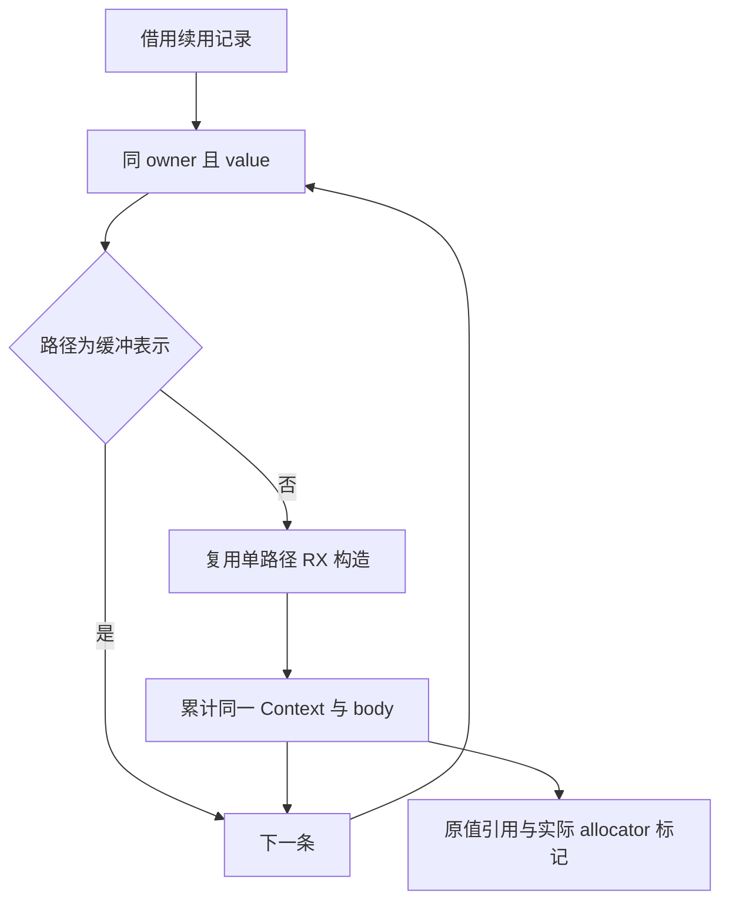

# 续用值执行组装自举

## Intent：最终目标

迁移 renewValue 的记录选择、缓冲判断与有序调用组装，直接借用 Source 定义的
平坦续用记录，不在 Native 筛选或重新转换整表；保持原算法和生成形态。

## Data：可用证据

基线 140536aa。现 Native 在 renewed 名称及已有 ownership.clip 准备后，按
计划顺序选择 owner 相同且 value 为真的路径，跳过已有缓冲表示，再逐条调用
Source renew。Source Renewal 行模型已统一，可供只读视图直接借用。

## Edges：边界与限制

Native 保留已有名称/变量绑定、ownership.clip 和通用外层块包装；这些仍是
后续迁移职责。Source 复用单路径 renew 构造，在同一 Context 内累计 AST，
不改变实际调用顺序、capture、fresh 或 allocator 标记。没有选中路径或全部
缓冲时，不新增表达式或 allocator 使用。

只读路径判断复用 Source 类型表，不新增 Native 语义回调。允许必要资源
适配，禁止平坦记录到指针列表的强转或重新包装。不得新增测试用例。

## Answer：交付与成功标准

完整接通 Source 与正式/seed 入口，核对两代及固定 141 入口产物，运行现有
相关行为检查并记录 CPU/wall/RSS 与约 5.34 秒固定 CPU 基线的累计趋势。
整体自举仍需完成剩余语义、状态桥及最终阶段链审计。

## 接口表示与生成单元

主单元公开写出 Renewal，同时新入口读取同一类型，输入/输出交集触发既有
装箱保护，executeValue.records 仍为指针列表。保持该保护；新增 growth 生成
单元只公开续用值读取入口，使它获得独立且合法的只读平坦视图。构建注册、
模块绑定和源码追踪与现有 ordered/collections 机制一致，不按类型名放宽
storage/columns 校验，也不逐调用创建指针表。

跨单元 Source 元数据按现有 columns.view 校验布局；输入 source 和 capture
描述符在调用帧中存活，输出的四份列描述符临时适配后立即拥有型导入。
这些是资源与布局适配，保留同一类型表、记录和底层路径，未复制整表载荷。

## 实现复核与性能

14 个 RX/ZX 文件通过格式及 lint。Native 39/39、Source 21/21 构建通过，
新增独立单元的实际 executeValue.records 为平坦行切片。Source prepare 每条
重置 request/arguments/steps，但保留累计 Context 和 body；结果 root 始终为
原绑定引用，无新 fresh。bufferedPath 的正式判断也迁入 Source，Native
旧循环仅保留 seed。

无其他构建干扰的八轮交替中位数：CPU 5.40→5.40 秒，wall 1.17→1.16
秒，峰值 RSS 495,976,448→483,868,672 字节。固定 141 入口的 2,268
文件仅工具身份不同。当前 CPU 较固定约 5.34 秒基线累计约 +0.06 秒，不
重置基线，不把微小 wall/RSS 波动报告为稳定收益。

工具体积 6,444,688→6,531,712 字节，增加 87,024 字节；新增单元带来额外
工具代码，未量化完整工具冷构建差异，不将生成器对照冒充后端编译计时。
应用生成产物所测形态不变。原始证据在被忽略的
`.zig-cache/cold-build-analysis/growth-value/`，包括 `native.log`、
`production.log`、`runtime-comparison.json`、`performance.log`。

## 两代产物与编译器检查

两代 main 2,703 文件、collections 50 文件、growth 59 文件全部仅工具身份
不同，报告为 `final-fixedpoint-result.json` 与 `fixedpoint.log`。growth 单元
包含 77 个模块、53 个函数文件，实际输入 records 为平坦只读行切片。
编译器 23/23 构建步骤、372/372 检查通过，记录为 `compiler-tests.log`。
相关行为回归结果见下节；这些证据不代表完整自举完成。

## 行为验收与交付

相关回归 763/763 构建步骤、2765/2765 检查通过，与编译器合计 3,137 项，
未新增测试。覆盖函数分析、值返回、更新、Task、typed try、字符串索引、loop
列、求值顺序、契约、嵌套缓冲、输入不可变性、复合引用和不可变列表的
源码/库入口；完整记录为 `related-tests.log`。

本阶段交付 Source 有序计划执行、缓冲判断和复用的单路径编排，输入记录及
底层路径直接借用，输出拥有型导入，fresh 顺序与原实现一致。14 个 Source
文件格式与 lint 通过，最长新增 ZX 为 58 行。既有名称绑定、ownership.clip、
通用块包装、共享 helper 定义及其他 Native 规则和状态仍需后续迁移；整体
目标及最终阶段链、传递依赖验收继续。
