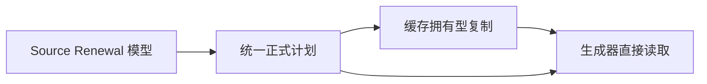
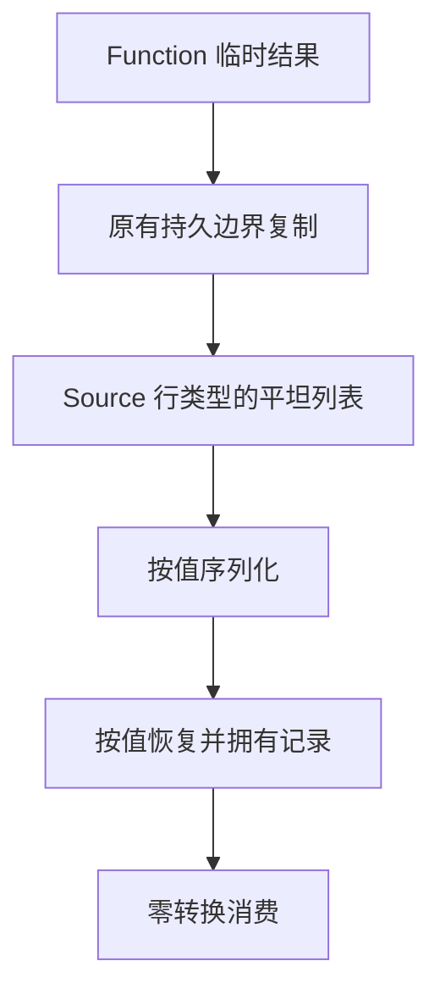

# 续用计划模型统一

## Intent：最终目标

以 Source 定义的 Renewal 行类型作为正式续用计划的唯一记录模型，移除
Native 的重复记录形状，为续用值编排直接消费计划提供前置条件。

## Data：可用证据

基线 51829a3e。现 Source 结果为 `[]const *const Row`，Row 包含 owner:u32、
path 切片及 value:bool；Native 再转为另一份平坦结构。计划构造、memo、root
和 function_analysis 重复实现深复制。Source 结果分配在 Function 临时 arena，
不能直接跨生命周期保存；路径必须在原有持久边界拥有型复制。

## Edges：边界与限制

正式行类型来自 generated Source ABI；旧 Native 模型仅留 seed。列表保持原有
平坦存储，以直接适配只读 Source 视图；不得在每次续用值处理时转换整表。跨 arena 的资源
复制仍由 Native 适配，保持原有寿命；不新增语义回调或运行层。

owner 保持原 32 位编码，字段顺序和旧缓存协议一致；不改序列化算法。使用现有回归及冷/缓存恢复对照，不新增测试用例。

## Answer：交付与成功标准

计划、缓存、提前分析和生成器全部改用统一 Source 行模型，移除重复复制循环。
验证两代与冻结输入的全部产物、既有行为和缓存恢复，记录 CPU/wall/RSS 与
固定约 5.34 秒 CPU 基线的累计趋势，完整收口后提交推送全部变更。

本阶段是执行 renewValue 完整 Source 编排的必要模型前置；该编排及 helper
定义仍待迁移，不将本阶段表述为完整自举完成。

## 表示核对与实施决定

最初核实公开 ABI 为行指针列表，随后构建发现 ordered replay 的 executeValue
只读视图实际接受平坦行切片；机械统一为指针列表会要求重新转换。因此正式
持久计划采用 Source 行类型的平坦列表，既保持原有分配与遍历成本，也能供
Source 只读视图直接借用。没有扩展 storage.view 放宽不兼容转换，也没有为
该尝试保留单对象指针序列化处理。

原先 Native owner 是 u32 背景枚举，统一后直接使用 Source 的 u32；所有消费
边界和 fingerprint 同步使用该宽度，语义及原字节编码保持一致。跨 allocator
的四份复制循环统一为同一拥有型资源适配；Source 输出的行指针仅在原有
持久复制边界读取，路径仍由目标 arena 拥有。

## 构建、产物与性能

Native 38/38、Source 20/20 构建步骤通过。两代 main 的 2,699 文件、
collections 的 50 文件仅工具身份记录不同；固定 141 入口的 2,268 文件亦
仅工具身份不同。相同工具恢复热缓存复用 2,162 生成项，冷/热的全部 2,268
文件逐字节一致，含工具身份记录。热恢复与其他验证并发，只作为正确性证据，
不报告其时间为性能结果。

无其他构建干扰的八轮交替对照中位数：CPU 5.40→5.41 秒，wall
1.17→1.17 秒，峰值 RSS 497,844,224→484,671,488 字节。CPU 差额
0.01 秒在约定容差内，较固定约 5.34 秒基线累计约 +0.07 秒；不以本阶段
为新基线，也不把 RSS 波动表述为稳定优化收益。

原始证据位于被忽略的 `.zig-cache/cold-build-analysis/renewal-model/`：
`native.log`、`production.log`、`final-fixedpoint-result.json`、
`runtime-comparison.json`、`performance.log`、`warm-comparison.json`。
编译器 22/22 步骤、372/372 检查通过，记录为 `compiler-tests.log`。

## 行为验收与阶段交付

相关回归 802/802 构建步骤、2915/2915 Zig 检查通过，与编译器合计
3,287 项；另有 3 个 Node 缓存场景通过，覆盖冷/热、语义编辑、禁用缓存、
损坏内容恢复和串换键拒绝。完整日志为 `related-tests.log`，没有新增测试。
同时覆盖函数分析、输出更新、Task、typed try、索引、loop、求值顺序、
契约、嵌套缓冲、输入不可变性、复合引用、不可变列表及缓存所有权。

本阶段完成 Renewal 记录类型统一、全部 Native 消费边界和资源复制收口，
Zig 格式及 diff 检查通过。Source 模型原定义保持不变，不为未改动的 ZX
重复格式与 lint。没有保留失败的指针列表尝试、storage.view 放宽或序列化
扩展。Plan 其他字段、Memo 容器、renewValue 编排及最终自举闭包仍待迁移。
