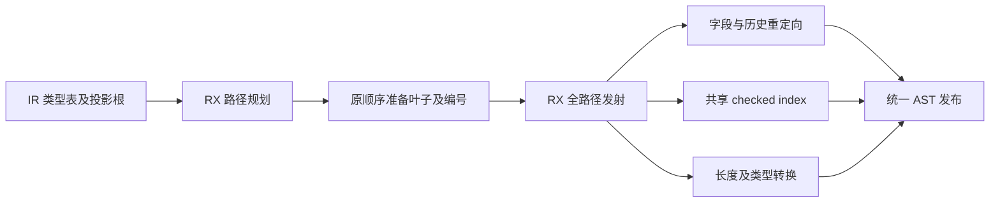
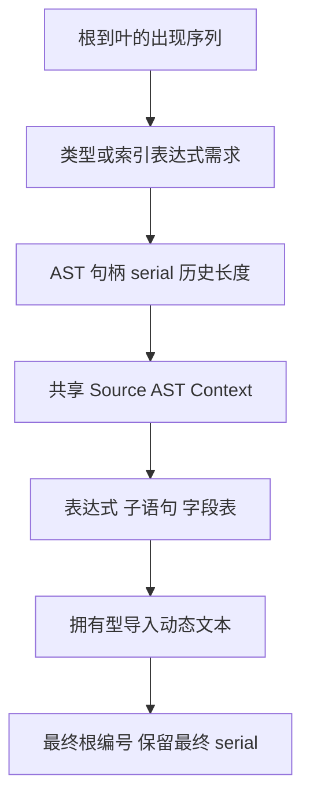

# 缓冲投影路径规划与发射自举

## Intent：最终目标

迁移缓冲投影读取的完整路径遍历、字段/元组投影、带检查索引、长度转换及
转移历史重定向的结构化 AST 发射，保持原运行时求值和临时命名顺序。

## Data：可用证据

基线提交 62f54337。旧 projection.read 沿路径递归，每个 Index 在目标投影后
降低独立索引表达式，再生成两个 operand 和一个 block。字段重定向可能生成
类型声明并读取当前转移历史。现有调用路径的 consumer 资格保证索引表达式
独立于 selected.symbol，普通转移路径仅含字段/元组字段。

长期固定 CPU 基线约 5.34 秒，上阶段终版上次测量约 5.33 秒。

## Edges：边界与限制

- Source 规划根到叶路径及每步类型/表达式资源需求，不按 ExprId 合并出现次数。
- Native 按原步骤顺序准备叶子，保留类型声明与缓存操作顺序。每个 Index 从
  共享 checked-index 名称契约取得预留数量，记录起始 serial 后再预留编号。
- 延后的是纯 AST 前缀构造，运行时仍先 source、再 index、再边界检查。
- 每步记录当时 history count。历史四列只追加，最终发射使用最终数组的对应
  前缀；不保留会跨 append 的旧切片，也不让后续记录影响先前重定向。
- 最终保留 Native 预备完成后的 serial，不能用最后一个 Index 的结束值覆盖
  后续类型准备消耗的名称。Source 验证每步预留和最终 serial 一致。
- 索引和重定向复用已有 Source 原子构造，不新增 Native 语义回调或运行库。
- Native 仍准备通用 Lower.expr/typeExpr 叶子、管理生命周期和 AST 物理存储；
  这是过渡边界，不能据此宣称整体 Lower 或全量自举完成。

## Answer：交付与成功标准

Source RX 分别公开规划及发射的真实阶段，ZX 实现路径算法和每类原子 AST。
补齐已有索引与缓冲构造的可组合 Context 接口，避免重复同一套规则。
集中执行现有相关回归、两代逐文件对照和固定输入性能验收，再提交推送全部内容。

## 自我复核

资源准备前移需要索引独立性和历史只追加这两项事实，不能推广为任意表达式
重排。当前 AST 行编号可能变化，必须以命名、声明和最终产物顺序验证结果。
Source 临时计划及拥有型文本导入存在实际成本，需实测；父 arena 回收边界
不等于局部 scratch 的 deinit。转换、缓冲创建及普通 ABI 投影仍待迁移。

## 产物与性能证据

证据目录 `.zig-cache/cold-build-analysis/projection-emission/`，日志与 JSON 本地忽略。

- Native 首代构建 38/38，Source 生产构建 20/20。
- 25 个 Source 文件已格式化；旧 CLI 可解析的 24 文件 lint 通过。
  含对象解构的 buffer/object.zx 使用 Native 解析器格式化并通过实际两代源码编译。
- 新增 ZX 最长 93 行。
- 两代主模块各 2,577 文件、集合模块各 50 文件，逐文件 SHA-256 仅
  `.zxc-inputs` 身份记录不同。
- 固定输入 141 入口、2,220 模块、1,982 函数文件，前后各 2,268 文件，
  除 `.zxc-inputs` 外逐文件一致。

相同工具链、resident=0、无并发构建下四组交替测量。首次样本完整保留，
下表为后面三组中位数，原始记录见 runtime-comparison.json。

| 指标     |    上阶段终版 |    本阶段终版 |      变化 |
| -------- | ------------: | ------------: | --------: |
| CPU      |        5.36 s |        5.33 s |   -0.03 s |
| 墙钟     |        1.18 s |        1.16 s |   -0.02 s |
| 峰值 RSS | 492,929,024 B | 495,894,528 B |     +0.6% |
| 工具大小 |   6,051,056 B |   6,102,448 B | +51,392 B |

相对未重置的长期 CPU 基线约 5.34 秒，累计差异约 -0.01 秒。当前证据未显示
累计性能退化；不将微小差异作为稳定加速或内存改善，也不将生成器测量推广
到完整冷构建的 LLVM 时间和峰值内存。

## 行为验收与交接

- 编译器现有检查 372/372 通过。
- 相关运行时回归覆盖 function-analysis、value-return、function-updates、zx-tasks、
  typed-try-runtime、string-index、loop-columns、evaluation-order 和 contracts。
  649/649 步、2,109/2,109 项通过；连同编译器共 2,481 项通过，没有新增测试用例。
- 复核确认 tuple 数字名与 fresh 名拥有型导入；仅 owner/items/owned 三个静态
  字段名继续借用。plan 与 prepared 数组在同步发射和导入结束后才销毁。
- projection.read 的 Reference/Field/TupleField/Index/Length 规则及遍历已迁移。
  通用表达式及类型叶子准备、AST 物理存储仍由 Native 适配，普通 ABI 投影及
  缓冲创建/转换仍待迁移；这些过渡实现不能从完成标准中剔除。
