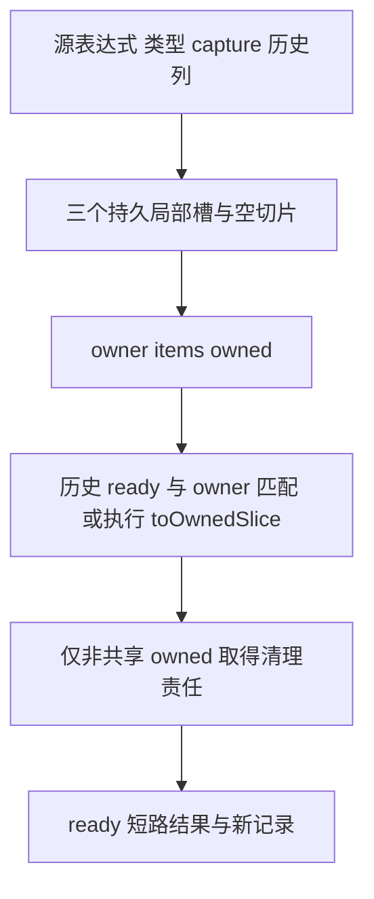

# 缓冲结果所有权转移自举

## Intent：最终目标

将迭代缓冲结果转移的去重、就绪标记、清理所有权、AST 构造和记录状态迁入
RX/ZX。保留原 owner 的复用路径，不新增载荷复制，保持错误顺序和一次释放契约。

## Data：可用证据

原 transfer.zig 创建三个可变槽与 errdefer；首次请求执行转移，相同类型与 owner
且已就绪的记录复用前次值。后出现记录包裹先前 chosen，保持原优先顺序。
projection.redirect 与 result 也读取记录，需要同步对齐列状态访问。

上一阶段 9ee3cef4，固定输入 CPU 约 5.31 秒，累计基线仍约 5.34 秒。

## Edges：边界与限制

- state_owned、cleanup、ready、operand、take block、evaluate block 的 fresh 顺序不变。
- take 的嵌套语句先存储，evaluate 从其后单独开始；不能把 take 语句纳入外层执行。
- 相同 owner 通过 ready 短路，只转移一次；共享结果不能重复取得 cleanup 所有权。
- 保留 try/capture 边界与 errdefer free；捕获错误时不得绕过应用既有边界。
- 历史记录用 Source 四列状态，访问只借用；追加完整成功后再发布，失败保留前缀。
- 原生懒类型查询、AST 存储及稠密列访问适配仍为过渡边界，不宣称整体自举完成。

## Answer：交付与成功标准

完整迁移转移逻辑和记录状态，验证去重、清理、块范围与名称顺序。执行现有
相关回归、两代产物一致、固定输入累计性能核对；统一收口全部变更后提交推送。

### 实现与审计

Source 四列记录追加完成后才发布；OOM 时可能推进个别列的物理 frontier，但旧
逻辑前缀和四列长度不变。Native 仅提供管理数组、枚举 ID 转换和稠密访问；
projection 与 result 原有规则只调整存储访问，不额外复制全部记录。

prefix 单独导入 flat body。take 全局两行，evaluate 随后五行，Source block.first
使用相对 statement_base 的 offset。AST 名称均取得目标所有权，未留下 scratch
借用。通用 variable 原语补齐推导类型，新增 unary 和 errdefer 结构化原语。

首次 Native 链接发现记录追加仅抛 OutOfMemory/Overflow，已按实际错误集合归一
到分配失败；未把它误写成整数窄化的 IntegerOverflow。

### 验证证据

Zig 0.17.0、ReleaseSmall、并发 12、generated-partitions=2、resident generator
关闭。Native seed 构建 38/38 步、Source 正式工具 20/20 步通过。两代 main 各
2494 文件、collections 各 50 文件，仅身份标记不同。

冻结输入仍使用 readability-final/cache-closure/manifest.json，141 入口、2220
模块、1982 函数文件，全部 2268 文件仅 `.zxc-inputs` 不同。

| 指标          |       迁移前 |       迁移后 |        变化 |
| ------------- | -----------: | -----------: | ----------: |
| CPU 中位      |      5.30 秒 |      5.27 秒 |    -0.03 秒 |
| 墙钟中位      |      1.16 秒 |      1.14 秒 |    -0.02 秒 |
| 峰值 RSS 中位 | 493,666,304B | 496,418,816B | +2,752,512B |

四轮交替执行，完整保留首轮，表中为后三轮中位。旧 RSS 为
485.6/498.1/493.7/483.9MB，新为 494.8/497.3/496.4/487.0MB，不把波动解释为
稳定增减。CPU 继续低于固定约 5.34 秒基线，不重置累计基线。新的首次 CPU
5.37 秒、墙钟 2.98 秒，infer 531ms、emit 420ms、write 59ms；额外等待仍未归因。

原始证据位于 `.zig-cache/cold-build-analysis/iteration-transfer/`，不提交临时日志。

### 自我复核与零拷贝边界

本次保持原有标准库 toOwnedSlice。已核对本机 Zig 0.17.0 的 array_list.zig：
先尝试 allocator.remap，失败才 alignedAlloc＋memcpy。ArenaAllocator 的缩容
resize 保留原地址，因而当前 Arena 路径不搬移数组内容；任意宿主分配器并不
保证重映射成功，不能笼统宣称这一接口永远零拷贝。

不能简单返回 items 后按逻辑长度 free 原容量分配，那会破坏分配契约。未来一般
分配器下的严格零拷贝需要保留完整分配所有权及容量；本阶段不引入隐藏运行库或
改变公开切片 ABI来掩盖该问题。此边界是原实现已有成本，不是新增复制。

转移规则和记录状态已经迁移，AST 存储、稠密访问适配及 projection/result 的其他
Native 职责仍待收口。用户新增的 TS 风格解构需求已记录，接下来实现并用于精简
实际 ZX 消费代码，不能只接通语法却继续到处重复取字段。

### 最终验收

- 编译器 22/22 步、372/372 项检查通过。
- function-analysis、value-return、function-updates、zx-tasks 既有回归
  355/355 步、636/636 项通过，包括别名、重复结果、更新错误顺序和分配失败。
- 18 个本次 RX/ZX 文件通过格式与 lint；后续没有修改这些文件，复用有效证据。
- seed 仅对齐新的记录存储访问，转移算法未变。未新增测试或浏览器检查。
- 全部未提交内容统一收口，包含用户新增解构需求记录与后续执行计划。
