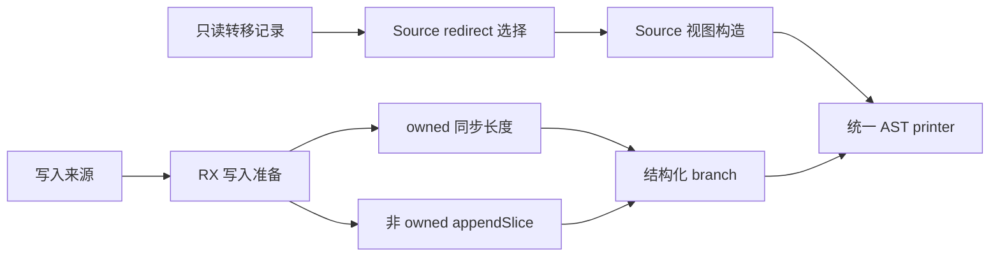
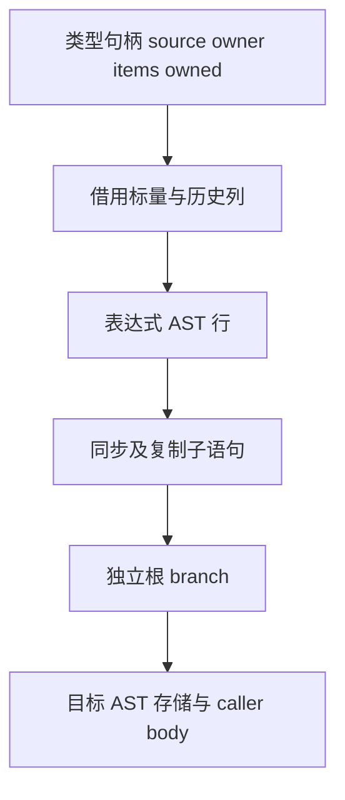

# 缓冲视图与写入准备自举

## Intent：最终目标

将缓冲视图组装、转移后的投影重定向及写入前所有权准备规则迁入 RX/ZX。
保持 owner/items/owned 表示、短路顺序和原有数组复用行为，不新增用户载荷复制。

## Data：可用证据

原 buffer.view 组装三字段视图，prepare 在 owned 分支同步长度，未持有时才
appendSlice。projection.redirect 按登记顺序包裹已就绪同 owner 的转移记录。
上一阶段提交 96f9c47c，固定输入 CPU 约 5.32 秒，累计基线仍约 5.34 秒。

## Edges：边界与限制

- 类型句柄可能生成 state_type 名称，仍由 Native 调用现有 Source 类型生成器预备；
  本次三项 AST 构造均不调用 fresh，移动这些句柄不会改变局部命名顺序。
- owned 为真仅同步 owner.items.len；假分支保留 appendSlice 与原 capture/try。
- 根 branch 单独追加 caller body，两条子语句存入全局行表，不把子语句额外执行。
- redirect 只接纳同 TypeId，ready 在 owner 比较之前短路，后登记匹配记录优先。
- 保留类型表示与既有所有权成本；create、递归投影读取及 AST 物理存储仍是过渡边界。

## Answer：交付与成功标准

完整迁移三项规则与结构化构造，保留无新鲜名称、分支/错误顺序与视图字段顺序。
集中执行已有相关回归、两代产物一致与固定输入性能对比，再统一提交推送。

## 实现与成本核对

- view 直接调用纯组装函数；redirect 的 RX 显式串联投影、历史选择与组装；
  prepare 的 RX 串联投影及 fallible 调用构造、子语句构造、根分支发布。
- Source 仅操作表达式编号及历史列描述符，不遍历或复制数组用户载荷。
- 输出三字段的名称来自类型职责 const.zx 的静态字符串。std.bytes.fromText
  返回原切片，Native 导入保留静态文本引用；字段描述符存入目标 AST。
- 表达式内字段名、方法名及 allocator 标识符也来自静态常量，capture 文本由
  Lower 保有。统一行导入使用现有 appendBorrowingText，避免追加文本复制；
  本阶段没有动态生成名称，不能将该借用策略无条件推广到其他生成器。
- Source 临时 AST 表使用栈缓冲优先分配器，溢出部分归 workspace 临时 arena；
  父 arena 的实际回收边界不保证等于该临时 arena 的 deinit。
- Native 仅处理类型句柄、资源与 AST 导入；seed 保留旧实现用于首代构建。

## 自我复核

本阶段未迁移缓冲创建时的递归转换与逐元素构造，也未迁移递归投影读取。
AST 物理存储仍在 Native；不能将本阶段表述为整个迭代模块或自举已经完成。
保持原有 appendSlice 所需的语义复制，不宣称所有不可变更新都没有复制。

## 验收证据

证据目录为 `.zig-cache/cold-build-analysis/iteration-buffer/`，日志及 JSON 均本地忽略。

- Native 首代构建 38/38 步；Source 生产构建及文本借用收口后的终版均 20/20 步。
- 编译器既有检查 372/372；相关函数分析、返回、更新及任务检查 636/636，
  共 1,008 项通过，没有新增测试用例。
- 最后将 AST 文本导入由复制改成已证明生命周期的借用。此前行为回归证据复用；
  终版另外执行两代生成及固定输入逐文件比较，验证该导入改动没有改变输出。
- 终版两代主模块各 2,524 文件，集合模块各 50 文件，仅 `.zxc-inputs` 身份记录不同。
- 14 个兼容旧 CLI 的修改文件 lint 通过；含新解构的 object.zx 使用当前 Native
  解析器格式化并通过两代实际源码编译。所有本次 ZX 文件均低于 180 行。
- 固定输入 141 入口、2,220 模块、1,982 函数文件，前后各 2,268 文件，
  除 `.zxc-inputs` 外逐文件 SHA-256 一致。

性能使用相同输入、工具链和 resident=0，四组交替测量，保留首次样本；
下表为后面三组的中位数，没有并发构建。原始记录为 runtime-comparison.json。

| 指标     |    上阶段终版 |    本阶段终版 |      变化 |
| -------- | ------------: | ------------: | --------: |
| CPU      |        5.31 s |        5.33 s |   +0.02 s |
| 墙钟     |        1.18 s |        1.18 s |    0.00 s |
| 峰值 RSS | 494,583,808 B | 496,615,424 B |     +0.4% |
| 工具大小 |   6,018,096 B |   6,036,288 B | +18,192 B |

相对长期固定 CPU 基线约 5.34 秒，累计差异约 -0.01 秒。单阶段 CPU 差异在
已接受容差内，当前证据未显示累计退化；RSS 变化处于既有采样波动范围，不能
宣称内存改善。本测量是固定输入生成器路径，不代表完整冷构建时间或内存。
