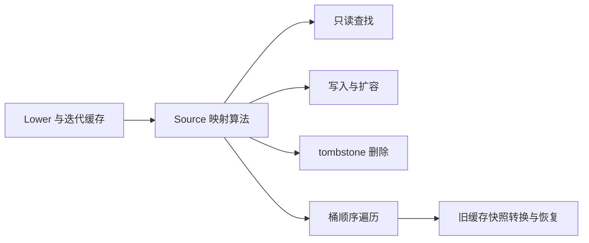
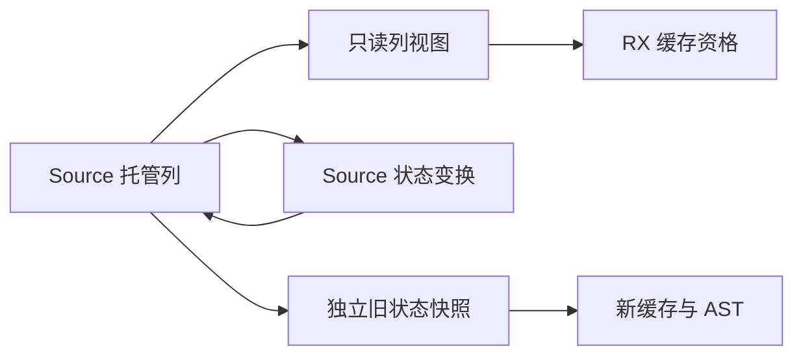

# 表达式缓存状态自举

## Intent：最终目标

将 Lower.cache 与 iteration_value.cache 的 u32 键值存储、查询、写入、删除、遍历迁入
通用 Source 映射，保留缓存快照恢复及生成顺序，继续完成整体自举。

## Data：可用证据

起点 3f7cff7a，工作区干净。原缓存是 AutoHashMap<ExprId,ExpressionId>，只有常规
get/put/remove/contains 与一个 bucket 升序 iterator。该 iterator 会调用转换并消耗
fresh serial。四个 Lower 克隆都重置 cache，独立迭代 Context 新建缓存；只读分析器
持有当前 Lower.cache 字段指针。state_value.enter 保存旧表并建立新表，不能共享
同一个可写状态头。

## Edges：边界与限制

- 复用 Zig 原规则：u32 的四字节 Wyhash、最小容量8、80%负载、线性探测与 tombstone。
- 普通覆盖也先尝试扩容，扩容按旧桶顺序重插；扩容 OOM 时已有键仍可更新。
- Source 管理算法和列；Native 仅保留类型、资源错误恢复与接口适配边界。
- 不复制完整 IR，不将缓存改为稠密全表，不改变迭代名称序列。
- 查询/删除零分配，原位覆盖及容量复用须看实际生成体，不能仅凭总耗时推断。
- 编译器局部语义缓存不自动等同持久化增量缓存，不扩大到无关失效策略。
- 不新增测试；按实际变更复用既有行为检查、阶段产物与固定累计性能基线。

## Answer：交付格式与成功标准

通用 Source 映射接通全部表达式缓存消费处，成员与缓存编译单元仍静态链接普通
Zig。原生与 Source 引导、全产物、行为和成本验证后收口全部变更，提交并推送。

## 实现与所有权

core/integer/map 以 count、metadata、keys、values 列表达状态。find 保留第一个
可重用 tombstone，同时继续寻找已有键，并以 capacity 限定扫描上限；即使表中
没有 free、只有 tombstone，也会终止。lookup 在 count=0 时直接返回空。

put 在查询已有键前按 80% 阈值准备扩容，grow 按旧桶升序重插；place 决定覆盖或
新增，remove 只标记 tombstone 并减少 count。next 输出位置及下一游标，Native
iterator 只把该位置投影为即时使用的 typed 指针，游标推进由 Source 决定。

std:integer 增加 hash32，实现及接口同时导出，读取 u32 的四字节本机表示；原
hash(u64) 保持不变。所有语义标记、阈值和指纹尺度集中在 map/const.zx。

两个缓存及分析器类型均已对齐。四处 Lower 克隆仍清空缓存；state_value.enter
保留旧缓存、建立独立新缓存、再替换，restore 还原旧状态，不引入共享可写头。
iteration_value/result 持有当前 lowering.cache 字段指针，未复制一次快照替代它。

Source grow 完成所有新列及重排后才返回，旧表没有写入。Native 在资源分配失败
时调用 Source overwrite，Source 决定已有键能否覆盖；这段资源错误恢复和 typed
接口仍是 Native 过渡适配，不宣称错误处理及全部 Lower 已闭包自举。原生初始
引导通过编译选项保留旧 AutoHashMap。

集合 Entry Set 从 members 对齐为 collections，复用独立私有状态 ABI，并限制
输入根在 core 与成员适配目录。主单元中的对象更新 root 直接借用完整缓存视图并
调用 Source lookup，移除了最后一项 Native cache.contains 资格事实。

## 实际生成体复核

实际 executeState/executeValue 调用闭包没有描述符装箱。lookup/next 无分配；
place/overwrite/remove 的写入在有效 exclusive 状态下直通原存储，只有增长路径
创建新缓冲区。普通共享输入的复制回退仍保留，公共 executeIn 的装箱不在 Native
实际调用链。

增长以三列分别构造，且安全初始化未使用槽位，与原 Native 单块分配不同；本轮
没有将这项差异藏成“物理实现完全一致”。实际对照验证该生成形态，重排没有逐项
复制整张表，插入/删除不缩短物理列，删空后重插可重用原表。

## 阶段与产物证据

初始引导构建 38/38 步骤通过，再由 Source 工具构建下一代工具 20/20 通过。
两代分别核对：

- main：159 入口、2371 模块、2428 文件，仅 .zxc-inputs 工具身份不同。
- collections：8 入口、20 模块、41 文件，仅 .zxc-inputs 工具身份不同。
- 编译器：22/22 构建步骤，372/372 现有检查通过。
- 13 个相关 Source 实现文件逐项格式/lint 通过，没有新增测试。

冻结 141 入口输入的新旧比较中，全部生成函数正文相同；types.zig 唯一差异为
新增 std:integer.hash32 的四项 Input/Output/InputValue/OutputValue 签名，删除
这一精确声明后逐字相同。.zxc-files 仅更新对应类型文件摘要，.zxc-inputs 更新工具
身份。此差异是标准库接口新增，不能将其称为所有文件完全相同，也不能忽略差异
直接放宽比较。

## 性能与累计边界

同冻结 manifest，关闭 resident，每轮新输出及生成缓存，新旧工具交替四轮，首轮
完整保留，中位取后续三轮。旧工具为 3f7cff7a 阶段的 retained-bootstrap，新工具
为本阶段 production-bootstrap；计时在其他构建前单独运行。

| 指标          | 修改前       | 修改后       | 变化           |
| ------------- | ------------ | ------------ | -------------- |
| CPU 中位      | 5.29 秒      | 5.28 秒      | -0.01 秒       |
| 墙钟中位      | 1.17 秒      | 1.15 秒      | -0.02 秒       |
| 峰值 RSS 中位 | 499,564,544B | 495,517,696B | 近期波动范围内 |

旧 RSS 四轮为 489.0/499.6/493.7/500.7MB，新为 498.0/485.7/495.5/495.6MB，
不据此宣称独立内存收益。CPU 仍低于固定约 5.34 秒比较基线，没有按阶段重置。
新工具首轮墙钟 3.00 秒、CPU 5.37 秒，内部 infer/emit/write 为 528/416/80ms；
后续墙钟 1.15～1.16 秒。首次额外等待尚未归因，继续保留原始样本。

命令、日志、工具摘要、实际差异证明及比较脚本在被忽略的
.zig-cache/cold-build-analysis/cache-state，主要结果为 fixedpoint-result.json、
runtime-comparison.json 与 output-difference-proof.json。比较脚本第一次断言要求
全部文件仅身份标记不同，因新增签名而失败；检查真实差异后补充精确声明证明，
复用原始计时，没有重跑来挑选结果。

## 最终验收与自我复核

- 编译器 22/22 步骤、372/372 现有检查通过。
- function-analysis、value-return、function-updates、zx-tasks 共 355/355 构建
  步骤、636/636 直接 Zig 检查通过，包含目标内 Node 行为检查；未新增测试。
- 13 个 Source 实现文件的最终 fmt --check 与 lint 通过。integer.d.zx 是标准库
  声明文件，普通 ZX 单默认函数检查不适用；误调用该检查被 contract 规则拒绝，
  已按标准库接口构建及两代编译验证，不改写声明来迎合不适用的检查。
- 只读审查核对了哈希宽度、tombstone、扩容前旧状态、OOM 既有键覆盖、完整桶
  上限、迭代顺序、四个 Lower 克隆及只读字段指针，未发现正确性或寿命阻塞。

本轮修改的是每个 Lower 生命周期内的语义缓存，没有改持久化编译缓存的 key、
依赖事实、失效或恢复策略，因此未机械重跑无关磁盘增量场景。既有函数更新与
函数分析检查覆盖局部缓存消费，实际全部函数正文对照也验证了生成顺序。

没有用排序修正产物或回退 Native 缓存来通过对照；Source 独立表达算法与数据，
资源失败恢复和 typed iterator 投影仍有 Native 适配。完成本阶段不等于整个 Lower
或整个编译器完成自举，其他字典、发射规则与 Native 传递依赖继续按完整职责迁移。
