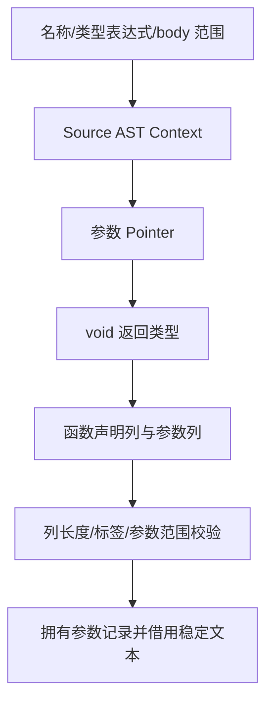

# 裁剪函数声明自举

## Intent：最终目标

将裁剪 helper 的参数标识符、指针类型、返回类型与函数声明构造迁入 ZX，复用结构化
AST 与统一 printer。完成真实消费后再验收，不把原生资源适配当作完整自举完成。

## Data：可用证据

现有 outlined.zig 已调用 Source 选择及 clear，但仍手写 identifier、pointer、void、
Field 和 Function。Source AST Context 已有 identifier/primitive，缺少 pointer 及
函数声明原语；已有声明 Columns 只服务常量，没有函数声明导入器。

原顺序为：类型句柄与名称准备、查重、参数标识符、clear、pointer/void、函数体
存储、函数声明。body 存储只转移已有语句，不创建表达式或生成 fresh 名称。本次
先取得同一 body 范围，再构造 pointer/void，表达式与语句中的求值顺序仍保持。

## Edges：边界与限制

- 通用 AST 原语补齐 Pointer 和 Function；不使用 Zig 模板、源码片段或专用运行库。
- helper 参数语义名在职责 const.zx 导出，prepare 与 declare 显式复用。
- Native 只准备句柄、执行 Source、导入结构化结果；旧构造仅留 seed 分支。
- 名称流式哈希、声明查重、调用 AST、projected 绑定及 Native 物理状态仍待迁移。
- 函数名来自 self allocator，参数名来自 Source 静态常量；bytes.fromText 返回原切片。
  借用文本要求两者均覆盖 AST 生命周期；参数记录由最终 allocator 持有，不引用 scratch。
- 不新增测试用例，按受影响范围集中检查与性能对照；固定累计基线不重置。

## Answer：交付与成功标准

正式 helper 的参数及声明构造来自 ZX，Native 不保留正式构造捷径。通过 seed 与
Source 工具构建、两代产物、既有行为检查；核对生成代码中借用文本的实际来源与
生命周期。相同冻结 manifest 下阶段前后及固定 anchor 的 CPU/wall/RSS 均记录，
保持无累计退化；收口全部未提交内容，提交推送后确认干净且无未推送提交。

## 执行记录

已接通 Source prepare/declare、通用指针及函数声明原语、Native 函数声明列导入。
Seed 构建通过 39/39 步，Source 构建通过 21/21 步。两代生成对照中，main
2704 个文件、collections 50 个文件、growth 116 个文件，均仅输入标识不同。

### 成本与生命周期核对

核对实际 growth 生成闭包：声明名称直接包装 `in.name`；参数名称来自静态
`"value"`，经 bytes.fromText 原样返回。名称列分配的是 `[]const u8` 描述符数组，
没有复制底层文本。公开 ABI 输出取列的 items，不重建文本；Native 导入时分配
最终拥有的 Field 记录，名称继续借用长期存储。scratch 释放后不引用其记录数组。

冻结 manifest 为 141 个入口、2220 个模块。每组交替执行八轮，排除首轮取中位数；
2268 个文件均仅输入标识不同。性能对照在行为检查与其他构建之前独立执行。

| 对照                 | CPU 秒      | wall 秒     | 峰值 RSS 字节         |
| -------------------- | ----------- | ----------- | --------------------- |
| 阶段前 → 本阶段      | 5.31 → 5.32 | 1.13 → 1.14 | 493568000 → 493584384 |
| 固定 anchor → 本阶段 | 5.37 → 5.32 | 1.18 → 1.15 | 492945408 → 491749376 |

阶段变化在既定容差内，同批固定基线未见累计退化；不将约 1 MB 的 RSS 差异
解释为稳定内存收益，也不将生成器计时解释为完整冷构建或 LLVM 收益。
固定 anchor 的 SHA256 仍为
`8f1e7cee1eadb3ea0f6f7150bab951c55672ce294e4fbe7c50d5858723bdd92d`。

原始证据在 `.zig-cache/cold-build-analysis/ownership-helper/`：native.log、
production.log、final-runtime-comparison.json、cumulative-runtime-comparison.json、
final-fixedpoint-result.json。构建产物与日志不提交。

编译器既有检查 372/372 通过；值返回、函数更新、拥有输入、复合引用、不可变
列表与嵌套缓冲六组检查通过 350/350 步、1124/1124 项，合计 1496 项。
日志为 final-compiler-tests.log、final-related-tests.log。未新增测试用例。

### 自我复核与剩余边界

本阶段仅迁移参数及声明构造。Native 仍执行名称哈希、查重、流程调用、全局
body 范围存储与 AST 资源导入；这些仍属于自举未完成项。prepare 和 declare
各为一个内聚的结构化 AST 操作，没有用空 RX 包装制造编排表象；完整 helper
流程尚未迁入 RX，不能将此阶段描述为所有权模块完整自举。
