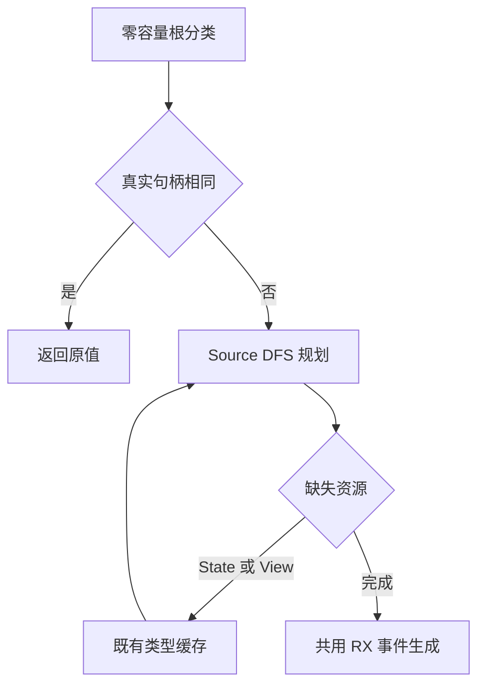
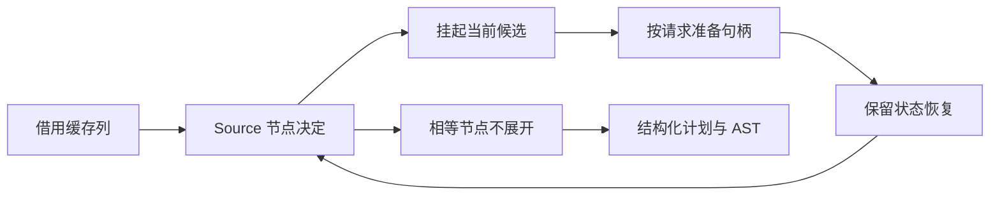

# 视图值转换自举

## Intent：最终目标

迁移 ViewValue/ViewLayout 的完整递归，保持实际类型句柄相等时整棵直返、对象行
列表零逐项转换及 origin 共享身份，复用已有转换生成树。

## Data：可用证据

起点 9f9e54f2，工作区干净。shared_state 在 borrowed 产品或首个不同成员处就
停止解析 View 子类型，因此根句柄准备不能证明后续子类型缓存齐全。
Source 需要可恢复资源请求；重扫前缀或每次全表 changed 都会改变成本模型。

## Edges：边界与限制

- 每个非列表 View 节点按 State、View 顺序请求真实类型句柄；unset 不是相等证据。
- 相等节点在展开前剪枝；根相等时，进入动态 plan/stack 分配之前直接返回。
- Source 保留 DFS 进度，请求未完成不追加重复节点；Native 只按请求调用既有
  types.get，无额外镜像缓存、语义回调或专用运行库。
- View 产品子模式保持方向并复制既有 origin；ViewValue referenced 产品保留
  Reference.store。连续对象行列表仅 borrowed/items，其余列表切换普通方向。
- 类型资源准备完成后才固定 emitter bases，不消费 fresh 或生成运行时 body。
- 不新增测试，集中验证受影响路径及固定累计性能。其他编译器原生依赖仍待迁移。

## Answer：交付与成功标准

View 语义、剪枝与遍历来自 RX/ZX；宿主资源适配不决定类型规则。原产物与行为
保持，CPU/内存趋势符合累计边界；统一提交推送全部变更，确认工作区干净。

## 执行与自我复核

已接入 View query、initialize、walk 三入口；普通模式继续使用原计划，View 在
共用 emitter 前生成同一 Plan。query 先 represented/list，再依序请求 State/View，
实际句柄相等则记 Value、零子节点。根 required 使用零容量 allocator，在动态
工作区创建之前退出。所有资源准备完成后才固定 AST bases，serial 与声明数不变。

DFS 保留当前 pending 和父 cursor，暂停时不追加节点；恢复后重读借用缓存列，
不会扫描已完成前缀。Native 仅把 Resource.State/View 转为既有 types.get 调用，
不新建镜像缓存，也不在宿主遍历或决定转换语义。

### 生成成本复核

初版生成闭包确认 query 无 create/alloc/dupe，initialize 不使用 allocator，
executeState 保留 Plan 的 items/storage，resume 没有整表 ABI 往返或 Plan 装箱。
复核同时发现对象 Frame 栈 push 和更新 cursor 都分配 Frame；已改为 nodes、next
两个标量列与 depth，并按高水位复用，不用 pop 缩短容量边界。这是生成成本的
实质修正，不以原始结果相同掩盖逐节点分配。

### 构建、性能与产物证据

标量栈最终 Native 构建通过 39/39 步，Source 正式构建通过 21/21 步。
冻结 141 个入口、2220 个模块，每组交替八轮、排除首轮取中位数；计时先于其他
构建与行为检查隔离进行，固定 anchor 未重置。

| 对照                 | CPU 秒      | wall 秒     | 峰值 RSS 字节         |
| -------------------- | ----------- | ----------- | --------------------- |
| 阶段前 → 本阶段      | 5.31 → 5.31 | 1.14 → 1.14 | 493879296 → 492765184 |
| 固定 anchor → 本阶段 | 5.35 → 5.33 | 1.17 → 1.14 | 491126784 → 493371392 |

阶段配对 CPU 差中位数 0.00 秒，累计 -0.02 秒。RSS 中位数变动方向相反，不能
据此宣称稳定收益或退化；这仅覆盖当前 arm64 生成器，不代表完整冷构建/LLVM。

阶段 2268 个文件仅 .zxc-inputs 不同；累计只含此前已验收的 SHA256 流式接口
ABI 及其清单哈希变化，逐项核对其余类型文本和实现，不豁免整个 types.zig。
固定 anchor SHA256 仍为
`8f1e7cee1eadb3ea0f6f7150bab951c55672ce294e4fbe7c50d5858723bdd92d`。

证据位于 `.zig-cache/cold-build-analysis/state-view/`：native.log、production.log、
final-runtime-comparison.json、cumulative-runtime-comparison.json、精确 ABI
校验脚本。产物和临时日志不提交。

两代生成 main 2704、collections 64、growth 217 个文件，仅 .zxc-inputs 不同，
见 final-fixedpoint-result.json。编译器既有检查通过 372/372 项（23/23 步），见
final-compiler-tests.log。相关运行检查通过 1414/1414 项（631/631 步），覆盖值返回、
函数更新、输入所有权、复合引用、不可变列表、嵌套缓冲、Task、库运行、RX 并行
与原生引用分析/IR；见 final-related-tests.log。合计 1786 项，未新增测试用例。

最新闭包复核确认 Frame 指针类型和逐 Frame 创建点已消失；nodes/next 未超过
高水位时写回原槽，仅增长时 reserve，resume 继续传递托管列。这里不把普通
容量增长说成绝对零分配，也不把全部源码审计代替运行检查。

### 自我复核与剩余边界

没有将 unset 当相等、重算全表 changed、先展开再剪枝、恢复重扫或把对象行列表
转成逐项复制。字段名仍只借用长期名称/类型表/静态常量，动态名称经拥有型导入。
类型缓存和 AST 物理资源仍由宿主适配；elements 的其他原生规则、Lower 及更多
编译器依赖继续待迁移，本阶段不代表整体自举完成。

### 后续职责定位

状态值层仍有 elements 的 read/write/storedList/captureName/typeExpr 规则，真实
消费者包括 Lower.index、transform、sorting、predicates、list_update。其 convert
已只供 seed 使用，后续应整体核对元素边界及 capture 前缀生成。再之后是 root
enter/restore 的缓存表示切换，包含原生遍历、转换与重建缓存算法。当前仅定位
职责，不将它们记为已完成。
